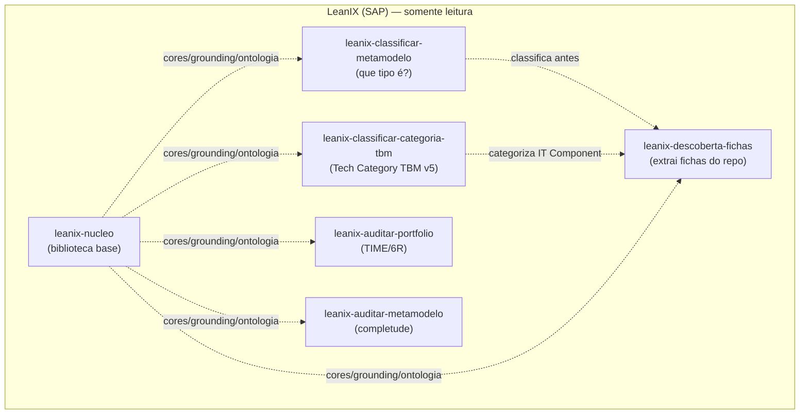

# Índice de Skills — LeanIX (extração, classificação e auditoria)

Catálogo do projeto: **6 skills** (`leanix-*`, PT-BR) para trabalhar o meta-modelo do **SAP LeanIX** a
partir de um repositório de desenvolvimento. Todas operam **somente leitura** (não escrevem no catálogo)
e se apoiam no núcleo compartilhado `leanix-nucleo`. Cada skill é uma pasta em `.kiro/skills/<nome>/` com
um `SKILL.md` (front matter YAML + instruções) e, quando precisa, uma pasta `references/` com material de
apoio. Para o detalhe de cada skill, veja o [README.md](README.md).

> **Exemplo executado (PoC):** o projeto traz o repositório fictício `repo/produto-service/` e as fichas
> geradas dele em `documentos-gerados/produto-service/` — demonstração pronta da descoberta ponta a ponta
> (a IA propõe; o humano reconcilia e aprova). Ver o README principal do projeto.

## As 4 capacidades do template

| Capacidade | Skill |
|---|---|
| **Extrair as fichas de um repositório** (varre o repo e identifica todos os Fact Sheets) | [`leanix-descoberta-fichas`](leanix-descoberta-fichas/SKILL.md) |
| **Identificar que tipo de ficha é um item** (Application? IT Component? Interface?…) | [`leanix-classificar-metamodelo`](leanix-classificar-metamodelo/SKILL.md) |
| **Categorizar os componentes de TI no TBM correto** (Tech Category v5) | [`leanix-classificar-categoria-tbm`](leanix-classificar-categoria-tbm/SKILL.md) |
| **Auditar o portfólio** (TIME, 6R, obsolescência, redundância) | [`leanix-auditar-portfolio`](leanix-auditar-portfolio/SKILL.md) |
| **Auditar o metamodelo** (completude e associações obrigatórias) | [`leanix-auditar-metamodelo`](leanix-auditar-metamodelo/SKILL.md) |
| *(base)* Cores, grounding, ontologia e segurança comuns a todas | [`leanix-nucleo`](leanix-nucleo/SKILL.md) |

## Visão geral (6 skills)

| Skill | Família | Escreve no catálogo? | Em uma linha |
|-------|---------|----------------------|--------------|
| [`leanix-descoberta-fichas`](leanix-descoberta-fichas/SKILL.md) | LeanIX | Não (entrega fichas) | Varre um repositório e monta/valida as fichas dos 15 tipos de Fact Sheet, campo a campo. |
| [`leanix-classificar-metamodelo`](leanix-classificar-metamodelo/SKILL.md) | LeanIX | Não (decide) | Decide o tipo correto de um item pela árvore de decisão oficial. |
| [`leanix-classificar-categoria-tbm`](leanix-classificar-categoria-tbm/SKILL.md) | LeanIX | Não (recomenda) | Classifica a Tech Category de um IT Component pela Taxonomia TBM v5. |
| [`leanix-auditar-portfolio`](leanix-auditar-portfolio/SKILL.md) | LeanIX (auditoria) | Não (recomenda) | Estratégia de portfólio: valor × risco, TIME, 6R, obsolescência, racionalização. |
| [`leanix-auditar-metamodelo`](leanix-auditar-metamodelo/SKILL.md) | LeanIX (auditoria) | Não (leitura MCP) | Audita completude e associações obrigatórias (ecossistema inteiro ou 1 app). |
| [`leanix-nucleo`](leanix-nucleo/SKILL.md) | LeanIX (base) | Não (biblioteca) | Núcleo compartilhado: cores, grounding, ontologia e segurança das skills LeanIX. |

## Qual skill usar?

- **Ler um repositório e gerar todas as fichas** → `leanix-descoberta-fichas` (modo DESCOBERTA). As fichas
  são **base do cadastro no LeanIX**: cada Fact Sheet detalhado campo a campo, nada resumido (steering
  `fichas-leanix-completas`).
- **Montar/validar a ficha de um item específico** → `leanix-descoberta-fichas` (modo FICHA).
- **Dúvida de "que tipo de ficha é isso?"** (Application × IT Component × Interface × Data Object ×
  Platform × Provider × Tech Category) → `leanix-classificar-metamodelo`.
- **"Em qual Tech Category (TBM) entra este componente de TI?"** → `leanix-classificar-categoria-tbm`.
- **Avaliar/racionalizar o portfólio** (TIME, 6R, obsolescência, redundância, roadmap) → `leanix-auditar-portfolio`.
- **Medir completude e associações obrigatórias do catálogo** (órfãos, lacunas, 1 app correta) → `leanix-auditar-metamodelo`.
- Todas as skills se apoiam no **`leanix-nucleo`** (não é acionado diretamente).

## Completude obrigatória dos entregáveis

Steering `inclusion: auto` **`fichas-leanix-completas`**: as fichas LeanIX são detalhadas campo a campo,
nº de fichas = nº de itens identificados, nunca resumidas com "demais seguem o mesmo padrão". Vale para
toda saída em `documentos-gerados/`.
