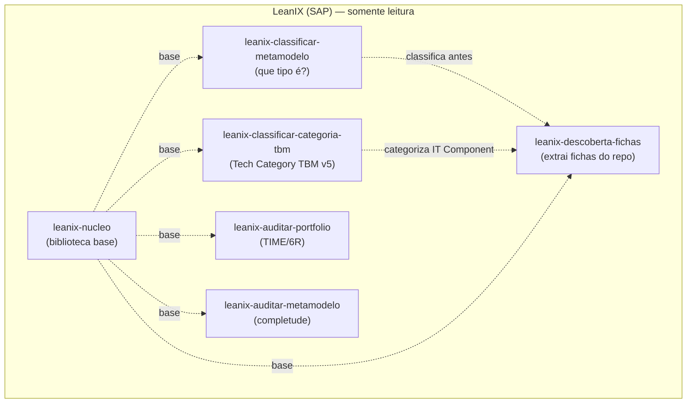
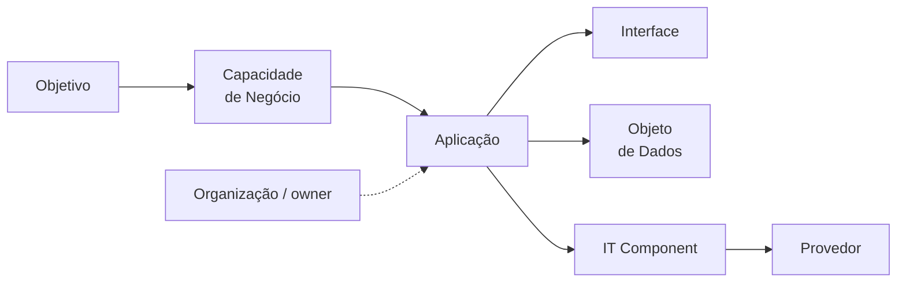

# Skills — LeanIX (extração, classificação e auditoria)

Projeto com **6 Agent Skills** para o Kiro (`leanix-*`, PT-BR) que trabalham o meta-modelo do **SAP
LeanIX** a partir de um repositório de desenvolvimento. Cada skill é uma pasta em `.kiro/skills/<nome>/`
com um `SKILL.md` (front matter YAML + instruções) e, quando precisa, uma pasta `references/` com
material de apoio. O índice-resumo está no [INDEX.md](INDEX.md).

Todas operam **somente leitura** — consultam, **entregam fichas prontas** e **recomendam**; **nenhuma
escreve no catálogo LeanIX** (o cadastro é manual). A IA **propõe**, o humano **reconcilia e aprova**.

> **Exemplo executado (PoC):** para ver estas skills em ação sem configurar nada, o projeto inclui o
> microsserviço fictício `repo/produto-service/` e as fichas que a `leanix-descoberta-fichas` gerou dele
> em `documentos-gerados/produto-service/` (1 Application, 3 Interfaces, 17 IT Components, 3 Data Objects,
> 11 Providers, 1 Business Capability, 1 Organization). Detalhes no README principal do projeto.

---

## Como as skills funcionam

- **Ativação por contexto:** o Kiro lê o campo `description` de cada `SKILL.md` e ativa a skill quando o
  pedido casa (via `disclose_context`).
- **Estrutura de uma skill:** `SKILL.md` (front matter: `name` = nome da pasta, `description` = gatilho
  de ativação) + o corpo com as instruções; `references/` com o material de apoio.

## Mapa das skills

| Você quer… | Skill |
|---|---|
| Ler um repositório e gerar todas as fichas | `leanix-descoberta-fichas` |
| Saber que tipo de ficha é um item | `leanix-classificar-metamodelo` |
| Categorizar um componente de TI no TBM | `leanix-classificar-categoria-tbm` |
| Avaliar/racionalizar o portfólio (TIME, 6R) | `leanix-auditar-portfolio` |
| Medir completude/associações do catálogo | `leanix-auditar-metamodelo` |
| Consultar cores/grounding/ontologia | `leanix-nucleo` (base, não acionada direto) |

---

## 1. `leanix-descoberta-fichas`
**Família:** LeanIX · **não escreve no catálogo** (entrega fichas prontas)

**Extrai os dados de um repositório e gera as fichas de Fact Sheet.** Mapeia o meta-modelo completo do
tenant configurado (15 tipos: Application, ITComponent, Interface, DataObject, BusinessCapability,
Provider, Platform, Tech Category e outros) e **valida + cria** a ficha campo a campo — com tipo de
dado, obrigatoriedade, valores de seleção, condicionais (camada backend/ui/data, autenticação, governança
de IA), tags, hierarquia e grafo de relações.

**Dois modos:**
1. **Descoberta de repositório** — varre um repo/pasta e identifica **todas** as fichas que o sistema
   geraria, com tipo, subtipo, tags, autenticação e relações.
2. **Ficha / validação por tipo** — gera ou valida a ficha de um item específico, campo a campo.

**Quando usar:** "ler este repositório e gerar todas as fichas", "montar/validar a ficha de X", "quais
campos/subtipos/tags/relações tem o tipo Y".

**Apoio:** `references/` com `templates-por-tipo/` (`_INDICE.md` + 15 templates `TPL-01..15`),
`estrutura-subtipos-relacoes.md`, `tags-grupos-leanix.md`, `tech-categories-leanix.md`,
`descoberta-repo-para-fichas.md`, `template-ficha-cadastro.md`, `checklist-execucao.md`.
**Completude obrigatória:** steering `fichas-leanix-completas`.

---

## 2. `leanix-classificar-metamodelo`
**Família:** LeanIX · **não consulta nem escreve** (só decide e justifica)

**Identifica que tipo de ficha é um item.** Decide o tipo correto no meta-modelo pela **árvore de decisão
oficial** — Interface, Data Object, Application, IT Component, Platform, Provider ou Tech Category — com a
pré-triagem, as perguntas P1/P2/P3, a exceção SaaS e a Tríade de Ouro do IT Component. Skill
autossuficiente e agnóstica. Vem **antes** da ficha: a `leanix-descoberta-fichas` a invoca em dúvidas de
classificação.

**Quando usar:** classificar/reclassificar um item, decidir se algo é Application ou IT Component, validar
um enquadramento, ou justificar por que um cadastro está no tipo errado.

**Apoio:** `references/` (building blocks ABB/SBB, árvore Platform × Tech Category × Business Context,
complemento de tipos v4 e ontologia, dicionário TOGAF → LeanIX).

---

## 3. `leanix-classificar-categoria-tbm`
**Família:** LeanIX · **recomenda** (não escreve no catálogo)

**Categoriza os componentes de TI na Tech Category (TBM v5) correta.** Opera em dois modos:
- **Categorizar** — recebe o nome de um ou mais IT Components (software, SaaS/PaaS/IaaS, hardware ou
  modelo de IA), pesquisa a função técnica real e retorna a categoria **primária** e as **secundárias**
  com justificativa e confiança; confirma contra o tenant quando há MCP.
- **Taxonomia/descrição** — classifica um nó na árvore TBM (N1 → N2 → N3) e escreve/padroniza a descrição
  enriquecida da categoria.

**Quando usar:** "em qual Tech Category entra o componente X?", dúvida de como categorizar algo,
categorizar um software/serviço ou lote, ou padronizar a descrição de uma categoria.

**Apoio:** `references/tbm-taxonomy-v5.md` (Taxonomia TBM v5.0.1).

---

## 4. `leanix-auditar-portfolio`
**Família:** LeanIX (auditoria) · **somente leitura, recomenda**

**Audita a saúde estratégica do portfólio.** Avalia o **valor** e o **risco** das aplicações para decidir
o que manter, investir, migrar ou eliminar: obsolescência (lifecycle), redundância funcional,
acoplamento/integrações, risco, aderência a princípios, classificação **TIME** e **6R**, análise
AS-IS → TO-BE e racionalização.

**Quando usar:** avaliação/racionalização de portfólio, TIME, 6R, obsolescência, redundância, mapa de
integrações ou roadmap de modernização.
**Não use para:** completude/associações obrigatórias (→ `leanix-auditar-metamodelo`).

**Apoio:** apoia-se nos `references/` do `leanix-nucleo`; não tem `references/` próprios.

---

## 5. `leanix-auditar-metamodelo`
**Família:** LeanIX (auditoria) · **somente leitura via MCP**

**Audita a completude e as associações obrigatórias** do catálogo em dois escopos:
- **Ecossistema** — varre o catálogo via MCP e mede não-conformidades em escala: cadastros sem
  Nome/Assinatura/Descrição, Provedores órfãos/duplicados, IT Components sem provedor, Interfaces sem
  produtor/consumidor/objeto de dados, Aplicações sem IT Component.
- **Conformidade de 1 app** — valida se uma aplicação/projeto está corretamente representada (app,
  interfaces fornecidas/consumidas, IT Components, owner/capability/lifecycle).

**Quando usar:** varrer o catálogo e medir completude/lacunas, ou checar se um projeto/app específico está
cadastrado certo.
**Não use para:** estratégia TIME/6R (→ `leanix-auditar-portfolio`).

**Apoio:** `references/boas-praticas-e-evolucao.md`.

---

## 6. `leanix-nucleo`
**Família:** LeanIX (biblioteca base) · **não executa ação própria**

Núcleo compartilhado das skills `leanix-*` — reúne, num só lugar e de forma autossuficiente, os dados e
regras padrão de todo trabalho com SAP LeanIX:

- **Cores oficiais** por tipo de Fact Sheet (para diagramas Mermaid/SVG);
- **Grounding** (rigor de evidência: só dado real via MCP, nunca inventar, somente leitura);
- **Ontologia** do meta-modelo (tipos v4 + customizados do tenant, subtipos, Provider → IT Component → Application);
- **Segurança de conteúdo** (TCO/custo restrito, segredos por nome).

As demais skills referenciam este núcleo em vez de steerings soltas, para poderem ser importadas em grupo
para outro projeto.

**Meta-modelo (camadas que as skills LeanIX percorrem):**

**Apoio:** `references/` (`grounding.md`, `cores-fact-sheet.md`, `ontologia-metamodelo.md`,
`seguranca-conteudo.md`).
