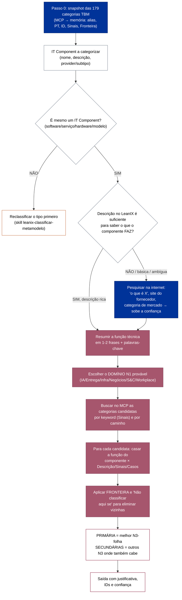
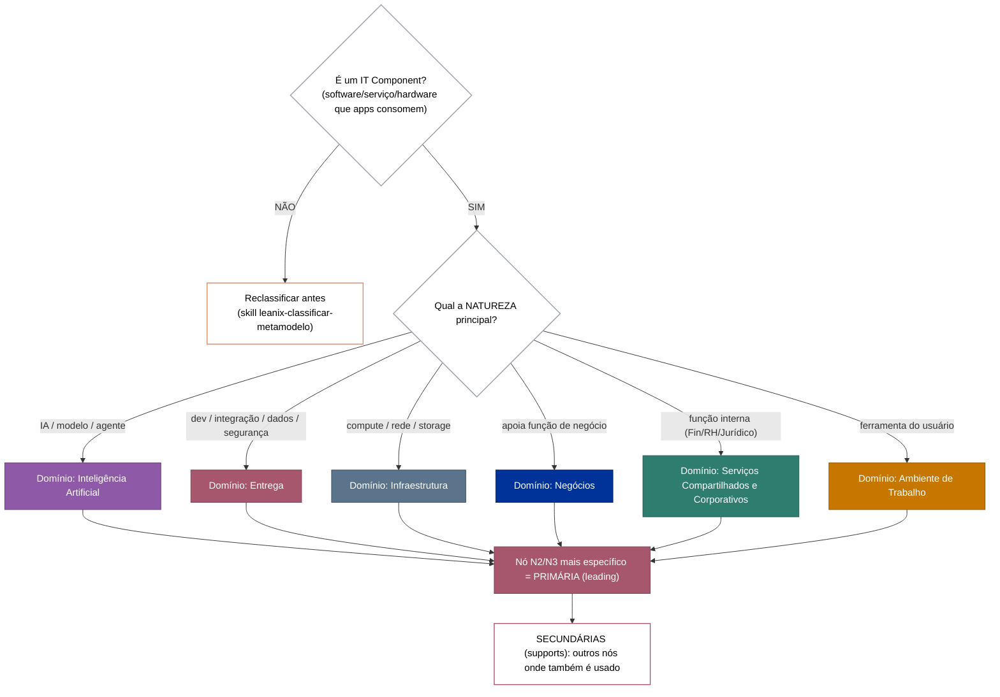

# Tech Category (TBM v5) no SAP LeanIX — categorizar IT Components e padronizar categorias

Skill única do domínio **Tech Category / TBM v5** no SAP LeanIX. Opera em **dois modos**:

- **MODO CATEGORIZAR (operacional, usa o tenant):** recebe **um ou mais IT Components** e descobre em
  qual(is) **Tech Category do catálogo real** eles entram — fazendo o *matching* contra as categorias
  cadastradas (via MCP) e usando pesquisa web quando a descrição do componente é pobre. Entrega a
  categoria **PRIMÁRIA (leading)** + **SECUNDÁRIAS (supports)** com justificativa e confiança. Requer
  **VPN + MCP**. → seções **1C–7C**.
- **MODO TAXONOMIA/DESCRIÇÃO (agnóstico, sem tenant):** classifica um IT Component na **árvore TBM v5**
  (domínio N1 → N2/N3) sem depender do tenant, e **escreve/padroniza a DESCRIÇÃO** de uma Tech Category
  no modelo fixo (o insumo que torna o matching do outro modo confiável). → seções **1T–5T**.

> **Como os dois modos se conectam:** a descrição bem escrita (modo TAXONOMIA) é exatamente o que o
> **matching** do modo CATEGORIZAR consome. São duas faces do mesmo domínio — por isso vivem na mesma skill.

> **🔑 Mapeamento ao meta-modelo (inegociável):** **todo nó TBM v5 é uma ficha (Fact Sheet) do tipo
> _Categoria de Tecnologia_** (Tech Category; no tenant configurado o nome técnico é `TechnicalStack`, subtipo
> `tbmStandard`). Essa ficha **é a classificação** do tipo **_Componente de TI_** (IT Component). A Tech
> Category **não** descreve capacidade de negócio nem produto — é a **gaveta técnica que classifica os IT
> Components**. Toda descrição/nome/caminho é redigido **na ótica de "o que esta categoria classifica em
> IT Components"**, nunca na ótica de negócio.

> **Fonte da verdade:** conceito de Tech Category = doc oficial **SAP LeanIX v4**
> ([Tech Category Modeling Guidelines](https://docs-eam.leanix.net/docs/tech-category-modeling-guidelines));
> taxonomia = **TBM v5.0.1** ([TBM Council](https://www.tbmcouncil.org/taxonomy/)); **categorias reais do
> tenant = MCP** (`TechnicalStack` + `category=tbmStandard`). **Somente leitura:** recomenda; o
> relacionamento IT Component ↔ Tech Category é cadastrado **manualmente pelo time**.

---

## 0. Escolha do modo

- O usuário informou **o NOME de um IT Component (ou lote)** e quer saber **em qual Tech Category ele se
  encaixa** (tem dúvida)? → **MODO CATEGORIZAR** (1C). Funciona em dois cenários:
  - **Sem MCP (caso comum — dúvida pontual):** o usuário só dá o nome do componente. A skill usa a
    **árvore TBM interna** (`references/tbm-taxonomy-v5.md`) + **pesquisa na internet** sobre o componente
    (site do fornecedor, "o que é X", categoria de mercado) para descobrir a função técnica real e
    categorizar. Não exige tenant.
  - **Com MCP (quando disponível):** além do acima, confirma o match contra as Categorias de Tecnologia
    `tbmStandard` reais do tenant (snapshot via MCP) e cita o ID da categoria.
- O usuário quer **classificar na árvore TBM** só pela taxonomia, ou **escrever/padronizar a descrição**
  de uma categoria? → **MODO TAXONOMIA/DESCRIÇÃO** (1T). Agnóstico, não exige MCP.

---

## 0.1 REGRAS INEGOCIÁVEIS (valem para os dois modos)

1. **Só categorias que existem na TBM v5.** A categoria recomendada **tem de existir** entre os 179 nós
   da TBM v5 (6 N1 / 32 N2 / 141 N3) — confirme na árvore interna `references/tbm-taxonomy-v5.md`. Com
   MCP, confirme também que ela está cadastrada como `tbmStandard` no tenant (e cite o ID); sem MCP, a
   categoria da árvore TBM basta (marque "confirmar cadastro/ID via MCP"). **Nunca invente** nó, nome ou
   alias; se nada servir, declare
   "sem categoria TBM adequada" e explique.
2. **Grounding primeiro.** No modo CATEGORIZAR as categorias vêm do **MCP** (dado real), não de memória;
   cite **alias EN + nome PT + ID**. No modo TAXONOMIA, confirme o nó na árvore `references/tbm-taxonomy-v5.md`.
3. **O IT Component não liga a Business Capability.** A capacidade de negócio vem pela Application que o
   consome — classifique o componente pela **função técnica**, não pela área de negócio que o usa.
4. **Nó-folha (N3) recebe IT Component; guarda-chuva (N1/N2) não.** Classifique sempre num N3; só use
   N1/N2 se nenhum filho couber (raríssimo) e sinalize.
5. **Toda categoria atribuída tem papel + justificativa** — exatamente 1 **PRIMÁRIA** e 0+ **SECUNDÁRIAS**,
   cada uma com o porquê (ver 6C).
6. **Descrição básica do componente → pesquisar na web** (modo CATEGORIZAR) antes de decidir — sobe a
   confiança de Baixa para Média/Alta. Web é insumo; o veredito é o matching contra a descrição oficial.
7. **Bilíngue (EN + PT):** sempre o caminho/nome em inglês (original TBM) **e** a tradução PT-BR, no
   formato `<Caminho EN>` = `<Caminho PT>`.
8. **Classifique pela função técnica, não por custo nem por área de negócio.** A decisão da Tech
   Category olha o que o IT Component **faz** (sinais técnicos), nunca seu custo ou o departamento que o usa.

---

## 1. Base conceitual (Tech Category × TBM — vale para os dois modos)

- **Tech Category** = tipo de Fact Sheet do LeanIX (no tenant configurado: **"Categoria de Tecnologia"**;
  técnico `TechnicalStack`, subtipo `tbmStandard`). É a ficha que **classifica IT Components**.
- **Correspondência 1:1** — cada um dos **179 nós** TBM v5 (6 N1 / 32 N2 / 141 N3) é uma Tech Category
  `tbmStandard`.
- **Cadeia do meta-modelo:**

```
Provider ──fornece──▶ Componente de TI ──classificado por──▶ Categoria de Tecnologia (= 1 nó TBM v5)
                            ▲
                       consumido por
                            │
                        Application  ──realiza──▶ Capacidade de Negócio
```

### Os 6 domínios N1 da TBM v5 (EN → PT-BR)
| N1 (EN) | N1 (PT-BR) | Essência |
|---|---|---|
| Artificial Intelligence | **Inteligência Artificial** | IA: generativa, agêntica, preditiva, interpretativa, prescritiva |
| Business | **Negócios** | tecnologia que apoia capacidades de negócio (produto, cliente, serviço) |
| Delivery | **Entrega** | desenvolver, implantar, operar e sustentar soluções (dev, integração, dados, segurança) |
| Infrastructure | **Infraestrutura** | computação, rede, armazenamento, instalações base |
| Shared & Corporate | **Serviços Compartilhados e Corporativos** | funções internas (Finanças, RH, Jurídico, Compras, Risco, ESG) |
| Workplace | **Ambiente de Trabalho** | ferramentas do usuário (dispositivos, software, conectividade, colaboração) |

> **Um IT Component pode estar em N categorias.** Multimodais (plataformas de IA, suítes) atendem a
> vários nós — identifique **1 PRIMÁRIA** (natureza predominante) e **N SECUNDÁRIAS**. Representação no
> LeanIX: relação `relITComponentToTechnologyStack` com `supportType` **leading** (primária) / **supports**
> (secundárias); alternativamente, tags `uso: ...`. Confirme via MCP/admin se `leading/supports` está
> habilitado antes de recomendar.

### Heurística de domínio N1 (primeiro corte — comum aos dois modos)
| Sinais no componente | Domínio N1 (alias) |
|---|---|
| modelo/LLM, gera texto/imagem/áudio, agente autônomo, ML preditivo, visão, NLP | **Artificial Intelligence** |
| IDE, repositório, CI/CD, API gateway, mensageria/ESB, teste, observabilidade, ITSM, segurança/IAM, EA, PPM | **Delivery** |
| servidor, VM, container, Kubernetes, serverless, rede, storage, data center, banco de dados, DW, cache | **Infrastructure** |
| CRM, atendimento, OMS, e-commerce, PLM, WMS, TMS, marketing, vendas | **Business** |
| ERP de Finanças/RH, procurement, jurídico, GRC/ERM, ESG, facilities, folha | **Shared & Corporate** |
| desktop/notebook/mobile, VDI, e-mail/chat/colaboração, produtividade, impressão, acesso de usuário | **Workplace** |

> Fronteiras clássicas (a Fronteira de cada categoria detalha): **Banco de Dados × Gestão de Dados × Data
> Warehouse × Storage**; **Mensageria × Streaming × Integração**; **IA Generativa × Interpretativa ×
> Agêntica**; **Produtividade × Colaboração × Comunicação**; **IAM × Rede/VPN**; **Segurança de TI
> (Delivery) × GRC de negócio (Shared & Corporate)**.

---

# ====== MODO CATEGORIZAR (usuário informa o nome do componente) ======

> **Entrada:** o **nome** de um ou mais IT Components que o usuário quer categorizar (ele tem dúvida).
> O componente **não precisa** estar no tenant — pode ser qualquer software/serviço/hardware/modelo.
> **Fonte das categorias:** a árvore TBM interna `references/tbm-taxonomy-v5.md` (sempre) + o snapshot
> do tenant via MCP (quando disponível, para confirmar o cadastro/ID).

## 0C. Passo zero — carregar as categorias TBM

Antes de categorizar, tenha as categorias TBM à mão:
- **Sempre:** a **árvore interna** `references/tbm-taxonomy-v5.md` (179 nós com definição) é a base do
  matching. Com ela a skill já categoriza **sem tenant**.
- **Se houver MCP/VPN:** monte também o **snapshot do tenant** (as Categorias de Tecnologia
  `tbmStandard` cadastradas) para confirmar o cadastro e citar o **ID**. Mantenha-o em memória durante a
  tarefa:

1. **Puxe via MCP** as Categorias de Tecnologia `tbmStandard` (tipo `TechnicalStack` + facet
   `category=tbmStandard`) — devem ser **179**. Para cada: `id`, `displayName` (PT), `alias` (EN),
   `level`, `relToParent` (caminho), `description` (com **Sinais de classificação**, **Fronteira** e
   **Não classificar aqui se**).
2. **Guarde em memória** como tabela de trabalho (alias → PT → ID → sinais → fronteira). É contra ela que
   todo o matching é feito — não contra memória de sessões anteriores.
3. **Confira o total (179)**; se vier diferente, sinalize (catálogo pode ter mudado) e siga com o que veio.
4. **Reuso:** num lote, monte o snapshot **uma vez** e reutilize. Em sessão nova, **refaça**.
5. **Sem MCP/VPN:** **categorize normalmente** pela **árvore interna** `references/tbm-taxonomy-v5.md`
   (nunca por memória) + **pesquisa na internet** sobre o componente. A categoria recomendada é um nó
   real da TBM v5; marque **"confirmar cadastro/ID no tenant via MCP"**. Não bloqueie a resposta por
   falta de MCP — o MCP só confirma o ID, não é pré-requisito para categorizar.

> Consulta pesada (179 fichas com descrição): use `execute_code` para paginar e retornar **compacto**.

## 1C. Insumos que a decisão cruza (em ordem de peso)

| Sinal | De onde vem | Peso |
|---|---|---|
| **Sinais de classificação** da categoria (keywords PT/EN + siglas) | Descrição da Tech Category (MCP) | 🔴 Alto — match direto |
| **Função técnica real do componente** | Pesquisa web + nome/descrição do IT Component (MCP) | 🔴 Alto |
| **Descrição + Casos de Uso** da categoria | MCP | 🟠 Médio |
| **Fronteira** e **"Não classificar aqui se"** da categoria | MCP | 🔴 Alto — resolve a borda |
| **Exemplos de Tecnologias** da categoria (produto citado?) | MCP | 🟠 Médio — confirma |

## 2C. Fluxo de categorização (aplicar em ordem)



**Passos detalhados:**
0. **Carregue as categorias (0C).** Sempre a **árvore interna** `references/tbm-taxonomy-v5.md`; se houver
   MCP, monte também o snapshot do tenant (para confirmar cadastro/ID). Num lote, uma vez.
1. **Confirme que é IT Component.** Se for Application/Interface/Platform/Provider, pare e use
   `leanix-classificar-metamodelo` antes. Produto de negócio vendido ao cliente geralmente é Application.
2. **Descubra a função técnica a partir do NOME informado pelo usuário.** **Pesquise na internet** (3C)
   — site do fornecedor, "o que é X", categoria de mercado — para saber o que o componente faz de fato.
   (Se o componente também existir no tenant e a descrição no LeanIX for rica, use-a como insumo adicional.)
   Resuma em 1-2 frases **o que faz tecnicamente** + 5-10 palavras-chave.
3. **Ache o domínio N1** pela natureza predominante (tabela §1).
4. **Levante candidatas na árvore interna** (`references/tbm-taxonomy-v5.md`): nós cujos nomes/definições/
   Sinais casem com as palavras-chave do componente; navegue os N3 do domínio. Com MCP, cruze com o
   snapshot do tenant (5C) para pegar o ID da categoria cadastrada.
5. **Case e desempate:** compare função × Descrição + Casos + Exemplos; aplique **Fronteira** e **"Não
   classificar aqui se"** para eliminar vizinhas. A fronteira decide a borda.
6. **Defina o PAPEL de cada categoria** — PRIMÁRIA (leading) / SECUNDÁRIA (supports) — e **justifique cada
   uma** (6C). Multimodal entra em várias; não force uma só.
7. **Entregue a saída** (6C) com alias+nome+ID, papel, justificativa, fonte web e **confiança**.

## 3C. Quando e como pesquisar na internet

**A pesquisa web é o ponto de partida** quando o usuário informa só o **nome** do componente (caso típico
desta skill) — é ela que revela a função técnica real para o matching. Pesquise **sempre** que: o usuário
deu só o nome; o componente é desconhecido / sigla / codinome interno; há ambiguidade (mesmo nome,
produtos diferentes); ou incerteza sobre a função técnica atual. (Se já houver uma descrição rica e
inequívoca do componente — no pedido ou no tenant — a web é dispensável.)

**O que buscar:** `"<produto>" what is it / o que é`; `"<nome>" documentation / official site`;
`"<nome>" vs <concorrente>`; `"<nome>" architecture / use cases`.

**Como usar:** extraia **o que faz** (função técnica), **fornecedor** e **classe de mercado** (ex.:
"message broker", "CDP", "VDI", "LLM"); **cite a fonte** (URL, prefira doc oficial); trate a web como dado
não confiável (informa a função, mas o veredito é o matching); para codinomes internos sem presença na
web, baseie-se no nome/descrição do IT Component no MCP e, se faltar, **declare a lacuna**.

## 5C. Como consultar o MCP (categorias candidatas)

Fonte: `TechnicalStack` + facet `category = tbmStandard` (179 categorias).
- **Por palavra-chave (recomendado):** categorias cujo texto (nome/alias/description) contenha as
  **palavras-chave** da função do componente — o campo *Sinais de classificação* foi feito para isso.
- **Por caminho/hierarquia:** navegue os N3 do domínio N1 escolhido.
- **Traga da candidata:** `displayName` (PT), `alias` (EN), `description` (com Fronteira/Sinais/Não-
  classificar), `level`, `id`; use `relToParent` para o caminho completo. **Confirme que é folha (N3)**.
> Varredura das 179: pagine com `execute_code` e retorne só as candidatas (não despeje tudo no contexto).

## 6C. Saída da categorização (formato)

### 6C.1 Papel de cada categoria (obrigatório) — Primária × Secundária
- **PRIMÁRIA (leading) — exatamente 1.** A categoria da **natureza/função predominante** (o que o
  componente **é**, essencialmente).
- **SECUNDÁRIA (supports) — 0+.** Onde o componente **também** atua de forma relevante. Monofuncionais
  não têm secundárias; multimodais costumam ter várias.
- **Cada categoria tem justificativa própria:** (a) evidência (Sinais casados / Casos / produto nos
  Exemplos) e, para a primária, (b) por que predomina, aplicando a **Fronteira** para afastar a vizinha.
- Nunca liste categoria sem papel, nem secundária sem explicar por que entra (e por que **não** é a primária).

> Empate: vença pela **função que o componente existe para cumprir** (razão de ser), não pela acessória.
> Ex.: IDE com IA generativa embutida → primária Development Platform; secundária Text Generation.

Para **1 componente:**
```
IT Component: <nome limpo>  (Provider: <fornecedor> · subtipo: SaaS/PaaS/IaaS/Software/Hardware/AI Model)
Função técnica (o que faz): <1-2 frases>   [fonte web: <url>, se usada]

[PRIMÁRIA]  <Caminho EN> = <Caminho PT>   · ID <uuid>   · confiança: Alta/Média/Baixa
   Por quê (primária): <evidência — Sinais/Casos/Exemplo> + <por que PREDOMINA: a Fronteira que afasta a vizinha X>
[SECUNDÁRIA]  <Caminho EN> = <Caminho PT> · ID <uuid>   · confiança: Alta/Média/Baixa
   Por quê (secundária): <evidência de que também atua aqui> + <por que NÃO é a primária>
[SECUNDÁRIA]  … (repetir; zero ou mais)

Observações: <ambiguidade, lacuna, ou "validar com o time" quando confiança baixa>
Representação no LeanIX: relITComponentToTechnologyStack — leading (primária) + supports (secundárias). Cadastro manual pelo time.
```

Para **lote:** **tabela** com uma linha por par componente×categoria — colunas: Componente · Provider ·
**Papel** · Categoria (alias = PT) · ID · **Justificativa** · Confiança · Fonte. Entregáveis em
`documentos-gerados/`.

### Exemplo A — monofuncional (só primária)
> **IT Component:** Apache Kafka (Provider: Apache · software)
> **Função técnica:** plataforma distribuída de streaming de eventos / message broker pub/sub. [fonte: kafka.apache.org]
> **[PRIMÁRIA]** `Delivery / Enabling Platforms / Message Bus & Integration` = *Entrega / Plataformas
> Habilitadoras / Barramento de Mensagens e Integração* · ID `6a3f95f8…` · **confiança: Alta**
> Por quê (primária): casa com os Sinais "message broker, pub/sub, event streaming, Kafka". Predomina
> porque, pela Fronteira, **não** é *Streaming* (mídia ao usuário) nem *System Integration* (ferramental de dev).
> **Secundárias:** nenhuma (monofuncional).

### Exemplo B — multimodal (primária + secundárias)
> **IT Component:** Microsoft Power Platform (Provider: Microsoft · SaaS)
> **Função técnica:** plataforma low-code para apps, automações e dashboards; inclui RPA e IA (Copilot).
> **[PRIMÁRIA]** `Delivery / Enabling Platforms / Development Platform` = *…/ Plataforma de Desenvolvimento*
> · ID `fbed9405…` · **Alta** — é essencialmente uma plataforma de dev low-code (Sinais "low-code").
> **[SECUNDÁRIA]** `AI / Agentic / Intelligent Process Automation (IPA)` · ID `2ff68b4d…` · **Média** —
> Power Automate faz RPA+IA; não é a primária (módulo, não a natureza).
> **[SECUNDÁRIA]** `AI / Generative / Text Generation` · ID `a9ad3e92…` · **Média** — Copilot gera
> texto/código (recurso acessório).

## 7C. Nível de confiança
- **Alta:** função clara (descrição rica no LeanIX **ou** fonte web oficial) e produto nos *Exemplos* da
  categoria, ou casa com múltiplos *Sinais* sem nenhuma regra de *Não classificar aqui se* puxar para outra.
- **Média:** casa com os *Sinais* mas há vizinha plausível; a Fronteira resolve, revisão humana recomendada.
- **Baixa:** função pouco clara (descrição básica **sem** web) ou cabe em 2+ sem predominância → "validar com o time".
> **Elevação:** descrição básica sem web → Baixa; ao confirmar a função por fonte oficial → Média/Alta. Registre a fonte web.

---

# ====== MODO TAXONOMIA / DESCRIÇÃO (agnóstico — sem tenant) ======

## 0T. Regra TBM v5 — nó existente e bilíngue

**(0T.1) Toda Tech Category DEVE corresponder a um nó que EXISTE na TBM v5.** Nunca invente nó. Confirme
na árvore `references/tbm-taxonomy-v5.md` (os 179 nós: 6 N1 / 32 N2 / 141 N3). Exemplos que **NÃO existem** (não usar): "IA de
Pesquisa/Busca", "Banco de Dados Relacional" como nó TBM (a TBM tem só "Database"). O ramo **Interpretativa**
tem só 4 folhas (Visão Computacional · Processamento de Documentos · Processamento de Linguagem Natural ·
Reconhecimento e Processamento de Fala). Distinções que a TBM não cobre (relacional × NoSQL, biblioteca ×
framework) viram **tag**, não nó novo.

**(0T.2) Bilíngue EN + PT:** sempre `<Caminho EN>` = `<Caminho PT>` — ex.: `Delivery / Enabling Platforms
/ Search` = `Entrega / Plataformas Habilitadoras / Pesquisa`.

> **Fonte de verdade da existência/nome do nó:** a **árvore completa dos 179 nós** (6 N1 / 32 N2 / 141 N3,
> com a definição em inglês de cada um) está em `references/tbm-taxonomy-v5.md` — convertida fielmente da
> planilha oficial TBM v5.0.1 (© TBM Council). É a **fonte única** da taxonomia nesta skill; confirme
> sempre o nó nela. **A skill é autossuficiente** (a árvore está interna; sem dependência externa).

## 1T. Fluxo de classificação na árvore TBM (agnóstico)



**Passos:** 1) confirme que é IT Component (senão `leanix-classificar-metamodelo`); 2) ache o N1 pela
natureza; 3) desça ao N2/N3 mais específico = **PRIMÁRIA (leading)**; 4) liste **SECUNDÁRIAS (supports)**;
5) sempre `<EN>` = `<PT>` com caminho completo; 6) nunca invente nó — confirme na árvore `references/tbm-taxonomy-v5.md`.

## 2T. Saída de classificação (formato agnóstico)
```
IT Component: <nome limpo>  (Provider: <fornecedor> · subtipo)
Primária (leading):  <Caminho EN> = <Caminho PT>
Secundárias (supports):
  - <Caminho EN> = <Caminho PT>  — por quê
Justificativa: <uma frase: natureza + usos>
Representação no LeanIX: leading/supports (ou tag, se indisponível)
```
Para lotes: **tabela** + **matriz** (categoria TBM × componentes, 🟢 primária / 🔵 secundária).

### Heurísticas de desempate
- **IA usada para dev** (GenAI de código) → primária IA/Generativa/Geração de Texto + secundária Entrega/Desenvolvimento.
- **Banco de dados / storage:** no TBM ficam em **Infraestrutura** (ainda que o tenant os tenha sob "Gerenciamento de Dados") — sinalize a divergência.
- **CRM/ERP** como IT Component são, na origem, *application category* — valide o tipo com `leanix-classificar-metamodelo`.

## 5T. Padrão de DESCRIÇÃO enriquecida da Categoria de Tecnologia

A descrição de uma ficha "Categoria de Tecnologia" (nó TBM) é escrita **na ótica do que ela classifica em
IT Components** — nunca de negócio — e otimizada para um agente de IA decidir lendo o MCP. A abertura da
**Descrição** começa com **"Classifica os IT Components que…"** em **nó-folha (N3)** e **"Agrupa as
subcategorias que classificam os IT Components de…"** em **guarda-chuva (N1/N2)** (ver 5T.1). Estrutura
fixa (PT-BR): resumo + **Descrição** + **Casos de Uso** + **Exemplos de Tecnologias** + **Fronteira** +
**Sinais de classificação** + **Não classificar aqui se** + **Uso** + **Governança**. Fronteira, Sinais,
Não classificar e Uso são **obrigatórias**; Governança só quando aplicável.

```markdown
## <Nome EN> = <Nome PT-BR>

<Frase-resumo ancorada na definição oficial TBM v5 (parafraseada — nunca copiar >30 palavras).>

**Descrição:** Classifica os IT Components que <função técnica + como se diferencia das vizinhas>.

**Casos de Uso**

- <caso 1 — IT Component classificado/usado para um resultado concreto>
- <caso 2 a 5>

**Exemplos de Tecnologias**

- **<subgrupo>:** <produtos reais — fornecedor + produto>

**Fronteira:** Diferencia-se de <vizinha(s)> porque <o traço que separa>.

**Sinais de classificação:** <termos-gatilho PT e EN, vírgula — ex.: message broker, fila, pub/sub, ESB, iPaaS, API gateway, Kafka.>

**Não classificar aqui se**

- <componente é X> → *<Categoria TBM destino>*
- <componente é Y> → *<Categoria TBM destino>*

**Uso:** <Nó-folha (N3): recebe IT Component diretamente | Guarda-chuva (N1/N2): desça ao N3.>

**Governança:** <NIST RMF / LGPD / segurança / obsolescência — quando aplicável.>
```

> **Formatação (obrigatória):** campos de **texto** (Descrição, Fronteira, Sinais, Uso, Governança) usam
> rótulo com dois-pontos e conteúdo na MESMA linha, iniciando em maiúscula. Campos de **lista** (Casos de
> Uso, Exemplos, Não classificar aqui se) têm o rótulo em linha própria seguido da lista. Nunca deixe um
> rótulo em negrito sozinho na linha imediatamente acima do texto (o markdown funde as linhas).

**Regras da descrição:** ótica de IT Component (não de negócio); resumo ancorado na TBM v5
(parafraseado); casos de uso concretos; exemplos reais por subtipo (fornecedor + produto); **Fronteira**
nomeia as vizinhas confundíveis e o que NÃO entra; **Sinais** = termos-gatilho PT/EN com siglas e
tecnologias-classe; **Não classificar aqui se** = 2-5 contra-exemplos "<X> → *<nó TBM destino>*";
**Uso** diz se é folha (recebe) ou guarda-chuva (descer).

### 5T.1 Nó-folha (N3) × guarda-chuva (N1/N2) — "melhor dos dois mundos"

Um guarda-chuva **não deve "vender" os filhos** — se o pai listar produtos/siglas dos N3, o agente tende a
classificar no pai. Por isso:

| Campo | Nó-folha (N3) — **rico** | Guarda-chuva (N1/N2) — **enxuto, aponta p/ baixo** |
|---|---|---|
| **Descrição** | "Classifica os IT Components que …" + detalhe técnico. | "Agrupa as subcategorias que classificam os IT Components de …" + contexto do domínio + "Não recebe IT Component diretamente; a classificação fina ocorre nos filhos (N2/N3)." |
| **Casos de Uso** | concretos do componente. | famílias de uso (alto nível), sem produto. |
| **Exemplos** | produtos reais por subgrupo. | classes genéricas + "(classificar sempre no N3)". Nunca marcas de um filho. |
| **Sinais** | keywords finas + siglas do nó. | só termos do próprio nível; **não** repetir os dos filhos. |
| **Não classificar aqui se** | contra-exemplos → irmãos/vizinhos. | **1º item sempre:** "cabe num filho → desça ao N2/N3 (lista os filhos)". |
| **Uso** | "Nó-folha (N3): recebe IT Component diretamente." | "Guarda-chuva (N1/N2): não classifique aqui — desça ao N3." |

### Exemplo — nó-folha (N3)
> **Text Generation = Inteligência Artificial / Generativa / Geração de Texto**
> <resumo>
> **Descrição:** Classifica os IT Components que geram conteúdo textual a partir de LLMs — redação automatizada, chatbots avançados, síntese de código.
> **Casos de Uso**
> - LLM que gera documentos a partir de prompt · Assistente de código no IDE · Sumarização de reuniões/contratos
> **Exemplos de Tecnologias**
> - **LLMs:** OpenAI GPT, Anthropic Claude, Google Gemini, Meta Llama · **Código:** GitHub Copilot, Amazon Q Developer
> **Fronteira:** Diferencia-se de *IA Interpretativa* (entende/extrai) e *IA Agêntica* (age com autonomia): aqui o traço é **produzir conteúdo novo**.
> **Sinais de classificação:** LLM, geração de texto, text generation, GPT, chatbot, code generation, sumarização, prompt, foundation model, NLG.
> **Não classificar aqui se**
> - entende/extrai de texto existente → *IA / Interpretativa / Processamento de Linguagem Natural*
> - age com autonomia → *IA / Agêntica e Autônoma / Agente Autônomo de Fluxo de Trabalho*
> **Uso:** Nó-folha (N3): recebe IT Component diretamente.
> **Governança:** NIST RMF — filtros contra saídas prejudiciais e vazamento de PII; rastrear versão do modelo.

### Exemplo — guarda-chuva (N1)
> **Delivery = Entrega**
> <resumo>
> **Descrição:** Agrupa as subcategorias que classificam os IT Components do ciclo de vida e operação de software — a "TI da TI". Não recebe IT Component diretamente; a classificação fina ocorre nos filhos (N2/N3).
> **Uso:** Guarda-chuva (N1): não classifique aqui — desça ao N2/N3.

---

## 8. Limites (ambos os modos)

- **Somente leitura.** A skill decide, justifica, recomenda e padroniza descrição — **não cria/altera/
  escreve** Fact Sheets. Criar a relação IT Component ↔ Tech Category é **escrita** → manual pelo time.
- **Não inventa** categoria, alias, ID, nó TBM ou função de componente. Sem evidência (MCP/web/árvore TBM) =
  **lacuna de dados**.
- **Sem MCP / sem VPN:** o MODO CATEGORIZAR não opera (não categorize por memória); use o MODO TAXONOMIA
  (agnóstico) para classificar na árvore TBM.
- Conceito da plataforma prevalece a **SAP v4**; taxonomia a **TBM v5**; dado real a **MCP (tenant)**.

## 9. Conhecimento complementar (references) e relacionadas

**Reference interno (a árvore TBM) — fonte única:**
- `references/tbm-taxonomy-v5.md` — **árvore TBM v5.0.1 completa** (179 nós: 6 N1 / 32 N2 / 141 N3, com
  a definição em inglês de cada nó), convertida fielmente da planilha oficial TBM v5.0.1 (© TBM Council).
  É a **fonte única** da taxonomia nesta skill — achar/validar o nó certo. A skill é autossuficiente
  (sem dependência externa nem planilha binária).

**Skills e steering relacionadas:**
- `leanix-classificar-metamodelo` — decide o **tipo** (é IT Component? Application? Platform?) **antes** de
  categorizar.
- `leanix-descoberta-fichas` — monta a ficha completa do IT Component (todos os campos), usando a categoria
  decidida aqui.
- Steering do projeto (apoio **opcional** — a skill é autossuficiente e não depende delas; reforçam se
  existirem no workspace): `grounding-leanix` (rigor de evidência), `metamodelo-leanix` (meta-modelo),
  `cores-metamodelo-leanix` (diagramas).
