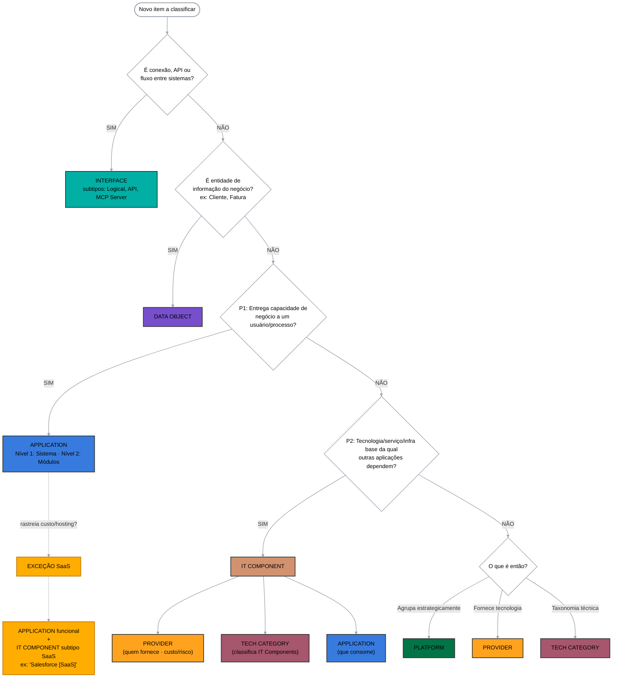

# Classificar no meta-modelo LeanIX (árvore de decisão)

Skill **isolada e agnóstica**: recebe a descrição de um item (o que ele é / o que faz) e decide **qual
Fact Sheet** do meta-modelo SAP LeanIX ele deve ser, **justificando** pela árvore de decisão. Não
depende de nenhum tenant, de outras skills ou de acesso ao catálogo — é raciocínio de classificação
puro. Pode ser copiada para qualquer projeto que use LeanIX.

> **Escopo:** esta skill **classifica e explica**. Ela **não** consulta o MCP nem escreve no catálogo.
> Se o projeto tiver MCP do LeanIX e você quiser confirmar o estado atual de um item real, faça essa
> consulta por fora e traga o resultado para a skill decidir — mas a skill funciona sem isso.

---

## Entrada esperada

Para cada item, o mínimo necessário para decidir:
- **Nome** do item.
- **O que ele é / o que faz** (uma frase basta).
- Se possível: **quem o fornece** (fornecedor) e se **precisa rastrear custo/hosting** — isso define o
  **Provider** e a **exceção SaaS**, mas **não** decide Application × IT Component (ver heurísticas).

Se faltar informação para responder a uma pergunta da árvore, **declare a dúvida** e aponte o que
confirmar — não invente a classificação.

---

## Árvore de decisão (aplicar nesta ordem)

### Passo 1 — Pré-triagem (antes de cogitar Application)
- **É conexão, API ou fluxo entre sistemas?** → **INTERFACE** (subtipos: *Logical*, *API*, *MCP Server*).
- **É entidade de informação do negócio** (ex.: Cliente, Fatura, Matrícula)? → **DATA OBJECT**.
- _Por quê:_ impede poluir o inventário com API/dado cadastrado como "aplicação" e habilita os
  diagramas de **Data Flow**.

### Passo 2 — P1: entrega capacidade de negócio a um usuário/processo?
- **SIM** → **APPLICATION** (Nível 1 = Sistema; Nível 2 = Módulos). *(Ver exceção SaaS no passo 5.)*
- **NÃO** → vá para P2.

### Passo 3 — P2: é tecnologia/serviço/infra base da qual outras aplicações dependem?
- **SIM** → **IT COMPONENT**. *(Aplicar a Tríade de Ouro — passo 6.)*
- **NÃO** → vá para P3.

### Passo 4 — P3: o que é então?
- **Agrupa estrategicamente capacidades/apps/tecnologias** → **PLATFORM**.
- **Fornece a tecnologia (quem vende)** → **PROVIDER**.
- **Taxonomia técnica abstrata** → **TECH CATEGORY**.

### Passo 5 — Exceção SaaS
Produto/SaaS que **ENTREGA capacidade de negócio** (responde SIM na P1) **e** precisa **rastrear
custo/hosting** → criar **os dois**: **APPLICATION funcional** + **IT COMPONENT subtipo SaaS**
(placeholder técnico). Ex.: "Salesforce" (Application) + "Salesforce [SaaS]" (IT Component).

### Passo 6 — Tríade de Ouro do IT Component (relações obrigatórias)
Um IT Component **órfão não tem valor**. Todo IT Component nasce ligado a:
1. **PROVIDER** — quem fornece; habilita contrato, custo e risco de terceiro.
2. **TECH CATEGORY** — classifica o IT Component numa categoria de tecnologia; habilita controle de
   obsolescência (Tech Risk / Lifecycle).
3. **APPLICATION que consome** — mapeia o impacto (se a tecnologia cai/obsoleta, qual negócio para).

---

## Heurísticas de desempate — Application × IT Component (critério oficial SAP)

> ⚠️ **Não decida por "quem fornece".** Produto de terceiro **não** é IT Component automaticamente. A
> SAP lista **Salesforce, SAP S/4HANA, Workday, Zoom e o próprio SAP LeanIX como exemplos de
> Application**. A pergunta é: **é um software que um usuário/processo usa para uma função, ou é
> infraestrutura/serviço base que outras aplicações consomem?**

| Sinal de **APPLICATION** | Sinal de **IT COMPONENT** (fundação técnica pura) |
|---|---|
| Um software que **usuários/times usam** para uma função | **System software / serviço / hardware** que apps consomem |
| Qualquer app de negócio **ou ferramenta de software** | Operating System, database, run-time environment, laptop |
| Ex.: SAP S/4HANA, Salesforce, Zendesk, Gupy, **Grafana, Zoom, Miro, Office 365, SAP LeanIX, Veracode** | Ex.: Oracle DB 19c, AWS EC2, Apache Kafka, Linux, JVM |

- **Regra oficial:** IT Component = "system software, technology services or hardware (operating
  systems, databases, run-time environments, laptops, devices)"
  ([SAP · Application vs. IT component](https://docs-eam.leanix.net/docs/application-vs-it-component)).
  Ferramentas de software (Grafana, Zoom, Veracode, Office 365) são **Application** —
  e, se SaaS, caem na **exceção SaaS** (Application + IT Component placeholder).
- **Tech Category ≠ CRM/ERP/LMS.** Tech Category é taxonomia **de infraestrutura** (Database, Message
  Broker, Operating System, Cloud Compute — [SAP · Tech Category](https://docs-eam.leanix.net/docs/tech-category-modeling)).
  CRM/ERP/LMS são Application Category / Business Capability, **não** Tech Category.
- **Construído/operado pela própria organização** → Application (ou Microsserviço/Módulo como subtipo).
- Casos de fronteira (infra que também é "usada" por uma área): **declare a dúvida** e confirme com o dono.

---

## Saída (formato recomendado)

Para cada item, responda com:

1. **Classificação:** `<Tipo>` (+ subtipo quando aplicável) — ou **"Application + IT Component
   (exceção SaaS)"**.
2. **Caminho na árvore:** as respostas que levaram até lá (ex.: "Não é Interface nem Data Object;
   P1 = Não; P2 = Sim → IT Component").
3. **Justificativa:** uma frase do porquê, no padrão. Exemplos:
   > App SaaS: "É Application (software usado por um processo de negócio) e, por ser SaaS que rastreia
   > custo/hosting, cai na **exceção SaaS** → Application + IT Component subtipo SaaS."
   > IT Component puro: "É IT Component — serviço/infra base (ex.: banco de dados, run-time) consumido
   > por outras aplicações; não entrega função de negócio direta."
4. **Relações a criar** (se IT Component): Provider + Tech Category + Application consumidora.
5. **Dúvidas/validação** (se houver): o que confirmar e com quem.

Para lotes, entregue uma **tabela**: `Item | Classificação | Caminho (P1/P2/P3) | Subtipo | Justificativa | Relações a criar`.

---

## Referência rápida — tipos, subtipos e cores

| Tipo (Fact Sheet) | Quando usar | Exemplos (fonte SAP) | Cor oficial LeanIX |
|---|---|---|---|
| **Business Capability** | o "quê" o negócio faz (independe de como) | Recursos Humanos, Finanças, Vendas | `#003399` |
| **Business Context** | o "como"/produto: processo, produto, jornada | Processo "Hire to Retire", Business Product, Journey | `#FE6690` |
| **Interface** | conexão/API/fluxo entre sistemas | Logical · API · MCP Server | `#02AFA4` (teal) |
| **Data Object** | entidade de informação do negócio | Cliente, Fatura, Matrícula | `#774FCC` (roxo) |
| **Application** | entrega função de negócio a usuário/processo | Salesforce, SAP S/4HANA, Workday, Zoom, SAP LeanIX | `#387BDE` (azul) |
| **IT Component** | system software / serviço / hardware base consumido por apps | Oracle DB 19c, AWS EC2, Apache Kafka, OS, run-time | `#D29270` (laranja) |
| **Platform** | agrupador **estratégico** de apps/tecnologias de grande valor | Plataforma de Pagamentos, SAP BTP | `#027446` (verde) |
| **Provider** | quem fornece a tecnologia | SAP, Oracle, Microsoft | `#FFA31F` |
| **Tech Category** | classifica **IT Components** em categorias de tecnologia (SAP v4) | **Database, Operating System, Server Software, Networked Storage** | `#A6566D` (marrom) |
| _Exceção SaaS_ | Application + IT Component (SaaS) — produto SaaS que rastreia custo/hosting | "Salesforce" (App) + "Salesforce [SaaS]" (IT Comp.) | `#FFAD01` (âmbar) |

> **Subtipos de IT Component** (v4): SaaS · PaaS · IaaS · Software · Hardware · Service · **AI Model**.
> **Subtipos de Application** (v4): **Business Application** (N1/sistema) · **Microservice** (opc.) ·
> **AI Agent** · **Extension**. **Subtipos de Interface:** Logical · API · MCP Server.
> **Decida sempre pela definição oficial de cada tipo na SAP LeanIX v4** (a organização adotou o
> meta-modelo SAP LeanIX — ele é a fonte da verdade). Pela SAP v4: **Platform** = agrupamento
> **estratégico** de capacidades/apps/tecnologias; **Tech Category** = classificação de **IT
> Components** em categorias de tecnologia (Database, OS, Server Software); **Business Capability** =
> o "o quê" do negócio. Platform **não** é camada/categoria técnica. CRM/ERP/LMS **não** são Tech
> Category — são Application Category / Business Capability. Termos de outros frameworks (ex.: "ABB"
> do TOGAF) **não** são critério aqui — na dúvida, prevalece a SAP v4.
> _(Detalhe em `references/complemento-tipos-e-ontologia-v4.md`, §3.)_

> Os subtipos de IT Component e de Application podem variar por tenant. Quando o projeto tiver acesso
> ao meta-modelo real (via MCP ou documentação do workspace), confirme a lista de subtipos antes de
> cravar um valor. Esta skill traz o conjunto padrão v4 + extensões comuns.

---

## Conhecimento complementar (references)

- **Árvore de decisão — Platform × Tech Category × Business Context (refinada, 100% SAP):**
  `references/arvore-platform-techcategory-businesscontext.md`.
  Use quando a dúvida for especificamente **um item que "agrupa" ou "categoriza"** outros — resolve o
  antipadrão de usar **Platform como camada/categoria técnica** (`ABB_Aplicacoes` no tenant) e separa,
  pela definição SAP v4, Platform (agrupamento estratégico) de Tech Category (classifica IT
  Components) e de Business Capability/Context. Complementa a árvore principal (Interface → Data
  Object → P1 → P2 → P3).
- **Complemento — tipos v4 completos, ontologia e subtipos (100% SAP):**
  `references/complemento-tipos-e-ontologia-v4.md`.
  Use quando o item **não cair direto na árvore principal**: traz os tipos que faltavam (**Objective,
  Initiative, Organization, Data Product, System**), a regra de ontologia **Provider → IT Component →
  Application**, a separação **Platform × Tech Category × Business Capability pela definição SAP v4**
  (§3) e a **redação oficial dos subtipos** v4 (AI Agent, MCP Server, AI Model, Business Application ×
  Microservice).
- **Dicionário de tradução — TOGAF → SAP LeanIX v4 (ABB/SBB e outros termos):**
  `references/dicionario-togaf-para-leanix.md`.
  Material **didático** para quem já pensa em TOGAF (ABB, SBB, as 4 camadas do ADM) e está aprendendo
  o meta-modelo LeanIX: de-para termo a termo, camadas ADM → camadas v4, e "como usar o de-para para
  aprender". **É tradução/ensino, não critério** — a classificação final segue sempre a definição SAP
  v4. Use quando a pessoa perguntar "onde cai o ABB/SBB (ou outro termo TOGAF) no LeanIX?".
- **Building Blocks — ABB e SBB (lente conceitual TOGAF → LeanIX):**
  `references/building-blocks-abb-sbb.md`.
  Define e exemplifica **ABB** (Architecture Building Block, o "o quê" — capacidade agnóstica) e **SBB**
  (Solution Building Block, o "como/com o quê" — produto concreto), com a tradução para Fact Sheets
  (ABB → Business Capability/Tech Category/Platform; SBB → Application ou IT Component + Provider). Use
  para decidir se o item descrito é uma **capacidade** (ABB) ou uma **implementação** (SBB) e evitar o
  antipadrão de nomear capacidade com nome de produto.

---

## Limites

- A skill **decide e justifica** — não cria, não altera e não consulta Fact Sheets.
- Reclassificar o **tipo** de um Fact Sheet existente (ex.: Application → IT Component) é operação de
  **escrita** e migração de relacionamentos: deve ser executada manualmente pela equipe responsável.
- Quando a informação de entrada for insuficiente, **não chute** — aponte o que falta decidir.
