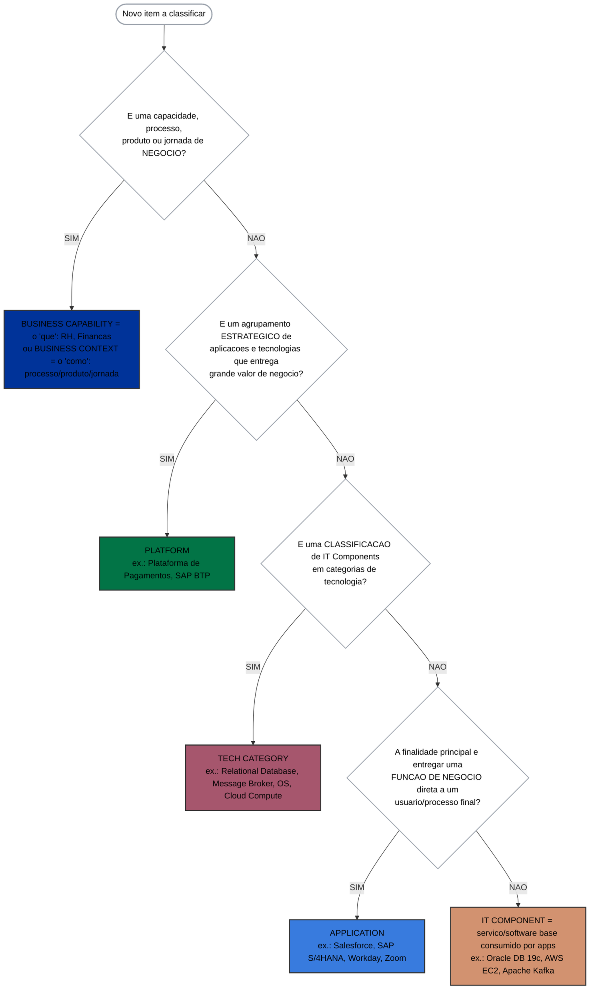

# Árvore de decisão — Platform × Tech Category × Business Context (refinada)

Guia complementar da skill `leanix-classificar-metamodelo` para o **desempate mais confundido do
meta-modelo**: quando um item "agrupa" ou "categoriza" coisas, ele é **Platform**, **Tech Category**,
**Business Capability/Context**, **Application** ou **IT Component**? Esta árvore resolve a confusão
clássica de usar **Platform como se fosse uma camada/categoria técnica** (o antipadrão
`ABB_Aplicacoes` do tenant). **Fonte da verdade: definição oficial de cada tipo na SAP LeanIX v4.**

> Complementa — não substitui — a árvore principal da SKILL.md (Interface → Data Object → P1 → P2 →
> P3). Use esta aqui quando a dúvida for especificamente **Platform × Tech Category × Business
> Context**. Exemplos ancorados na documentação oficial da SAP.

---

## Diagrama

> As cores dos nós seguem o padrão oficial LeanIX (Business `#003399`, Platform `#027446`, Tech
> Category `#A6566D`, Application `#387BDE`, IT Component `#D29270`) — mesma paleta da SKILL.md e de
> `leanix-nucleo` → `references/cores-fact-sheet.md`.

---

## Tabela de decisão

| Se o item é… | → Fact Sheet | Exemplos (fonte SAP) | Cor oficial |
|---|---|---|---|
| O **"o quê"** do negócio (capacidade, independe de como é feita) | **Business Capability** | Recursos Humanos, Finanças, Vendas | `#003399` |
| O **"como/produto"** do negócio (processo, produto, jornada do cliente) | **Business Context** | Processo "Hire to Retire", Business Product, Customer Journey | `#FE6690` |
| Agrupamento **estratégico** de apps e tecnologias de grande valor | **Platform** | Plataforma de Pagamentos, SAP BTP | `#027446` |
| **Classificação de IT Components** em categorias de tecnologia | **Tech Category** | Database, Operating System, Server Software, Networked Storage | `#A6566D` |
| Entrega **função de negócio direta** a um usuário/processo | **Application** | Salesforce, SAP S/4HANA, Workday, Zoom | `#387BDE` |
| **Software/serviço base** consumido por outras aplicações | **IT Component** (+ Provider + Tech Category) | Oracle DB 19c, AWS EC2, Apache Kafka | `#D29270` |

---

## As 4 confusões que esta árvore resolve

**1. Platform × Tech Category (a mais comum — o antipadrão `ABB_Aplicacoes`).**
> **Pela definição oficial SAP v4.** Platform (SAP) = "agrupamentos de capacidades, aplicações ou
> tecnologias **estrategicamente relevantes**". Tech Category (SAP) = "agrupar **IT Components** em
> categorias de tecnologia — ex.: Database, Operating System, Server Software". O termo "ABB" é TOGAF,
> não SAP; o nome `ABB_Aplicacoes` do tenant é justamente o rótulo do antipadrão.
- **Platform** agrupa itens numa **oferta estratégica coesa** que entrega valor de negócio
  (ex.: SAP BTP, Salesforce Platform, uma plataforma de pagamentos da própria organização). O teste:
  *"estas apps/tecnologias juntas formam UMA oferta estratégica?"* → Platform.
- **Tech Category** **classifica IT Components** em categorias de tecnologia (Database, Operating
  System, Server Software). O teste: *"isto é uma categoria de tecnologia que agrupa IT Components,
  não um produto?"* → Tech Category.
- **Sinal de erro:** um Fact Sheet Platform cuja descrição diz "**bloco arquitetônico**", "**camada**"
  ou "**categoria**" e que agrupa apps **só porque têm uma característica técnica em comum** (ex.: "são
  front-end", "são de dados") — não atende a definição SAP de Platform (estratégica) nem de Tech
  Category (classifica IT Components). Agrupamento de apps por função de negócio = **Business
  Capability**.

**2. Platform × Business Capability.**
- Se o agrupamento é do **"o quê" o negócio faz** (ex.: "Gestão de Aprendizagem", "Relacionamento"),
  é **Business Capability** — não Platform. Platform é o **agrupamento de TI/tecnologia** que **suporta**
  (relação *supports*) a capability; não é a capability em si.

**3. Tech Category × CRM/ERP/LMS.**
- CRM, ERP, LMS **não** são Tech Category. São **Application Category** ou **Business Capability**.
- Tech Category é **só infraestrutura** (banco, broker, SO, compute). Um "CRM" é uma classe de
  **aplicação de negócio**, não uma categoria de infra.

**4. Application × IT Component (não se decide por "quem fornece").**
- Decide-se por **função**: software que um **usuário/processo usa** = Application (mesmo sendo de
  terceiro: Salesforce, S/4HANA, Workday, Zoom e o próprio SAP LeanIX são **Application** pela SAP).
- **IT Component** = **system software / serviço / hardware base** que outras aplicações **consomem**
  (Oracle DB, EC2, Kafka, SO, run-time). Se for SaaS que entrega função de negócio **e** precisa
  rastrear custo/hosting → **exceção SaaS** (Application + IT Component placeholder — ver SKILL.md).

---

## Como aplicar junto da árvore principal

1. Rode primeiro a **pré-triagem** da SKILL.md (Interface? Data Object?).
2. Se o item **"agrupa" ou "categoriza"** outros itens e você está em dúvida entre Platform / Tech
   Category / Business — use **esta** árvore (Negócio? → Estratégico? → Classifica IT Components? →
   Função? → Infra base?).
3. Para o desempate final **Application × IT Component**, aplique as heurísticas da SKILL.md
   (critério oficial SAP: função, não fornecedor) e a **Tríade de Ouro** do IT Component.

---

## Fontes (doc oficial SAP LeanIX)

- Platform — [Platform Modeling Guidelines](https://docs-eam.leanix.net/docs/platform-modeling-guidelines):
  "Platforms são agrupamentos de aplicações estrategicamente relevantes, ou de tecnologias, que
  impulsionam simplificação e padronização." *(traduzido/parafraseado para conformidade de licença)*
- Tech Category — [Tech Category Modeling Guidelines](https://docs-eam.leanix.net/docs/tech-category-modeling-guidelines).
- Business Capability / Business Context — [Meta Model v4](https://docs-eam.leanix.net/docs/meta-model).
- Application × IT Component — [Application vs. IT Component](https://docs-eam.leanix.net/docs/application-vs-it-component).

> **Nota de conformidade:** as citações da SAP foram traduzidas/parafraseadas; consulte os links para
> o texto original em inglês.
