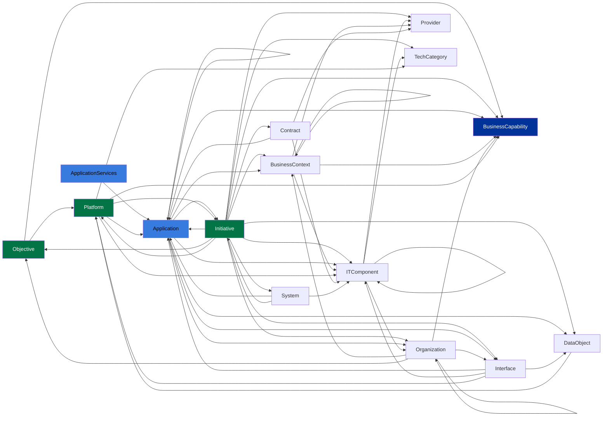

# Estrutura do meta-modelo — tipos, subtipos, camadas, relações e ontologia

Visão **estrutural e conceitual** dos 15 tipos para **entender** cada Fact Sheet, **descobrir fichas a
partir de um repositório** e **ligá-las corretamente**.

> **Os CAMPOS de cada tipo (lista exaustiva com valores de seleção) estão nos
> `templates-por-tipo/TPL-NN-<Tipo>.md`** (fonte de verdade, gerados da API). Este arquivo cobre a
> **estrutura** (subtipos, camada, hierarquia, workflow, regra de nome), o **grafo de relações** e a
> **ontologia** (por que modelar assim). Tags em `tags-grupos-leanix.md`; Tech Categories em
> `tech-categories-leanix.md`.

## 1. Subtipos (`category`), camada, hierarquia, workflow e regra de nome

| Tipo | Camada (v4) | Hierarquia | Workflow de aprovação | Regra de nome | Subtipos (`category`) |
|---|---|---|---|---|---|
| Application | Aplicações & Dados | 3 | MANUAL — exige Responsible + description | `name` + `release` | businessApplication · microservice · Modulo · aiAgent · extension |
| ApplicationServices | Aplicações & Dados | 3 | — | `name` ("verbo+alvo") | (sem subtipo) |
| Interface | Aplicações & Dados | 3 | — | autogera `IF <app provedora> (<seq>)` ou `name`+`release` | api · logicalInterface · Event · ETL · mcpServer |
| DataObject | Aplicações & Dados | 3 | — | `name` | (sem subtipo) |
| ITComponent | Técnica | 3 | MANUAL — exige description | `<Provider> name release` | saas · paas · iaas · software · hardware · service · llm · aiModel |
| TechnicalStack (Tech Category) | Técnica | 5 | — | `name` | tbmStandard |
| Provider | Técnica | 3 | — | `name` | (sem subtipo) |
| Contract | Técnica | 3 | — | `name` | applicationContract · itComponentContract |
| System | Técnica (opcional) | 3 | — | `name` | sap |
| BusinessCapability | Negócio | 3 | — | `name` | (sem subtipo) |
| BusinessContext | Negócio | 4 | — | `name` | valueStream · customerJourney · process · product · Contract |
| Organization | Negócio | 5 | — | `name` | legalEntity · country · businessUnit · team · customer |
| Platform | Estratégia & Transf. | 3 | — | `name` | ABB_Aplicacoes · strategicPlatform |
| Objective | Estratégia & Transf. | 5 | — | `name` | KeyResult |
| Initiative | Estratégia & Transf. | 4 | — | `name` | idea · program · project · epic |

> O **subtipo muda os campos** (condicionais "ativado por category=X"). Decida o subtipo **antes** de
> montar a ficha. Hierarquia = profundidade máxima de parent/child (use com parcimônia: 2–3 níveis, MECE).
> **BASE_FIELDS** (todo tipo): `name` (obrigatório), `displayName` (gerado), `description`, `tags`,
> `subscriptions`, `resources`/`documents`.

## 2. Como o subtipo sai do repositório (gatilhos de descoberta)

### Application
- **aiAgent** — há system prompt/persona, loop de raciocínio, uso de LLM, config de agente (`agent`,
  `mcp.json`, ferramentas). → subtipo AI Agent (+ tag ABB "AI Agent"/"AI Assistant").
- **microservice** — serviço deployável isolado (Dockerfile próprio, `service` em compose, health
  endpoint, um bounded context). → Microservice (+ tag "Service Layer (PaaS + Microservices)").
  **Libera o campo `lxMicroserviceType`** (só existe neste subtipo) — classifique a camada:
  **`backend`** (Back-end: API/worker sem UI) · **`ui`** (UI/Frontend: BFF, micro-frontend, SPA) ·
  **`data`** (Dados: pipeline/ETL/materialização). Sem evidência da camada = lacuna.
- **extension** — plugin/extensão que só amplia um host (SAP BTP, Fiori, plugin). → Extension.
- **Modulo** — módulo funcional de um sistema maior (parent/child). → Modulo.
- **businessApplication** — aplicação lógica de negócio (o caso padrão). → Business Application.

### ITComponent (subtipo = natureza da tecnologia)
- **software** — runtime, linguagem, framework, biblioteca, SGBD instalado (Node, Python, PostgreSQL,
  LangChain). **saas** — serviço SaaS consumido. **paas** — plataforma gerenciada (App Service,
  Functions). **iaas** — infra (VM, EC2). **service** — serviço gerenciado (fila, storage, gateway).
  **llm / aiModel** — modelo/LLM fundacional (GPT-4o, Claude). **hardware** — equipamento físico.
- Versão vai no campo `release`; o nome compõe com Provider + release.

### Interface (subtipo = natureza da troca)
- **api** — endpoint REST/gRPC exposto/consumido. **mcpServer** — servidor MCP (`mcp.json`,
  `mcpServers`). **Event** — tópico/fila de eventos (Kafka, SNS/SQS, pub/sub). **ETL** — pipeline de
  dados em lote. **logicalInterface** — troca lógica sem contrato técnico explícito.

### Interface/Data Object/Provider sem subtipo → decidir pelo conteúdo, não por category.

## 3. Grafo de relações (de → para) — como ligar as fichas

Pares de relação explícita do tenant (origem → destino). Use para **conectar** as fichas descobertas:

Lista completa dos pares origem → destino:
- **Application** → Application, BusinessCapability, BusinessContext, DataObject, Initiative, Interface, ITComponent, Organization
- **ApplicationServices** → Application
- **BusinessContext** → BusinessCapability, BusinessContext, ITComponent, Provider
- **Contract** → Application, ITComponent, Provider
- **DataObject** → Platform
- **Initiative** → BusinessCapability, BusinessContext, Contract, DataObject, Initiative, Interface, ITComponent, Objective, Organization, Provider, System, TechnicalStack
- **Interface** → Application, DataObject, ITComponent, Platform
- **ITComponent** → ITComponent, Organization, Provider, TechnicalStack
- **Objective** → BusinessCapability, Platform
- **Organization** → BusinessCapability, BusinessContext, Interface, Objective, Organization
- **Platform** → Application, BusinessCapability, Initiative, ITComponent, TechnicalStack
- **System** → Application, Initiative, ITComponent

## 4. Ontologia inegociável (para ligar certo)

- **Provider → ITComponent → Application.** Provider liga em ITComponent (`relITComponentToProvider`,
  1:*), nunca direto na Application. **Como a relação é obrigatória, TODO Provider citado num
  ITComponent vira uma ficha de Provider** (`leanix-providers.md`): fornecedor de nuvem (AWS/Azure/GCP),
  fabricante (PostgreSQL GDG, Redis), mantenedor de framework/lib (Spring, Apache, open source nominal).
  Vários ITComponents compartilham o mesmo Provider → **uma ficha por Provider distinto** (reúso, não
  duplicar). Na descoberta, antes de fechar: **deduplicar os provedores citados e conferir que cada um
  tem ficha** (ver o gate "Fechamento de relações" na steering `fichas-leanix-completas`).
- **ITComponent órfão não vale** — nasce com Provider + Tech Category (`relITComponentToTechnologyStack`)
  + Application consumidora (`relITComponentToApplication`).
- **Interface precisa das duas pontas** — provedora (`relInterfaceToProviderApplication`, 1:*) +
  consumidora (`relInterfaceToConsumerApplication`) + Data Object que trafega (`relInterfaceToDataObject`).
- **Capability (o quê) ≠ BusinessContext (como/onde) ≠ Organization (quem).**
- **AI Agent/Microservice/Extension/Modulo** = subtipos de Application; **MCP Server/API/Event/ETL/
  Logical** = subtipos de Interface; **AI Model/llm** = subtipo de ITComponent; **System** não liga a
  Capability/Context/Organization (o contexto passa pela Application).

## 5. Notas de ontologia por tipo (decisões e antipadrões)

- **Application** — nó central (liga negócio e TI). `usersNumber` é obrigatório. Autenticação
  (`lxAuthentication`/`lxOtherAuthentication`) e campos de IA só no subtipo `aiAgent`;
  `lxMicroserviceType` (backend/ui/data) só no subtipo `microservice`. **Agente de IA = subtipo
  `aiAgent`**, não um tipo à parte.
- **ApplicationServices** — comportamento **exposto** da app ("oferta de serviço"), nomeado como
  "verbo + alvo" (ex.: "Emitir boleto"). Não é o software nem o código.
- **Interface** — precisa das **duas pontas** + Data Object. Autenticação via `lxAuthentication` +
  `lxOtherAuthentication` (para HMAC/IAM/RSA-AES/SASL). Endpoints concretos vão **dentro** da ficha
  (não Fact Sheet por rota). Infra (SQS/S3/Neptune/Postgres) pode ser modelada como Interface além de IT Component.
- **DataObject** — **conceito** de negócio (Cliente, Fatura, Matrícula), **não** catálogo de colunas/
  tabelas. Use `dataClassification` (public/sensitive/restricted/confidential); dado pessoal/financeiro
  ≥ restricted; cifrado/cofre = confidential. Mapeie dono (C/U/D) × leitores (R) via `usage`.
- **ITComponent** — **órfão não vale**: nasce com Provider + Tech Category + Application. Versão em
  `release`. Obrigatórios: `category`, `lifecycle`, `lxTechnologyAssessment` (decisão da autoridade
  de arquitetura/governança → lacuna), `lxTechnologyAssessmentCategory` (inferível: Languages/FrameworksLibraries/
  Integration/DataMgmtStorage/Infrastructure/Service/Tooling). Não confundir esse campo com a **Tech
  Category TBM** (relação `relITComponentToTechnologyStack`).
- **TechnicalStack (Tech Category)** — classifica IT Components; use uma das 222 categorias existentes
  (`tech-categories-leanix.md`), não invente.
- **Provider** — **nunca** direto na Application; o caminho é Provider → ITComponent → Application.
- **Contract / System** — ACL restrita. **System** no tenant só tem subtipo `sap` (instância/ambiente
  SAP); agrupamento de produto (Backstage `spec.system`) **não** é System → use BusinessContext/Platform.
- **BusinessCapability × BusinessContext × Organization** — "o quê" × "como/onde" × "quem". Capability
  não é departamento (isso é Organization) nem processo (isso é BusinessContext/process).
- **Platform** — agrupamento **estratégico**; `ABB_Aplicacoes` para blocos de construção de aplicações.
- **Objective/Initiative** — meta × esforço que a muda; Initiative conecta quase tudo (carrega prazo).
- **Dado restrito (TCO/custo)** — campos `tco_*`, `lx*Cost*`, `budget*`, `*TotalCostOfOwnership`,
  `netPresentValue`, `paybackPeriod`, `estimativa_economia`, `valor_total`, `orderedCapex/Opex` **não
  entram** em ficha/relatório (`leanix-nucleo` → `references/seguranca-conteudo.md`). Nos templates por tipo vêm marcados `(RESTRITO)`.
