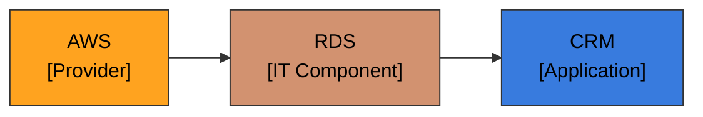

# Cores oficiais do meta-modelo LeanIX em diagramas

**REGRA FIXA.** Todo diagrama/desenho (Mermaid, SVG, HTML, tabela com legenda) cujos **nós representem
tipos de Fact Sheet do LeanIX** DEVE pintar cada nó com a **cor oficial do seu tipo**. Nunca use a
paleta institucional da organização (roxo/amarelo) para os nós de tipo, nem invente cor.

- Texto do nó: **preto `#000000`**. Setas: cinza neutro `#9AA1AB` (pode-se tingir a seta com a cor do
  tipo de destino quando ajudar a leitura).
- Diagrama com 3+ tipos → inclua **legenda** cor → tipo.
- **Escopo:** vale só para nós que **são tipos de Fact Sheet**. Nós de processo/fluxo (etapas, fases)
  usam o tema do documento (paleta institucional da organização).

## Tema do documento (paleta institucional da organização)
Roxo `#5219A1` (foco), amarelo `#FFAD01` (secundário), texto `#1A1A2E`, apoio `#EFE7FB`. Use no tema
visual (cabeçalho, destaques) — **não** para representar tipos de Fact Sheet.

## Cores por tipo de Fact Sheet (fonte da verdade — espelha o seu workspace LeanIX)
| Tipo (técnico) | Rótulo | Hex | Tipo (técnico) | Rótulo | Hex |
|---|---|---|---|---|---|
| `Application` | Aplicação | `#387BDE` | `DataObject` | Objeto de dados | `#774FCC` |
| `Interface` | Interface | `#02AFA4` | `ITComponent` | Componente de TI | `#D29270` |
| `ApplicationServices` | Serviço de aplicação | `#63D1CA` | `Provider` | Provedor | `#FFA31F` |
| `BusinessCapability` | Capacidade de negócio | `#003399` | `TechnicalStack` | Categoria de tecnologia | `#A6566D` |
| `BusinessContext` | Contexto de negócio | `#FE6690` | `Initiative` | Iniciativa | `#33CC58` |
| `Organization` | Organização | `#2889FF` | `Objective` | Objetivo | `#AD5F76` |
| `Platform` | Plataforma | `#027446` | `System` | Sistema | `#5B738B` |

- **Subtipos de Application** (AI Agent, Microservice, Extension) usam a cor de Application; diferencie
  pelo **rótulo**, não por outra cor.
- As cores são **configuráveis por workspace**; se o LeanIX mudar, **prevalece o LeanIX** (reconfirme
  no painel de facetas "Tipo"). Nunca invente cor.

## Exemplo (Mermaid)


### Sintaxe Mermaid — regras que evitam parse error (OBRIGATÓRIO)

Mermaid é sensível à formatação. Diagrama que não renderiza é entregável quebrado. Siga:

1. **Um `classDef` por linha.** NUNCA coloque dois `classDef` na mesma linha nem após `; ` de outra
   instrução. **Errado:** `...color:#000; classDef do fill:#774FCC,...` — isso gera
   `Parse error ... got 'UNICODE_TEXT'`. **Certo:** cada `classDef` na sua própria linha:
   ```
     classDef app fill:#387BDE,stroke:#333,color:#000;
     classDef do fill:#774FCC,stroke:#333,color:#000;
   ```
2. **Um `class` (atribuição) por linha**, pelo mesmo motivo — ou use o sufixo `:::classe` no próprio nó
   (ex.: `APP["..."]:::app`), que é a forma preferida neste projeto.
3. **`<br/>` dentro de rótulo** sempre entre aspas: `NODE["linha1<br/>linha2"]`.
4. **Cor em hex com `#`** e `classDef` terminando em `;`. Não use a vírgula final nem espaço antes do `#`.
5. **Bloco fechado** com a cerca ```` ``` ```` e o idioma `mermaid` na abertura.

> Regra prática ao gerar o diagrama: **quebre linha a cada `classDef` e a cada `class`**. Se precisar
> compactar para caber, compacte os **nós/arestas**, nunca os `classDef`. Vale para TODA skill que
> emite Mermaid (fichas LeanIX, C4, laudos, HTML institucional).
