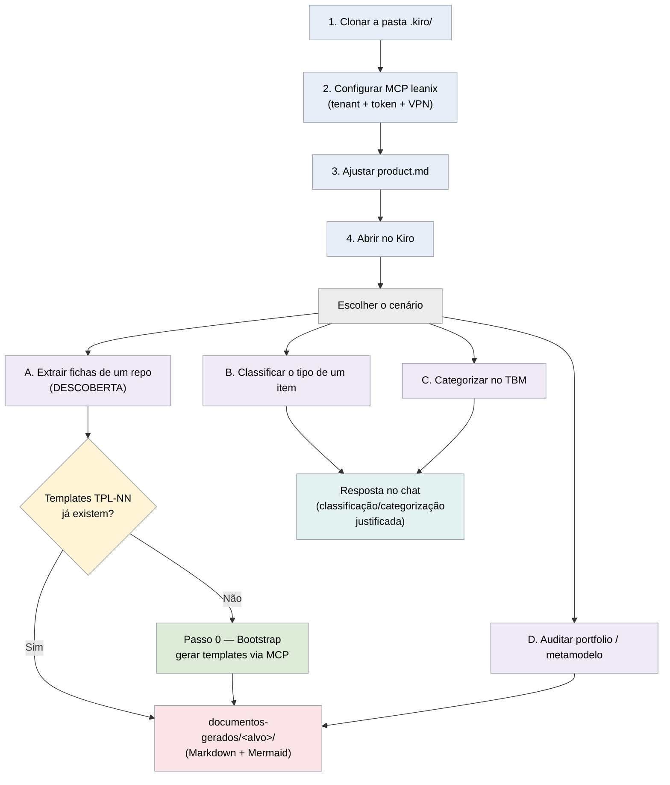

# Template Kiro — LeanIX a partir de um repositório

Template de projeto para o **Kiro** apoiar o trabalho de meta-modelo do **SAP LeanIX** a partir de um
**repositório de desenvolvimento**. O Kiro varre o repositório (código e/ou documentos) e cobre quatro
frentes, sempre **somente leitura** (recomenda e entrega; o cadastro no LeanIX é manual):

1. **Extrair as fichas do repositório** — identifica todos os Fact Sheets que o sistema geraria
   (Application, IT Components, Interfaces, Data Objects, Provider…) e monta cada ficha campo a campo.
2. **Identificar que tipo de ficha é um item** — decide o tipo correto no meta-modelo pela árvore de
   decisão oficial.
3. **Categorizar os componentes de TI no TBM** — classifica cada IT Component na Tech Category (TBM v5)
   correta.
4. **Auditar o catálogo** — portfólio (TIME, 6R, obsolescência) e metamodelo (completude e associações
   obrigatórias).

Empacota, em `.kiro/`, as **skills**, os **steerings**, os **hooks** (guardas de bootstrap, completude
e fechamento de relações) e a configuração de **MCP** do LeanIX, para você clonar e começar um novo
projeto já com a base de conhecimento e as regras ativas.

> Este repositório é um **template reutilizável**. A pasta `.kiro/` é o que importa para derivados.
> A pasta `documentos-gerados/` é só material de trabalho (saída) e **não** precisa ser copiada.

> ⚠️ **Sobre a pasta `repo/produto-service/`.** O `produto-service` **não é um sistema real**: foi
> criado artificialmente, gerado por IA, apenas para servir de **alvo de teste** e validar as skills
> de descoberta do LeanIX deste template. Não está em produção e não deve ser usado como referência de
> segurança ou de implementação — credenciais e configurações presentes nele são exemplos fictícios do
> cenário de teste.

---

## Por que esta PoC existe — do catálogo obsoleto ao ecossistema mapeado

O inventário da arquitetura existe no papel, mas a realidade operacional está quilômetros à frente do
que está documentado. Esse é o retrato de quase todo catálogo de arquitetura corporativa: um ecossistema
inteiro rodando na sombra de um punhado de Fact Sheets desatualizados. Esta PoC propõe uma abordagem para
sair de um catálogo obsoleto para um mapa rico e detalhado do ecossistema de TI em poucos dias — com a
**governança sempre nas mãos do ser humano**.

### 🎯 Por que mapear o legado 100% no SAP LeanIX é inegociável

O SAP LeanIX não é um "repositório" estático; é o motor de decisão estratégica da TI. Sem o inventário
completo, a empresa perde a capacidade de:

- **Conectar TI e Negócio** — saber qual aplicação suporta qual Business Capability.
- **Racionalizar o portfólio** — achar sistemas redundantes que custam caro e podem ser desativados.
- **Gerenciar ciclo de vida e risco** — prever quando uma tecnologia (banco, framework) fica sem suporte,
  evitando falhas de segurança.

Um catálogo atualizado é o que permite responder à pergunta crítica: *"se desligarmos este servidor ou
migrarmos este serviço, o que para na empresa?"*

### 🛑 O risco invisível: a dependência do preenchimento manual

A defasagem do catálogo não é falha de execução das equipes — é falha de **design** do modelo atual. Hoje
o registro de cada novo sistema depende de alguém lembrar de documentá-lo manualmente sob a pressão das
entregas. Resultado: o catálogo já nasce obsoleto, a governança vira arqueologia manual e decisões passam
a ser tomadas sobre ficção, abrindo brecha para Shadow IT e retrabalho.

### 🔄 Como a IA resolve: de "Documentar" para "Descobrir"

Em vez de onerar arquitetos e desenvolvedores com documentação manual, o agente de IA **lê o legado e
mapeia os componentes de forma autônoma**. Ele atua como um "arquiteto júnior incansável": vasculha os
repositórios de desenvolvimento e varre, em segundos, código-fonte, arquivos de configuração (ex.:
`pom.xml`, `docker-compose`), contratos de API (OpenAPI/Swagger) e documentação em Markdown. A partir
dessa leitura, a IA:

- **Extrai** os elementos arquiteturais invisíveis a olho nu;
- **Classifica** o que é Interface, Application ou IT Component;
- **Constrói** a teia de relações (quem consome o quê);
- **Gera** um relatório estruturado recomendando a criação das fichas.

### 🛡️ A regra de ouro: a revisão humana evita o caos e a duplicidade

Se a IA é tão rápida, por que não cadastra tudo sozinha no LeanIX? Para evitar o caos das duplicidades.
A IA lê código muito bem, mas não tem o contexto de negócio que só a equipe possui. Ela poderia achar um
`DB_01` no código e criar um componente novo — quando o arquiteto sabe que `DB_01` é o *Customer Master
DB* já cadastrado há dois anos. Por isso **a IA propõe, mas o humano reconcilia e aprova**. A revisão
humana é o filtro para:

- **Evitar duplicados** — cruzar a recomendação com o que já existe via **MCP**, fundindo informação em
  vez de criar lixo no sistema.
- **Preencher lacunas de negócio** — Business Owner, criticidade corporativa e afins, que a IA não deduz
  do código.
- **Garantir a governança** — nenhum robô altera a base de produção sozinho.

Por isso o template é **somente leitura por padrão**: as skills entregam as fichas e recomendam; o
cadastro no LeanIX é manual, pela equipe responsável (ver steering `read-only-por-padrao`).

### 🧩 Visibilidade de ponta a ponta — muito além das APIs

O erro comum é limitar o *discovery* ao mapeamento de APIs. Aqui a IA extrai **todo** o ecossistema e
entrega os Fact Sheets prontos para validação:

- 📦 **Application** — o sistema ou serviço core (ex.: Motor de Pagamentos).
- ⚙️ **IT Component** — frameworks e bases de dados (ex.: Spring Boot, PostgreSQL).
- 🔌 **Interface** — APIs expostas e consumidas.
- 📄 **Data Object** — as entidades transacionadas (ex.: Pedido, Cliente).
- ☁️ **Provider** — provedores de infraestrutura e mantenedores (ex.: AWS, Spring).

Como a IA mapeia dependências nativamente, o catálogo nasce como um **grafo de arquitetura navegável**,
não como uma lista inútil de ativos soltos.

### 🛠️ Prova de Conceito incluída — `produto-service`

Este repositório **é** o framework da PoC: traz o system prompt (steering), as regras de negócio e a
árvore de decisão do SAP LeanIX, de forma aberta, para líderes de TI e arquitetos homologarem o conceito
no próprio ambiente. Basta aplicar esta arquitetura de instruções no LLM seguro da sua organização,
apontar para um repositório legado e **auditar a geração dos Fact Sheets antes de qualquer integração
sistêmica**.

Para você ver o resultado sem configurar nada, o template já inclui um **exemplo executado**: o
microsserviço fictício `repo/produto-service/` (Java/Spring Boot) e as fichas que a descoberta gerou a
partir dele, em [`documentos-gerados/produto-service/`](documentos-gerados/produto-service/). A partir de
um único serviço, o agente extraiu o ecossistema completo:

| Tipo de Fact Sheet | Fichas geradas (exemplo `produto-service`) |
|---|---|
| 📦 Application | 1 (`produto-service`, subtipo `microservice`) |
| 🔌 Interface | 3 (`produto-service-api`, `estoque.movimentos`, `viacep-api`) |
| ⚙️ IT Component | 17 (Spring Boot + starters, Flyway, PostgreSQL, Redis, Kafka, Lombok, MapStruct…) |
| 📄 Data Object | 3 (Produto, Endereço, Evento de Estoque) |
| ☁️ Provider | 11 (AWS, Spring, Redgate, PostgreSQL GDG, Apache, ViaCEP…) |
| 🧩 Business Capability | 1 (Gestão de catálogo) |
| 👥 Organization | 1 (Squad Catálogo) |

O resultado é a **ontologia instanciada** — um grafo navegável com as cores oficiais por tipo, onde cada
nó é um Fact Sheet e cada aresta uma relação (quem consome o quê, quem mantém o quê). É o salto da lista
de ativos soltos para o mapa real do ecossistema.

> **Como reproduzir:** abra o projeto no Kiro e peça *"leia o repositório `repo/produto-service` e gere
> todas as fichas LeanIX"* (ver [Cenário A](#cenário-a--extrair-as-fichas-de-um-repositório-modo-descoberta)).
> O caminho mais curto entre a arquitetura teórica e o ecossistema prático não é cobrar mais
> preenchimentos manuais — é **automatizar a descoberta com IA e governar com sabedoria humana**.

---

## O que vem no template

| Recurso | Qtde | Onde | O que é |
|---|---|---|---|
| **Skills** | 6 | `.kiro/skills/` | `leanix-*` (PT-BR): extração de fichas, classificação (tipo e TBM), auditoria (portfólio e metamodelo) + núcleo |
| **Steerings** | 8 | `.kiro/steering/` | Regras do projeto (5 sempre ativas + 3 por contexto) |
| **Hooks** | 3 | `.kiro/hooks/` | Guardas de qualidade (Node, cross-platform): aviso de bootstrap (`SessionStart`), guarda de completude das fichas (`PreToolUse`) e fechamento de relações de Provider (`PostFileSave`) |
| **MCP** | 1 | `.kiro/settings/mcp.json` | Servidor `leanix` (SAP LeanIX via HTTP) |
| **Exemplo** (demo) | 1 | `repo/produto-service/` + `documentos-gerados/produto-service/` | Microsserviço fictício Java/Spring Boot + as fichas que a descoberta gerou dele — material de demonstração, **não** faz parte do produto `.kiro/` |

### Skills (6 skills `leanix-*`)
- **`leanix-descoberta-fichas`** — extrai os dados de um repositório e gera as fichas dos tipos de
  Fact Sheet (15 tipos padrão; confirme a lista real do seu tenant via MCP), campo a campo (modo
  **DESCOBERTA** varre o repo; modo **FICHA** monta/valida um item).
- **`leanix-classificar-metamodelo`** — decide que tipo de ficha é um item pela árvore de decisão oficial
  (vem **antes** da ficha).
- **`leanix-classificar-categoria-tbm`** — categoriza um componente de TI na Tech Category (TBM v5) correta.
- **`leanix-auditar-portfolio`** — estratégia de portfólio: valor × risco, TIME, 6R, obsolescência,
  redundância, racionalização.
- **`leanix-auditar-metamodelo`** — audita completude e associações obrigatórias do catálogo (ecossistema
  inteiro ou 1 app).
- **`leanix-nucleo`** — biblioteca base: cores oficiais por tipo, grounding, ontologia e segurança de
  conteúdo. Referenciada pelas demais; não é acionada diretamente.

Detalhe de cada skill: [`.kiro/skills/README.md`](.kiro/skills/README.md) e
[`.kiro/skills/INDEX.md`](.kiro/skills/INDEX.md).

### Steerings (regras de trabalho)
**Sempre ativas (universais):**
- `product.md` — identidade e filosofia do agente *(ajustar por projeto)*
- `encoding-utf8.md` — UTF-8 sem BOM em todo arquivo
- `read-only-por-padrao.md` — consulta/análise não escreve; escrita exige confirmação
- `seguranca-segredos.md` — segredos em cofre, PII fora de log, TCO restrito
- `entrega-e-saida.md` — PT-BR, Resumo Executivo + Próximo Passo, saída em `documentos-gerados/`

**Por contexto (`inclusion: auto`, disparam quando o assunto casa):**
- `validacao-leanix.md` — cruzar doc oficial SAP + dado real via MCP, citar as fontes
- `cores-metamodelo-leanix.md` — cores oficiais dos tipos de Fact Sheet para diagramas
- `fichas-leanix-completas.md` — fichas detalhadas campo a campo, nada resumido

### Hooks (3 guardas de qualidade)
Todos rodam via **Node** (cross-platform: Windows, macOS e Linux), são **informativos** e **nunca
bloqueiam** a sessão por erro próprio.

- **`leanix-bootstrap-templates.json`** (`SessionStart`) — ao abrir o projeto, verifica se os templates
  por tipo (`TPL-NN`) já foram baixados do tenant. Enquanto a pasta estiver em **bootstrap** (só
  `_MODELO-DO-TEMPLATE.md` + `_INDICE.md`), o hook lembra o agente de **sugerir conectar o MCP `leanix` e
  gerar a estrutura do meta-modelo** (Passo 0) logo no início da sessão. Assim que os `TPL-NN` existem,
  o hook fica **silencioso**. Detecção via `leanix-bootstrap-check.js`. A mesma orientação também está no
  steering sempre ativo `product.md`, então vale mesmo sem o hook.
- **`leanix-completude-fichas.json`** (`PreToolUse`, antes de `fs_write`/`str_replace`/`fs_append`) —
  guarda da regra de completude (steering `fichas-leanix-completas`). Antes de gravar um entregável de
  ficha (`leanix-*.md` ou `fichas-leanix.md` em `documentos-gerados/`), inspeciona o texto em busca de
  frases que **resumem** fichas em vez de detalhar cada uma ("demais seguem o mesmo padrão",
  "representativa", reticências de omissão). Se achar, devolve uma decisão **`ask`** para você confirmar
  antes de gravar. Detecção via `leanix-completude-check.js`.
- **`leanix-fechamento-relacoes.json`** (`PostFileSave`) — guarda do fechamento de relações (passo 6 da
  steering `fichas-leanix-completas`). Depois de salvar uma ficha, cruza os provedores citados em
  `leanix-itcomponents.md` (relação obrigatória `relITComponentToProvider`) com as fichas em
  `leanix-providers.md` e **avisa** se houver Provider citado sem ficha correspondente. Detecção via
  `leanix-fechamento-relacoes-check.js`. A normalização de apelidos é **limitada** (hoje só "AWS" →
  "Amazon Web Services" e "PostgreSQL GDG" → "PostgreSQL"); outros nomes variantes (Azure, GCP, Oracle…)
  podem gerar falso aviso — amplie a lista de apelidos no `.js` conforme o seu tenant.

---

## Como criar um novo projeto a partir deste template

### 1. Copie a pasta `.kiro/` inteira

É a única coisa essencial. Dentro do seu novo projeto:

```
<novo-projeto>/
├── .kiro/
│   ├── skills/      (as 6 skills + INDEX.md, README.md)
│   ├── steering/    (os 8 steerings)
│   ├── hooks/       (3 guardas .json + seus .js: bootstrap, completude das fichas, fechamento de relações)
│   └── settings/
│       └── mcp.json (servidor leanix)
├── .gitignore       (bloqueia .env* e o token; leve junto)
├── .editorconfig    (UTF-8 + lf/crlf; leve junto)
└── .env.example     (modelo das variáveis LEANIX_TENANT / LEANIX_API_TOKEN)
```

Além do `.kiro/`, leve também o `.gitignore`, o `.editorconfig` e o `.env.example` da raiz — são o que
protege o token e fixa o encoding no projeto novo. O `LICENSE` (MIT) é opcional: ajuste ou substitua
conforme a política do seu projeto.

**NÃO copiar (material de trabalho/demonstração, não do produto):**
- `documentos-gerados/` — pasta de **saída** onde o agente grava as fichas. No template ela traz o
  exemplo `produto-service/` (resultado da PoC); num projeto novo, comece-a vazia (só `.gitkeep`).
- `repo/produto-service/` — microsserviço **fictício** usado só para demonstrar a descoberta. Troque pelo
  seu repositório-alvo real (ou aponte o caminho dele ao Kiro).

### 2. Configure o MCP do LeanIX

Em `.kiro/settings/mcp.json`, o servidor `leanix` já está declarado (tipo HTTP, com `url` e `headers`).
Você só precisa apontá-lo para o **seu tenant**:

- O `mcp.json` usa duas variáveis de ambiente: `${LEANIX_TENANT}` (subdomínio do seu workspace) e
  `${LEANIX_API_TOKEN}` (token de API). A `url` resolve para
  `https://${LEANIX_TENANT}.leanix.net/services/mcp-server/v1/mcp` — defina `LEANIX_TENANT` com o seu
  subdomínio (ou troque o placeholder direto na `url`, se preferir).
- O token vai no header de autorização via `${LEANIX_API_TOKEN}`. **Nunca** cole o valor do token em
  código, README ou resposta — mantenha-o em variável de ambiente. O `.gitignore` da raiz já bloqueia
  `.env*` e um `mcp.local.json`, mas o próprio `mcp.json` é versionado: **não** escreva o token nele.
- Copie o `.env.example` da raiz para `.env`, preencha as duas variáveis e reconecte o servidor pela
  view de MCP do Kiro.

> O MCP é **opcional** para boa parte do fluxo: as skills trazem o meta-modelo de referência embutido e
> funcionam sem VPN/MCP. Com o MCP, elas confirmam campos/valores ao vivo, reusam Fact Sheets por ID e
> habilitam as auditorias de catálogo (que leem o tenant real).

### 3. Ajuste o que é específico deste projeto

- **`.kiro/steering/product.md`** — reescreva a identidade/filosofia para o seu novo projeto (é
  `always`, então vale desde a primeira sessão).
- **Templates de ficha por tipo** — a pasta
  `.kiro/skills/leanix-descoberta-fichas/references/templates-por-tipo/` vem em **estado de bootstrap**:
  só o `_MODELO-DO-TEMPLATE.md` (estrutura canônica) e o `_INDICE.md` (mapa dos tipos), **sem** os
  `TPL-NN`. Você os gera do **seu** tenant via MCP na primeira execução — ver "Passo 0" abaixo. A
  geração preenche a data real da extração, o que destrava a regra de "janela de frescor de 30 dias"
  (a skill avisa quando os templates ficam defasados e sugere revalidar via MCP).

### 4. Abra o projeto no Kiro

As skills ativam por contexto (o Kiro lê o `description` de cada uma); os steerings `always` entram em
toda sessão e os `auto` quando o assunto casa.

---

## Como executar (passo a passo)

Você conversa com o Kiro em linguagem natural (PT-BR) e ele escolhe a skill certa pela sua intenção.
Abaixo, o fluxo por cenário. Em todos, a entrega é **recomendação/ficha** — o cadastro no LeanIX é manual.



> As cores acima são **temáticas de processo** (etapas do fluxo), não as cores oficiais de tipos de Fact
> Sheet — estas valem só em diagramas cujos nós representam tipos (ver `leanix-nucleo` →
> `references/cores-fact-sheet.md`).

### Passo 0 — Primeira execução: gerar os templates de ficha (bootstrap)

O template vem **sem** os templates por tipo (`TPL-NN`) — só com o modelo de estrutura
(`_MODELO-DO-TEMPLATE.md`) e o índice. Ao abrir o projeto pela primeira vez, o hook `SessionStart` já
**avisa** que os templates não foram baixados e sugere este Passo 0. Antes de extrair fichas pela
primeira vez, gere os `TPL-NN` do **seu** tenant:

1. Garanta o **MCP `leanix` conectado** (token + VPN) — é obrigatório aqui, pois os campos reais vêm do
   meta-modelo ao vivo.
2. Peça ao Kiro, por exemplo:
   > "Os templates por tipo estão vazios. Conecte no MCP do LeanIX e gere os templates do meta-modelo."
3. O Kiro lê o `_MODELO-DO-TEMPLATE.md`, puxa o meta-modelo (`get_fact_sheet_types` +
   `get_workspace_context`) e **gera um `TPL-NN-<Tipo>.md` por tipo** com todos os campos, opções e
   relações, preenchendo a **data real** da extração e regenerando o `_INDICE.md`.

> Sem MCP/VPN não dá para gerar os templates (o Kiro avisa e não inventa campos). Você ainda pode usar a
> classificação de tipo e a categorização TBM, que não dependem dos `TPL-NN`.

### Cenário A — Extrair as fichas de um repositório (modo DESCOBERTA)

1. Tenha o repositório-alvo acessível (abra-o no workspace, ou aponte o caminho/pasta).
2. Peça: *"Leia o repositório `<caminho>` e gere todas as fichas LeanIX."*
3. O Kiro varre o fonte, identifica os Fact Sheets (Application, IT Components, Interfaces, Data
   Objects, Provider…), monta cada ficha **campo a campo** com diagrama, e salva em
   `documentos-gerados/<alvo>/`.
4. Revise as **lacunas** marcadas (campos sem evidência no fonte) e os itens "a validar via MCP".

### Cenário B — Saber que tipo de ficha é um item (classificação de tipo)

1. Peça: *"Em que tipo de Fact Sheet isto se encaixa: `<descrição do item>`?"*
2. O Kiro decide pela árvore de decisão oficial (Interface → Data Object → Application × IT Component →
   Platform/Tech Category/Business Capability) e **justifica**. Não precisa de MCP.

### Cenário C — Categorizar um componente de TI no TBM

1. Peça: *"Em qual Tech Category (TBM v5) entra o componente `<nome>`?"* (aceita um ou vários).
2. O Kiro pesquisa a função técnica real, retorna a categoria **primária** e as **secundárias** com
   justificativa e confiança; com MCP, confirma contra o catálogo do tenant.

### Cenário D — Auditar o catálogo

1. **Portfólio:** *"Audite o portfólio do catálogo (TIME, 6R, obsolescência, redundância)."*
2. **Metamodelo:** *"Audite a completude e as associações obrigatórias do metamodelo."*
3. Essas auditorias **leem o tenant real** — requerem **MCP + VPN**. O Kiro distingue achado conclusivo
   de lacuna de dados e cita os Fact Sheets (ID + nome).

> **Onde sai o resultado:** tudo que é de um alvo (repositório/sistema) vai para
> `documentos-gerados/<alvo>/`; o genérico/transversal fica na raiz de `documentos-gerados/`. Formato
> Markdown (com Mermaid), UTF-8 sem BOM.

---

## Princípios que o template já impõe

- **Somente leitura por padrão** — o agente consulta, **entrega as fichas** e **recomenda**; qualquer
  escrita (LeanIX ou arquivos fora de `documentos-gerados/`) pede confirmação. O cadastro no LeanIX é
  **manual, pela equipe responsável**.
- **Grounding** — dado real do LeanIX vem do MCP (nunca de memória); conceito vem da doc oficial SAP e
  das referências do núcleo. Sem evidência = lacuna de dados.
- **Segurança** — segredos em cofre/env (referidos por nome), PII fora de log, dados de custo (TCO)
  restritos.
- **UTF-8 sem BOM** em tudo; no Windows/PowerShell, gravar via `.NET WriteAllText` (não
  `Set-Content -Encoding utf8`, que insere BOM).
- **Fonte única** — as regras de LeanIX (cores, grounding, ontologia, segurança) vivem na skill-núcleo
  `leanix-nucleo`; os steerings de LeanIX reforçam.

---

## Requisitos

- **Kiro** (IDE) com suporte a Agent Skills, steering e MCP.
- **MCP `leanix` + VPN** (token do tenant) — necessário para: gerar os templates de ficha na primeira
  execução (Passo 0), as auditorias de catálogo (portfólio e metamodelo, que leem o tenant real) e
  confirmar campos/valores e reusar Fact Sheets por ID ao vivo.
- **Sem MCP/VPN** continuam funcionando: a **classificação de tipo** (Cenário B) e a **categorização
  TBM** (Cenário C), que não dependem do catálogo real. A **extração de fichas** (Cenário A) precisa dos
  `TPL-NN` já gerados (Passo 0) — sem eles, o Kiro declara a limitação e não inventa campos.

## Quadro rápido — o que cada cenário precisa

| Cenário | Skill | Precisa de MCP/VPN? |
|---|---|---|
| Passo 0 — gerar templates (bootstrap) | `leanix-descoberta-fichas` | **Sim** (obrigatório) |
| A — extrair fichas de um repo | `leanix-descoberta-fichas` | Recomendado (templates via Passo 0; confirmação ao vivo) |
| B — classificar o tipo de um item | `leanix-classificar-metamodelo` | Não |
| C — categorizar no TBM | `leanix-classificar-categoria-tbm` | Opcional (confirma contra o tenant) |
| D — auditar portfólio/metamodelo | `leanix-auditar-portfolio` / `leanix-auditar-metamodelo` | **Sim** (lê o tenant real) |

---

## Troubleshooting

Problemas comuns e como resolver.

| Sintoma | Causa provável | O que fazer |
|---|---|---|
| **MCP `leanix` não conecta / tools não aparecem** | VPN fora do ar, `LEANIX_TENANT`/`LEANIX_API_TOKEN` não definidos, ou token expirado | Confirme a VPN; cheque se as variáveis estão no seu `.env` (copie de `.env.example`); gere um token novo no LeanIX se expirou; reconecte o servidor pela view de MCP do Kiro. |
| **`401 Unauthorized` do MCP** | Token inválido/sem permissão, ou header montado errado | Valide o token no LeanIX (Administration → API Tokens). O header é `Authorization: Token ${LEANIX_API_TOKEN}` — o valor vem da env var, nunca escrito no `mcp.json`. |
| **URL do MCP aponta para `${LEANIX_TENANT}`** | Variável de ambiente não resolvida | Defina `LEANIX_TENANT` (ex.: `acme` para `acme.leanix.net`) no `.env`, ou substitua o placeholder direto na `url` do `mcp.json`. |
| **Extração de fichas não traz os campos (Cenário A)** | Pasta `templates-por-tipo/` ainda em **bootstrap** (sem `TPL-NN`) | Rode o **Passo 0** com MCP+VPN para gerar os templates do seu tenant. Sem MCP, só os Cenários B e C funcionam; o Kiro não inventa campos. |
| **Acentos quebrados (`ç`, `ã`) nos arquivos gerados** | Arquivo gravado em encoding errado (cp1252) ou com BOM | O projeto é **UTF-8 sem BOM**. No PowerShell, grave com `[System.IO.File]::WriteAllText(...)` — não `Set-Content -Encoding utf8` (insere BOM). Ver steering `encoding-utf8`. |
| **Diagrama Mermaid não renderiza (parse error)** | `classDef`/sintaxe inválida, ou caractere especial sem escape (`<`, `>`) | Confira o bloco ```` ```mermaid ````; escape `<`/`>` como `&lt;`/`&gt;` dentro dos rótulos. |
| **Hook não dispara** | Node ausente no PATH, ou o caminho/trigger não bateu | Os hooks usam Node (vem com o Kiro). Confira o `trigger`/`matcher` no `.json` e que o `.js` existe em `.kiro/hooks/`. Os hooks nunca bloqueiam por erro próprio (saem em `exit 0`). |
| **Hook de completude pediu confirmação (`ask`) sem motivo** | O texto tinha frase de resumo proibida ("demais seguem o mesmo padrão", "representativa", reticências de omissão) | É o guarda da steering `fichas-leanix-completas`. Se **não** for um conjunto de fichas (ex.: nota metodológica), confirme; senão, detalhe cada ficha campo a campo. |

---

## Licença

Distribuído sob a **Licença MIT**. Veja o arquivo [`LICENSE`](LICENSE) para o texto completo.
