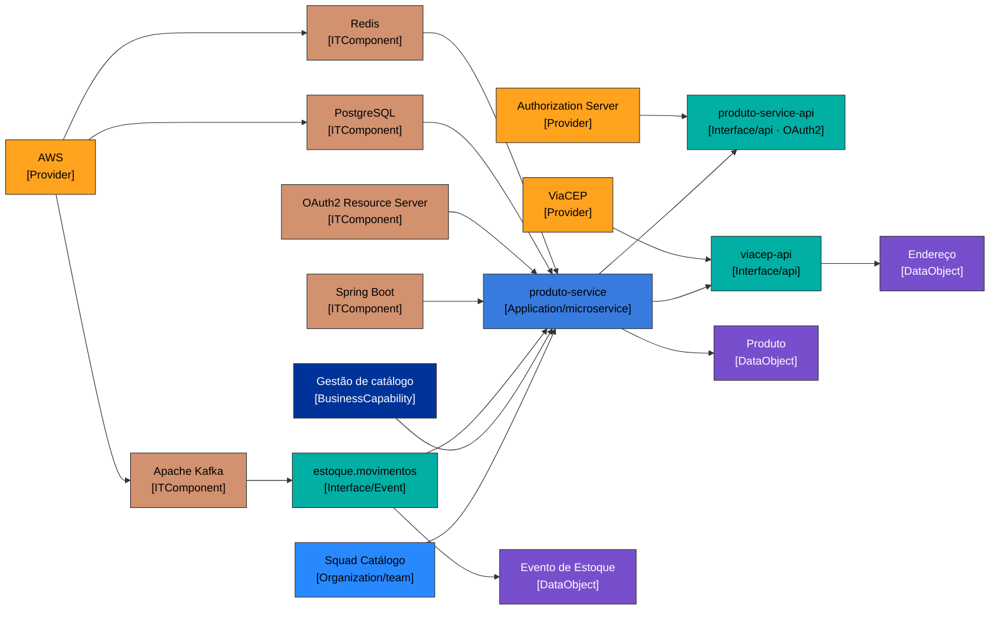

# Fichas LeanIX — descoberta do repositório `produto-service`

> **Alvo varrido:** `repo/produto-service` (sistema Java de exemplo) — **2026-11-02**.
> **Modo:** DESCOBERTA. **Somente leitura:** recomendação; o cadastro no LeanIX é manual, pelo time. Meta-modelo extraído do tenant em 2026-11-02 (templates `TPL-NN`).
> **Agrupamento:** 1 Application (`produto-service`, subtipo `microservice`) → um conjunto nesta pasta.

---

## 0. Evidência coletada (E1…En)

| # | Sinal | Valor | Origem (arquivo:trecho) |
|---|---|---|---|
| E1 | Nome/propósito do sistema | "CRUD de Produto com consumo de evento Kafka, cache/idempotencia Redis e integracao ViaCEP" | `pom.xml:artifactId=produto-service/description`; `README.md` |
| E2 | Tipo (catálogo) | `spec.type: service`; label `framework: spring-boot` | `catalog-info.yaml:spec.type/labels` |
| E3 | Linguagem / versão | Java 21 | `pom.xml:java.version`; `Dockerfile:temurin-21` |
| E4 | Framework base | Spring Boot 3.3.5 | `pom.xml:spring-boot-starter-parent 3.3.5` |
| E5 | Subtipo de app | microservice/backend (serviço REST deployável isolado, sem UI) | `pom.xml:spring-boot-starter-web`; `Dockerfile`; `README.md:Arquitetura` |
| E6 | API REST exposta | `produto-service-api` — `/api/v1/produtos` (POST/GET/GET-id/PUT/DELETE) + `/actuator/health` + `/swagger-ui.html` | `controller/ProdutoController.java`; `openapi.yaml`; `catalog-info.yaml:providesApis` |
| E7 | Idempotência REST | header `Idempotency-Key` no POST (Redis SET NX + TTL 24h) | `controller/ProdutoController.java:criar`; `idempotency/IdempotencyService.java` |
| E8 | Evento Kafka consumido | tópico `estoque.movimentos`, payload EstoqueEvent (eventId/sku/delta/origem) | `kafka/EstoqueEventConsumer.java:@KafkaListener`; `kafka/EstoqueEvent.java`; `application.yml:kafka.topicos` |
| E9 | Idempotência do consumer | por `eventId` (Redis), não reaplica delta em reentrega | `kafka/EstoqueEventConsumer.java:consumir` |
| E10 | Integração ViaCEP | `GET /ws/{cep}/json/` para enriquecer endereço de origem; resultado cacheado | `client/ViaCepClient.java`; `config/RestClientConfig.java`; `catalog-info.yaml:consumesApis=viacep-api` |
| E11 | Cache (Redis) | caches `produtos` (TTL 5min) e `enderecos` (TTL 7d) | `config/RedisCacheConfig.java`; `service/ProdutoService.java:@Cacheable/@CacheEvict` |
| E12 | Banco relacional | PostgreSQL (JPA/Hibernate), DB `produtos` | `pom.xml:postgresql`; `application.yml:datasource`; `domain/Produto.java` |
| E13 | Migrations | Flyway (`V1__cria_tabela_produto.sql`) | `pom.xml:flyway-core/flyway-database-postgresql`; `src/main/resources/db/migration` |
| E14 | Mensageria | Apache Kafka (spring-kafka), ack manual | `pom.xml:spring-kafka`; `config/KafkaConsumerConfig.java` |
| E15 | Entidade de dados | Produto (tabela `tb_produto`): sku, nome, preço, estoque, endereço de origem | `domain/Produto.java`; `V1__cria_tabela_produto.sql` |
| E16 | Objeto de dados externo | Endereço ViaCEP (cep/logradouro/bairro/localidade/uf) | `dto/EnderecoViaCep.java` |
| E17 | Objeto de dados de evento | EstoqueEvent (eventId/sku/delta/origem) | `kafka/EstoqueEvent.java` |
| E18 | Observabilidade | Spring Boot Actuator (health/info/metrics) | `pom.xml:spring-boot-starter-actuator`; `application.yml:management` |
| E19 | OpenAPI | springdoc-openapi 2.6.0 | `pom.xml:springdoc-openapi-starter-webmvc-ui 2.6.0`; `config/OpenApiConfig.java` |
| E20 | Mapeamento / utilitários | Lombok; MapStruct 1.6.3 | `pom.xml:lombok/mapstruct`; `mapper/ProdutoMapper.java` |
| E21 | Hospedagem/deploy | container (Dockerfile temurin-21-jre); cloud `aws` (catalog); compose local | `Dockerfile`; `docker-compose.yml`; `catalog-info.yaml:labels.cloud` |
| E22 | Dono / time | `group:default/squad-catalogo`; system `catalogo-produtos` | `catalog-info.yaml:spec.owner/system` |
| E23 | Contato API | "Time de Catalogo" | `openapi.yaml:info.contact.name`; `config/OpenApiConfig.java` |
| E24 | CODEOWNERS/AUTHORS | não encontrados | busca no repo |
| E25 | Ciclo de vida | `lifecycle: production` | `catalog-info.yaml` |
| E26 | Versão | 1.0.0 | `pom.xml:version`; `openapi.yaml:info.version` |
| E27 | Validação de entrada | Bean Validation nos DTOs; CEP só 8 dígitos | `dto/ProdutoRequest.java` |
| E28 | PII/LGPD | o endereço de origem é do produto (não de pessoa); sem dado pessoal evidente no fonte | `domain/Produto.java` |
| E29 | Capacidade de negócio | gestão de catálogo de produtos (cadastro + estoque) | `README.md`; `catalog-info.yaml:system=catalogo-produtos` |
| E30 | Autenticação (OAuth2) | API protegida por OAuth2 Resource Server (JWT Bearer); issuer configurável; scopes `produtos:read`/`produtos:write` | `config/SecurityConfig.java`; `pom.xml:spring-boot-starter-oauth2-resource-server`; `application.yml:spring.security.oauth2.resourceserver.jwt.issuer-uri`; `openapi.yaml:securitySchemes` |

---

## Inventário de fichas

| Fact Sheet | Tipo / Subtipo | Nome | Tags | Status | Reúso por ID (tenant) | Origem |
|---|---|---|---|---|---|---|
| App | Application / `microservice` | produto-service | java; spring-boot; Service Layer | criar | reúso a confirmar via MCP | E1,E2,E5 |
| API REST | Interface / `api` | produto-service-api | — | criar | reúso a confirmar via MCP | E6,E30 |
| Evento Kafka | Interface / `Event` | estoque.movimentos | — | criar | reúso a confirmar via MCP | E8 |
| ViaCEP | Interface / `api` | viacep-api | — | criar | reúso a confirmar via MCP | E10 |
| Spring Boot | ITComponent / `software` | Spring Boot 3.3.5 | Linguagem: Java | criar | reúso a confirmar via MCP | E4 |
| Spring Web | ITComponent / `software` | spring-boot-starter-web | Linguagem: Java | criar | reúso a confirmar via MCP | E6 |
| Spring Validation | ITComponent / `software` | spring-boot-starter-validation | Linguagem: Java | criar | reúso a confirmar via MCP | E27 |
| Spring Security OAuth2 | ITComponent / `software` | spring-boot-starter-oauth2-resource-server (+ security) | Linguagem: Java | criar | reúso a confirmar via MCP | E30 |
| Spring Data JPA | ITComponent / `software` | spring-boot-starter-data-jpa | Linguagem: Java | criar | reúso a confirmar via MCP | E12 |
| Spring Data Redis | ITComponent / `software` | spring-boot-starter-data-redis | Linguagem: Java | criar | reúso a confirmar via MCP | E11 |
| Spring Cache | ITComponent / `software` | spring-boot-starter-cache | Linguagem: Java | criar | reúso a confirmar via MCP | E11 |
| Spring Kafka | ITComponent / `software` | spring-kafka | Linguagem: Java | criar | reúso a confirmar via MCP | E14 |
| Spring Actuator | ITComponent / `software` | spring-boot-starter-actuator | Linguagem: Java | criar | reúso a confirmar via MCP | E18 |
| Flyway | ITComponent / `software` | flyway-core (+ flyway-database-postgresql) | Linguagem: Java | criar | reúso a confirmar via MCP | E13 |
| springdoc-openapi | ITComponent / `software` | springdoc-openapi 2.6.0 | Linguagem: Java | criar | reúso a confirmar via MCP | E19 |
| Lombok | ITComponent / `software` | Lombok | Linguagem: Java | criar | reúso a confirmar via MCP | E20 |
| MapStruct | ITComponent / `software` | MapStruct 1.6.3 | Linguagem: Java | criar | reúso a confirmar via MCP | E20 |
| PostgreSQL driver | ITComponent / `software` | PostgreSQL JDBC Driver | Linguagem: Java | criar | reúso a confirmar via MCP | E12 |
| PostgreSQL (server) | ITComponent / `service` | PostgreSQL 16 | SGBD Relacional (SQL) | criar | reúso a confirmar via MCP | E12,E21 |
| Redis (server) | ITComponent / `service` | Redis 7 | SGBD Em Memória (Cache) | criar | reúso a confirmar via MCP | E11,E21 |
| Kafka (broker) | ITComponent / `service` | Apache Kafka 3.8 | — | criar | reúso a confirmar via MCP | E14,E21 |
| DataObject Produto | DataObject | Produto | — | criar | reúso a confirmar via MCP | E15 |
| DataObject Endereço | DataObject | Endereço (ViaCEP) | — | criar | reúso a confirmar via MCP | E16 |
| DataObject Evento | DataObject | Evento de Estoque | — | criar | reúso a confirmar via MCP | E17 |
| Provider ViaCEP | Provider | ViaCEP | — | criar | reúso a confirmar via MCP | E10 |
| Provider AWS | Provider | Amazon Web Services | — | criar | reúso a confirmar via MCP | E21 |
| Provider Auth Server | Provider | Authorization Server (OAuth2 issuer) | — | validar | não existe → sugerir cadastro | E30 |
| Provider Spring | Provider | Spring (VMware/Broadcom) | — | criar | reúso a confirmar via MCP | E4 |
| Provider Redgate | Provider | Redgate (Flyway) | — | criar | reúso a confirmar via MCP | E13 |
| Provider springdoc | Provider | springdoc | — | criar | reúso a confirmar via MCP | E19 |
| Provider Lombok | Provider | Project Lombok | — | criar | reúso a confirmar via MCP | E20 |
| Provider MapStruct | Provider | MapStruct | — | criar | reúso a confirmar via MCP | E20 |
| Provider PostgreSQL GDG | Provider | PostgreSQL Global Development Group | — | criar | reúso a confirmar via MCP | E12 |
| Provider Redis | Provider | Redis (projeto) | — | criar | reúso a confirmar via MCP | E11 |
| Provider Apache | Provider | Apache Software Foundation | — | criar | reúso a confirmar via MCP | E14 |
| Capacidade | BusinessCapability | Gestão de catálogo de produtos | — | validar | não existe → sugerir cadastro | E29 |
| Organização/time | Organization / `team` | Squad Catálogo | — | validar | não existe → sugerir cadastro | E22 |

Detalhe campo a campo nos arquivos por tipo:
[Applications](leanix-applications.md) · [IT Components](leanix-itcomponents.md) · [Interfaces](leanix-interfaces.md) · [Data Objects](leanix-dataobjects.md) · [Providers](leanix-providers.md) · [Business Capabilities](leanix-businesscapabilities.md) · [Organizations](leanix-organizations.md)

---

## Divergências registradas

1. **`framework: spring-boot` (catálogo) × stack real.** Coerente — Spring Boot 3.3.5 (E4). Sem divergência; registre a versão exata na ficha do ITComponent.
2. **Autenticação OAuth2 (E30).** A API é protegida por **OAuth2 Resource Server** (JWT Bearer): o contrato declara o securityScheme e o `SecurityConfig` exige scopes (`produtos:read`/`produtos:write`); health/swagger públicos. `lxAuthentication` da interface = **oAuth2**. O **Authorization Server / issuer** (`OAUTH2_ISSUER_URI`) entra como Provider externo a identificar no tenant (o valor no fonte é placeholder).
3. **Owner é grupo, sem CODEOWNERS (E24).** O Responsible exige pessoa → lacuna "indicar pessoa do Squad Catálogo".
4. **PII/LGPD (E28).** O endereço modelado é a origem do produto, não de uma pessoa — sem dado pessoal evidente. Se futuramente houver dado de cliente, reclassificar o DataObject.
5. **Cloud `aws` declarada, sem IaC no repo.** O catalog diz `cloud: aws` (E21), mas não há Terraform/manifesto k8s no repositório — o Provider AWS entra como "a validar".

---

## Grafo (ontologia instanciada — cores oficiais por tipo)

**Legenda:** Application `#387BDE` · Interface `#02AFA4` · ITComponent `#D29270` · Provider `#FFA31F` · DataObject `#774FCC` · BusinessCapability `#003399` · Organization `#2889FF`.

---

## Resumo

**Fichas por tipo:** 1 Application · **17 ITComponents** · 3 Interfaces · 3 DataObjects · **11 Providers** · 1 BusinessCapability · 1 Organization — **todas detalhadas campo a campo** nos arquivos por tipo (regra `fichas-leanix-completas`). Os 11 Providers fecham a relação obrigatória `relITComponentToProvider` de todos os 17 ITComponents (fechamento de relações).

**Lacunas por severidade:**
- **Bloqueio de aprovação:** `Responsible` (pessoa) da Application — só há grupo (E24).
- **A validar:** Provider AWS sem IaC no fonte (E21); Authorization Server/issuer OAuth2 a identificar no tenant (E30); reúso de todos os FS via MCP.
- **A decidir:** `lxTechnologyAssessment`/`lxTechnologyAssessmentCategory` dos ITComponents (autoridade de tecnologia).

**Ordem de cadastro sugerida:** Provider (ViaCEP, AWS, Authorization Server) → ITComponents (Spring Boot, starters incl. OAuth2 Resource Server, PostgreSQL, Redis, Kafka, Flyway, springdoc, Lombok, MapStruct, driver) → Application (`produto-service`) → Interfaces (api, estoque.movimentos, viacep-api) + DataObjects (Produto, Endereço, Evento) → ancoragem de negócio (BusinessCapability, Organization/team).

> **Próximo passo acionável:** com VPN + MCP `leanix`, confirmar reúso dos FS compartilhados (Spring Boot, PostgreSQL, Redis, Kafka, AWS, ViaCEP, Authorization Server) por ID no tenant antes do cadastro.
