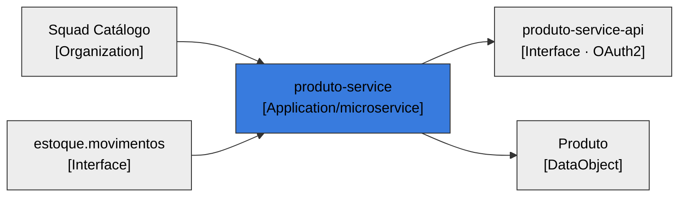

# LeanIX — Applications · `produto-service`

> Ficha no formato `TPL-01-Application.md`. Origem referencia os `Ex` de [fichas-leanix.md](fichas-leanix.md) §0.

## Ficha 1 — `produto-service` (Application / `microservice`)

### 0. Descrição rica

**Responsabilidade de negócio (OBRIGATÓRIO para tipo de negócio):**
- **Função de negócio:** mantém o catálogo de produtos — cadastro, consulta, atualização e remoção, mais o controle de estoque a partir de eventos. (E1, E29)
- **Responsabilidade no processo:** é o sistema-fonte do catálogo; ajusta o estoque conforme os movimentos publicados por outros sistemas. (E8, E29)
- **Valor para o negócio:** dá a visão única e consistente do produto e do estoque para o ecossistema. (E29)
- **Origem:** E1, E29.

**Descrição técnica (quando houver — recomendada):**
- **O que é / faz:** microsserviço REST Java 21 / Spring Boot 3.3.5, backend sem UI. (E3, E4, E5)
- **Como integra:** expõe `produto-service-api` (protegida por OAuth2); consome o evento Kafka `estoque.movimentos`; consulta o ViaCEP; persiste em PostgreSQL; usa Redis para cache e idempotência. (E6, E8, E10, E11, E12, E30)
- **Origem:** E4, E5, E6, E30.

### Campos

#### 1. Identificação
| Campo | Rotulo (PT) | Tipo | Obrig. | Valor | Origem |
|---|---|---|---|---|---|
| `name` | Nome | BASE_FIELD | **SIM** | produto-service | E1 |
| `category` | Subtipo | SINGLE_SELECT | **SIM** | [x] microservice (Microsserviço) | E5 |
| `tipo_desenvolvimento` | Tipo de desenvolvimento | SINGLE_SELECT | **SIM** | [x] interno (Custom-built) | E1,E22 |
| `lxMicroserviceType` | Tipo (camada) | SINGLE_SELECT | | [x] backend (Back-end) | E5 |
| `lxProductCategory` | Categoria do produto | STRING | | — lacuna | — |

#### 2. Ciclo de vida
| Campo | Valor | Origem |
|---|---|---|
| `lifecycle` | [x] active (Ativo) | E25 |

#### 3. Criticidade / fit / maturidade
| Campo | Valor | Origem |
|---|---|---|
| `businessCriticality` | — lacuna (a definir pelo time) | — |
| `usersNumber` (**obrigatório**) | — lacuna (serviço backend; medir consumidores/tráfego) | — |
| `technicalSuitability` | — lacuna | — |

#### 4. Governança de IA
Não se aplica — o sistema não usa IA (sem LLM/modelo/agente no fonte). `lxAiUsage` = noAiUsage.

#### 5. Autenticação / SSO
| Campo | Valor | Origem |
|---|---|---|
| `lxStatusSSO` | — não aplicável (serviço backend) | E30 |
| `lxAuthentication` | [x] oAuth2 (OAuth2 Resource Server; valida JWT Bearer do issuer; scopes produtos:read/produtos:write) | E30 |

> A API valida o token no padrão OAuth2 Resource Server; o Authorization Server (issuer `OAUTH2_ISSUER_URI`) é externo — ver Provider "Authorization Server" e o ITComponent spring-boot-starter-oauth2-resource-server.

#### 6. Hospedagem
| Campo | Valor | Origem |
|---|---|---|
| `lxHostingType` | [x] paas/iaas (container; cloud aws declarada, sem IaC no fonte → a confirmar) | E21 |
| `lxHostingDescription` | container temurin-21-jre (Dockerfile); compose local com Postgres/Redis/Kafka | E21 |
| `repository_url` | https://github.com/exemplo/produto-service | `catalog-info.yaml:links` |

#### 7. Racionalização (TIME/6R)
| Campo | Valor | Origem |
|---|---|---|
| `lxTimeClassification` | — lacuna (a definir) | — |

#### 9. Custos (RESTRITO — não exibir)
TCO indisponível no fonte. `lxApplicationTotalCostOfOwnership`, `tco_*` → RESTRITO, sem valor.

### Relações
| Relação | Destino | Alvo | Origem |
|---|---|---|---|
| `relApplicationToITComponent` | ITComponent | Spring Boot, starters (web/validation/oauth2-resource-server/data-jpa/data-redis/cache/actuator), spring-kafka, PostgreSQL, Redis, Kafka, Flyway, springdoc, Lombok, MapStruct, driver | E4,E11–E14,E19,E20,E30 |
| `relProviderApplicationToInterface` | Interface | produto-service-api (provê) | E6 |
| `relConsumerApplicationToInterface` | Interface | estoque.movimentos, viacep-api (consome) | E8,E10 |
| `relApplicationToDataObject` | DataObject | Produto (CRUD), Endereço (read), Evento de Estoque (read) | E15,E16,E17 |
| `relApplicationToBusinessCapability` | BusinessCapability | Gestão de catálogo de produtos | E29 |
| `relApplicationToOrganization` | Organization/team | Squad Catálogo | E22 |

### Assinaturas
| Papel | Pessoa | Obrig.? | Origem |
|---|---|---|---|
| Responsible | — lacuna (indicar pessoa do Squad Catálogo) — **obrigatório p/ aprovar** | workflow | E22,E24 |
| Accountable | — lacuna | recomendado | — |

### Diagrama

