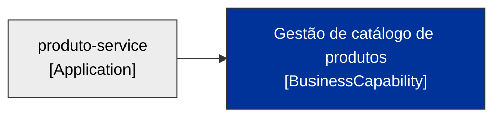

# LeanIX — Business Capabilities · `produto-service`

> Ficha no formato `TPL-06-BusinessCapability.md`. **Status: a validar/cadastrar** — inferida do propósito; procurar reúso via MCP antes de criar. Origem referencia os `Ex` de [fichas-leanix.md](fichas-leanix.md) §0.

## Ficha — Gestão de catálogo de produtos (BusinessCapability)

### 0. Responsabilidade de negócio (OBRIGATÓRIO para tipo de negócio)
- **Função de negócio:** a capacidade de **manter o catálogo de produtos e seu estoque** — cadastrar, consultar, atualizar produtos e refletir movimentos de estoque. (E29)
- **Responsabilidade no processo:** sustenta o processo de catálogo/estoque do negócio. (E29)
- **Valor para o negócio:** visão única e confiável do produto e do estoque para os demais sistemas. (E29)
- **Origem:** E29.

### 0. Descrição técnica (quando houver — recomendada)
- Não aplicável — item de negócio (a capacidade independe da tecnologia que a realiza).

### Campos
| Campo | Rotulo (PT) | Valor | Origem |
|---|---|---|---|
| `name` | Nome | Gestão de catálogo de produtos | E29 |
| `lifecycle` | Ciclo de vida | [x] active | E25 |
| `lxEnterpriseDomain` | Enterprise Domain | [x] Core (capacidade de catálogo) — a confirmar | E29 |
| `strategicImportance` | Importância estratégica | — lacuna (a definir) | — |
| `aiPotential` | Potencial de IA | [x] noPotential (o sistema atual não usa IA) | E28 |

### Relações
| Relação | Destino | Alvo | Origem |
|---|---|---|---|
| `relBusinessCapabilityToApplication` | Application | produto-service | E29 |

> **Reúso:** procurar via MCP (`FactSheetTypes=["BusinessCapability"]`) uma capacidade de catálogo já existente; se existir, reusar o ID. Sem MCP: cadastro a confirmar.

### Diagrama

