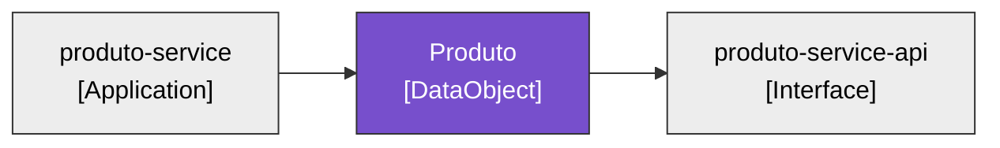
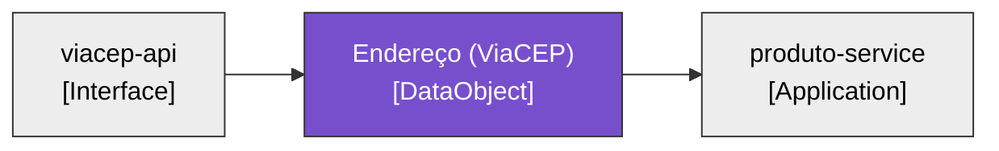
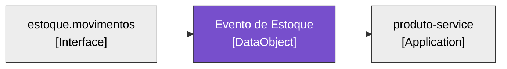

# LeanIX — Data Objects · `produto-service`

> Fichas no formato `TPL-04-DataObject.md`. **3 Data Objects identificados → 3 fichas completas** (regra de completude). Origem referencia os `Ex` de [fichas-leanix.md](fichas-leanix.md) §0.

## Inventário de abertura

| Data Object | Classificação (sugerida) | Representa | Origem |
|---|---|---|---|
| Produto | Público/Interno | item do catálogo (sku, nome, preço, estoque, endereço de origem) | E15 |
| Endereço (ViaCEP) | Público | endereço resolvido de um CEP | E16 |
| Evento de Estoque | Interno | movimento de estoque consumido do Kafka | E17 |

---

## Ficha — Produto (DataObject)

### 0. Descrição de negócio (quando houver — recomendada)
- **Função de negócio:** o item do catálogo que a empresa vende/controla — base do estoque e do preço. (E15, E29)
- **Valor para o negócio:** é o dado central do domínio; tudo gira em torno dele (CRUD, estoque, endereço de origem).
- **Origem:** E15.

### 0. Descrição técnica (OBRIGATÓRIA)
- **O que é / que informação representa:** entidade persistida em `tb_produto` — id (UUID), sku (único), nome, descrição, preço, quantidade de estoque e endereço de origem (CEP + logradouro/bairro/cidade/UF enriquecidos via ViaCEP). (E15)
- **Como é usado:** CRUD pela Application via API REST; estoque ajustado pelo evento Kafka. (E6, E8)
- **Classificação de segurança:** sem PII evidente (endereço é de origem do produto, não de pessoa — E28). (E28)
- **Origem:** E15.

### Campos
| Campo | Rotulo (PT) | Valor | Origem |
|---|---|---|---|
| `name` | Nome | Produto | E15 |
| `lifecycle` | Ciclo de vida | [x] active | E25 |
| `dataClassification` | Classificação de dados | [x] public (L-0) / interno — dado de catálogo, sem PII | E28 |
| `dataClassificationDescription` | Descrição | item do catálogo; endereço é de origem do produto; a confirmar com o dono do dado | E28 |

### Relações
| Relação | Destino | Alvo | Origem |
|---|---|---|---|
| `relDataObjectToApplication` | Application | produto-service (create/read/update/delete) | E15 |
| `relDataObjectToInterface` | Interface | produto-service-api | E6 |

### Diagrama

---

## Ficha — Endereço (ViaCEP) (DataObject)

### 0. Descrição de negócio (quando houver — recomendada)
- **Função de negócio:** o endereço de origem do produto (logradouro, bairro, cidade, UF) derivado do CEP — usado para localizar/padronizar a origem.
- **Valor para o negócio:** padroniza o endereço; apoio ao cadastro, não entidade central.
- **Origem:** E16 (apoio).

### 0. Descrição técnica (OBRIGATÓRIA)
- **O que é / que informação representa:** DTO `EnderecoViaCep` (cep, logradouro, bairro, localidade, uf) retornado pelo ViaCEP; campos gravados no Produto. Não é tabela própria — é objeto de transferência cacheado. (E16, E11)
- **Como é usado:** lido do ViaCEP e cacheado no Redis (cache `enderecos`); seus campos são copiados para o Produto. (E10, E11)
- **Classificação de segurança:** dado público de CEP (sem PII). (E28)
- **Origem:** E16.

### Campos
| Campo | Rotulo (PT) | Valor | Origem |
|---|---|---|---|
| `name` | Nome | Endereço (ViaCEP) | E16 |
| `lifecycle` | Ciclo de vida | [x] active | E25 |
| `dataClassification` | Classificação de dados | [x] public (L-0) — dado público de CEP | E28 |
| `dataClassificationDescription` | Descrição | endereço resolvido de CEP via ViaCEP; público | E16 |

### Relações
| Relação | Destino | Alvo | Origem |
|---|---|---|---|
| `relDataObjectToApplication` | Application | produto-service (read) | E10 |
| `relDataObjectToInterface` | Interface | viacep-api | E10 |

### Diagrama

---

## Ficha — Evento de Estoque (DataObject)

### 0. Descrição de negócio (quando houver — recomendada)
- **Função de negócio:** representa um movimento de estoque (entrada/saída) de um produto, emitido por outro sistema do ecossistema. (E17, E8)
- **Valor para o negócio:** é o que mantém o estoque do catálogo fiel às operações; o `eventId` garante que cada movimento conte uma vez só. (E9)
- **Origem:** E17.

### 0. Descrição técnica (OBRIGATÓRIA)
- **O que é / que informação representa:** record `EstoqueEvent` (eventId, sku, delta, origem) trafegado no tópico Kafka `estoque.movimentos`. Não é tabela — é payload de mensagem. (E17, E8)
- **Como é usado:** consumido pelo `EstoqueEventConsumer`, aplica `delta` no produto por `sku`, idempotente por `eventId`. (E8, E9)
- **Classificação de segurança:** dado operacional interno, sem PII. (E28)
- **Origem:** E17.

### Campos
| Campo | Rotulo (PT) | Valor | Origem |
|---|---|---|---|
| `name` | Nome | Evento de Estoque | E17 |
| `lifecycle` | Ciclo de vida | [x] active | E25 |
| `dataClassification` | Classificação de dados | [x] sensitive (L-1) / interno — dado operacional; a confirmar | E28 |
| `dataClassificationDescription` | Descrição | movimento de estoque (sku/delta/origem); interno, sem PII | E17 |

### Relações
| Relação | Destino | Alvo | Origem |
|---|---|---|---|
| `relDataObjectToApplication` | Application | produto-service (read) | E8 |
| `relDataObjectToInterface` | Interface | estoque.movimentos | E8 |

### Diagrama

