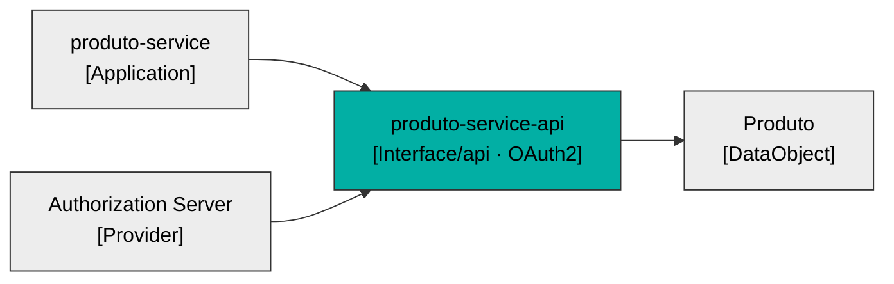
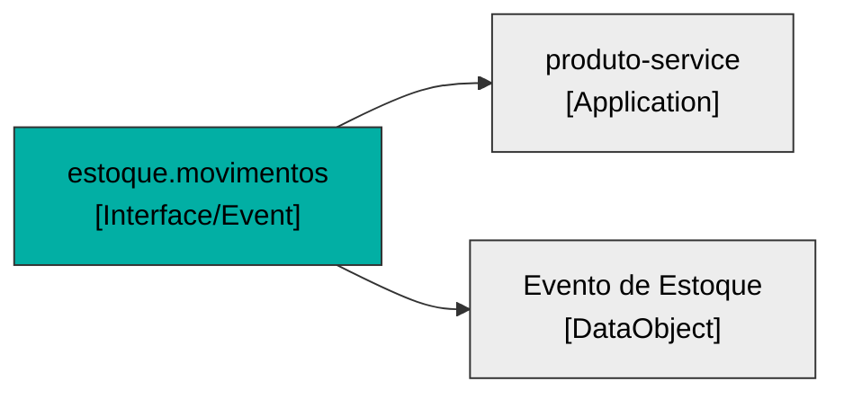
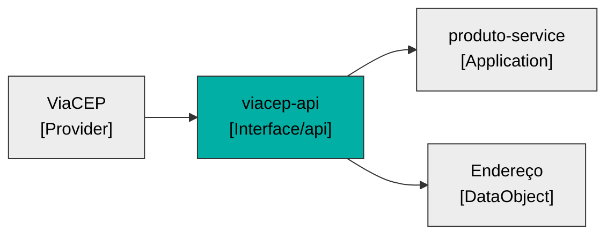

# LeanIX — Interfaces · `produto-service`

> Fichas no formato `TPL-03-Interface.md`. **3 interfaces identificadas → 3 fichas completas** (regra de completude). Origem referencia os `Ex` de [fichas-leanix.md](fichas-leanix.md) §0.

## Inventário de abertura

| Interface | Subtipo | Direção | Provedor → Consumidor | Dados | Origem |
|---|---|---|---|---|---|
| produto-service-api | `api` | expõe (OAuth2) | produto-service → clientes | Produto | E6,E30 |
| estoque.movimentos | `Event` | consome | produtor externo → produto-service (via Kafka) | Evento de Estoque | E8 |
| viacep-api | `api` | consome | ViaCEP → produto-service | Endereço | E10 |

---

## Ficha — produto-service-api (Interface / `api`)

### 0. Descrição de negócio (quando houver — recomendada)
- **Função de negócio:** é o ponto por onde o catálogo é cadastrado e consultado — todo CRUD de produto passa por ela. (E1, E6)
- **Valor para o negócio:** expõe o catálogo e o estoque para os consumidores; se cai, nenhum sistema cadastra ou lê produto. (E6)
- **Origem:** E6.

### 0. Descrição técnica (OBRIGATÓRIA)
- **O que é / faz:** API REST (OpenAPI 3.0.3) com `/api/v1/produtos` (POST/GET/GET-id/PUT/DELETE), `/actuator/health` e `/swagger-ui.html`. POST idempotente via header `Idempotency-Key`. (E6, E7)
- **Como integra:** HTTP síncrono; provê a Application produto-service; trafega o Data Object Produto. **Protegida por OAuth2** (JWT Bearer, Resource Server): leitura exige scope `produtos:read`, escrita `produtos:write`; health/swagger públicos. (E6, E15, E30)
- **Origem:** E6, E30.

### Campos
| Campo | Rotulo (PT) | Valor | Origem |
|---|---|---|---|
| `name` | Nome | produto-service-api | E6 |
| `category` | Subtipo | [x] api | E6 |
| `lifecycle` | Ciclo de vida | [x] active | E25 |
| `dataFlowDirection` | Direção do fluxo | [x] incoming (expõe e recebe requisições) | E6 |
| `interfaceType` | Modo | [x] synchronous | E6 |
| `frequency` | Frequência | [x] onDemand | E6 |
| `lxAuthentication` | Autenticação | [x] oAuth2 (OAuth 2.0 — JWT Bearer, Resource Server; scopes produtos:read / produtos:write) | E30 |

### Relações
| Relação | Destino | Alvo | Origem |
|---|---|---|---|
| `relProviderApplicationToInterface` | Application | produto-service (provê) | E6 |
| `relInterfaceToDataObject` | DataObject | Produto | E15 |

### Diagrama

---

## Ficha — estoque.movimentos (Interface / `Event`)

### 0. Descrição de negócio (quando houver — recomendada)
- **Função de negócio:** mantém o estoque do catálogo em dia — cada movimento (entrada/saída) emitido por outro sistema ajusta a quantidade do produto. (E8, E29)
- **Valor para o negócio:** garante que o estoque reflita as operações reais sem acoplamento síncrono; a idempotência evita contar o mesmo movimento duas vezes. (E9)
- **Origem:** E8, E9.

### 0. Descrição técnica (OBRIGATÓRIA)
- **O que é / faz:** tópico Kafka `estoque.movimentos` consumido pelo produto-service; payload `EstoqueEvent` (eventId/sku/delta/origem). Ack manual; idempotência por `eventId` no Redis. (E8, E9, E14)
- **Como integra:** assíncrono (fila/tópico); produtor externo → produto-service; trafega o Data Object Evento de Estoque. (E8, E17)
- **Origem:** E8.

### Campos
| Campo | Rotulo (PT) | Valor | Origem |
|---|---|---|---|
| `name` | Nome | estoque.movimentos | E8 |
| `category` | Subtipo | [x] Event (Evento) | E8 |
| `lifecycle` | Ciclo de vida | [x] active | E25 |
| `dataFlowDirection` | Direção do fluxo | [x] incoming (o serviço consome o evento) | E8 |
| `interfaceType` | Modo | [x] asynchronous (Kafka) | E8,E14 |
| `frequency` | Frequência | [x] realtime (por evento publicado) | E8 |
| `lxAuthentication` | Autenticação | — lacuna (segurança do broker Kafka, a confirmar) | E14 |

### Relações
| Relação | Destino | Alvo | Origem |
|---|---|---|---|
| `relConsumerApplicationToInterface` | Application | produto-service (consome) | E8 |
| `relInterfaceToITComponent` | ITComponent | Apache Kafka (broker) | E14 |
| `relInterfaceToDataObject` | DataObject | Evento de Estoque | E17 |

### Diagrama

---

## Ficha — viacep-api (Interface / `api`)

### 0. Descrição de negócio (quando houver — recomendada)
- **Função de negócio:** preenche automaticamente o endereço de origem do produto a partir do CEP, poupando digitação e padronizando logradouro/cidade/UF. (E10)
- **Valor para o negócio:** qualidade e consistência do dado de endereço; é apoio ao cadastro, não uma etapa de negócio própria.
- **Origem:** E10 (função de apoio).

### 0. Descrição técnica (OBRIGATÓRIA)
- **O que é / faz:** consome a API pública ViaCEP (`GET /ws/{cep}/json/`) para resolver um CEP em endereço. Resultado cacheado no Redis (cache `enderecos`, TTL 7d). (E10, E11)
- **Como integra:** HTTP síncrono; ViaCEP → produto-service; trafega o Data Object Endereço. Timeouts: connect 2s / read 3s. (E10)
- **Origem:** E10.

### Campos
| Campo | Rotulo (PT) | Valor | Origem |
|---|---|---|---|
| `name` | Nome | viacep-api | E10 |
| `category` | Subtipo | [x] api | E10 |
| `lifecycle` | Ciclo de vida | [x] active | E25 |
| `dataFlowDirection` | Direção do fluxo | [x] outgoing (o serviço chama o ViaCEP) | E10 |
| `interfaceType` | Modo | [x] synchronous | E10 |
| `frequency` | Frequência | [x] onDemand (na criação/atualização com CEP) | E10 |
| `lxAuthentication` | Autenticação | [x] (nenhuma — API pública sem credencial) | E10 |

### Relações
| Relação | Destino | Alvo | Origem |
|---|---|---|---|
| `relConsumerApplicationToInterface` | Application | produto-service (consome) | E10 |
| Provider | Provider | ViaCEP | E10 |
| `relInterfaceToDataObject` | DataObject | Endereço (ViaCEP) | E16 |

### Diagrama

