# LeanIX — IT Components · `produto-service`

> Fichas no formato `TPL-02-ITComponent.md`. **17 IT Components identificados → 17 fichas completas** (regra de completude: nenhum resumido). Versões da stack do `pom.xml`/parent. `lxTechnologyAssessment*` sem evidência = lacuna a definir pela autoridade de tecnologia. Origem referencia os `Ex` de [fichas-leanix.md](fichas-leanix.md) §0.

## Inventário de abertura

| IT Component | Subtipo | Versão | Provedor | Papel | Origem |
|---|---|---|---|---|---|
| Spring Boot | software | 3.3.5 | Spring (open source) | framework base da aplicação | E4 |
| spring-boot-starter-web | software | 3.3.5 | Spring | servidor REST/MVC | E6 |
| spring-boot-starter-validation | software | 3.3.5 | Spring | Bean Validation | E27 |
| spring-boot-starter-oauth2-resource-server (+ security) | software | 3.3.5 | Spring | autenticação OAuth2 (valida JWT) | E30 |
| spring-boot-starter-data-jpa | software | 3.3.5 | Spring | ORM/JPA (Hibernate) | E12 |
| spring-boot-starter-data-redis | software | 3.3.5 | Spring | cliente Redis | E11 |
| spring-boot-starter-cache | software | 3.3.5 | Spring | abstração de cache | E11 |
| spring-kafka | software | (gerenciada pelo parent 3.3.5) | Spring | consumer Kafka | E14 |
| spring-boot-starter-actuator | software | 3.3.5 | Spring | health/metrics | E18 |
| flyway-core (+ flyway-database-postgresql) | software | (gerenciada pelo parent) | Redgate (open source) | migrations de banco | E13 |
| springdoc-openapi | software | 2.6.0 | springdoc (open source) | OpenAPI/Swagger UI | E19 |
| Lombok | software | (gerenciada pelo parent) | Project Lombok | redução de boilerplate | E20 |
| MapStruct | software | 1.6.3 | MapStruct | mapeamento DTO | E20 |
| PostgreSQL JDBC Driver | software | (gerenciada pelo parent) | PostgreSQL Global Dev Group | driver JDBC | E12 |
| PostgreSQL (server) | service | 16 | AWS (a confirmar) / PostgreSQL | banco relacional | E12,E21 |
| Redis (server) | service | 7 | AWS (a confirmar) / Redis | cache + idempotência | E11,E21 |
| Apache Kafka (broker) | service | 3.8 | AWS (a confirmar) / Apache | mensageria | E14,E21 |

---

## Ficha — Spring Boot 3.3.5 (ITComponent / `software`)

### 0. Descrição de negócio (quando houver — recomendada)
- Não aplicável — item técnico/infra (valor atribuído à Application que o usa).

### 0. Descrição técnica (OBRIGATÓRIA)
- **O que é:** framework base da aplicação (auto-configuração, injeção, servidor embarcado). Versão 3.3.5 (parent). (E4)
- **Como o sistema usa:** sustenta toda a aplicação (web, segurança, JPA, Redis, cache, Kafka, actuator). (E4)
- **Origem:** E4.

### Campos
| Campo | Valor | Origem |
|---|---|---|
| `name` | Spring Boot | E4 |
| `category` | [x] software | E4 |
| `lifecycle` (**obrig.**) | [x] active | E25 |
| `lxTechnologyAssessmentCategory` (**obrig.**) | [x] Frameworks e Bibliotecas de Desenvolvimento | E4 |
| `lxTechnologyAssessment` (**obrig.**) | — lacuna → a definir pela autoridade de tecnologia | — |
| Versão (nome/alias) | 3.3.5 | E4 |

### Relações
| Relação | Destino | Alvo | Origem |
|---|---|---|---|
| `relITComponentToProvider` | Provider | Spring (open source) — a confirmar | E4 |
| `relITComponentToApplication` | Application | produto-service | E4 |

### Diagrama
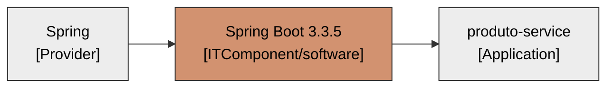

---

## Ficha — spring-boot-starter-web 3.3.5 (ITComponent / `software`)

### 0. Descrição de negócio (quando houver — recomendada)
- Não aplicável — item técnico/infra.

### 0. Descrição técnica (OBRIGATÓRIA)
- **O que é:** starter web/MVC (Tomcat embarcado, Jackson) que serve a API REST. (E6)
- **Como o sistema usa:** expõe os endpoints de `ProdutoController`. (E6)
- **Origem:** E6.

### Campos
| Campo | Valor | Origem |
|---|---|---|
| `name` | spring-boot-starter-web | E6 |
| `category` | [x] software | E6 |
| `lifecycle` (**obrig.**) | [x] active | E25 |
| `lxTechnologyAssessmentCategory` (**obrig.**) | [x] Frameworks e Bibliotecas de Desenvolvimento | E6 |
| `lxTechnologyAssessment` (**obrig.**) | — lacuna → a definir | — |
| Versão (nome/alias) | 3.3.5 | E4 |

### Relações
| Relação | Destino | Alvo | Origem |
|---|---|---|---|
| `relITComponentToProvider` | Provider | Spring (open source) | E4 |
| `relITComponentToApplication` | Application | produto-service | E6 |

### Diagrama
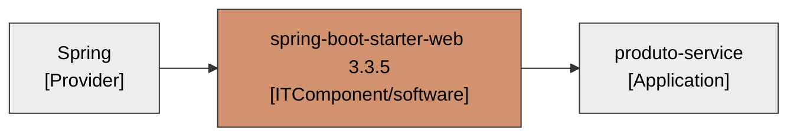

---

## Ficha — spring-boot-starter-validation 3.3.5 (ITComponent / `software`)

### 0. Descrição de negócio (quando houver — recomendada)
- Não aplicável — item técnico/infra.

### 0. Descrição técnica (OBRIGATÓRIA)
- **O que é:** Bean Validation (Hibernate Validator) para validar os DTOs de entrada. (E27)
- **Como o sistema usa:** valida `ProdutoRequest` (sku/nome/preço/estoque/CEP). (E27)
- **Origem:** E27.

### Campos
| Campo | Valor | Origem |
|---|---|---|
| `name` | spring-boot-starter-validation | E27 |
| `category` | [x] software | E27 |
| `lifecycle` (**obrig.**) | [x] active | E25 |
| `lxTechnologyAssessmentCategory` (**obrig.**) | [x] Frameworks e Bibliotecas de Desenvolvimento | E27 |
| `lxTechnologyAssessment` (**obrig.**) | — lacuna → a definir | — |
| Versão (nome/alias) | 3.3.5 | E4 |

### Relações
| Relação | Destino | Alvo | Origem |
|---|---|---|---|
| `relITComponentToProvider` | Provider | Spring (open source) | E4 |
| `relITComponentToApplication` | Application | produto-service | E27 |

### Diagrama
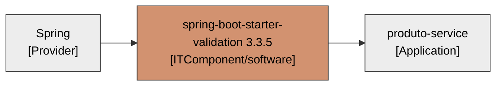

---

## Ficha — spring-boot-starter-oauth2-resource-server 3.3.5 (ITComponent / `software`)

### 0. Descrição de negócio (quando houver — recomendada)
- **Função de negócio:** garante que só clientes autorizados acessem o catálogo — protege o dado de produto/estoque de acesso indevido. (E30)
- **Valor para o negócio:** controle de acesso e conformidade; sem ele a API ficaria aberta.
- **Origem:** E30.

### 0. Descrição técnica (OBRIGATÓRIA)
- **O que é:** Spring Security + OAuth2 Resource Server — valida o JWT Bearer emitido pelo Authorization Server (issuer). Versão gerenciada pelo parent 3.3.5. (E30)
- **Como o sistema usa:** `SecurityConfig` exige scopes `produtos:read` (GET) e `produtos:write` (POST/PUT/DELETE); health/swagger públicos; API stateless. (E30)
- **Origem:** E30.

### Campos
| Campo | Valor | Origem |
|---|---|---|
| `name` | spring-boot-starter-oauth2-resource-server (+ spring-boot-starter-security) | E30 |
| `category` | [x] software | E30 |
| `lifecycle` (**obrig.**) | [x] active | E25 |
| `lxTechnologyAssessmentCategory` (**obrig.**) | [x] Frameworks e Bibliotecas de Desenvolvimento | E30 |
| `lxTechnologyAssessment` (**obrig.**) | — lacuna → a definir | — |
| Versão (nome/alias) | gerenciada pelo parent 3.3.5 | E4 |

### Relações
| Relação | Destino | Alvo | Origem |
|---|---|---|---|
| `relITComponentToProvider` | Provider | Spring (open source) | E4 |
| `relITComponentToApplication` | Application | produto-service | E30 |

### Diagrama
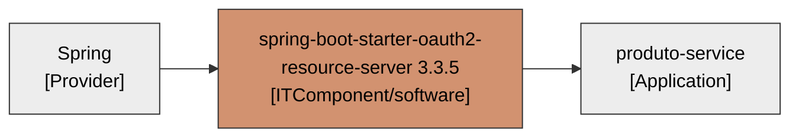

---

## Ficha — spring-boot-starter-data-jpa 3.3.5 (ITComponent / `software`)

### 0. Descrição de negócio (quando houver — recomendada)
- Não aplicável — item técnico/infra.

### 0. Descrição técnica (OBRIGATÓRIA)
- **O que é:** Spring Data JPA + Hibernate — mapeamento objeto-relacional e repositórios. (E12)
- **Como o sistema usa:** `ProdutoRepository` e a entidade `Produto` sobre PostgreSQL. (E12)
- **Origem:** E12.

### Campos
| Campo | Valor | Origem |
|---|---|---|
| `name` | spring-boot-starter-data-jpa | E12 |
| `category` | [x] software | E12 |
| `lifecycle` (**obrig.**) | [x] active | E25 |
| `lxTechnologyAssessmentCategory` (**obrig.**) | [x] Gerenciamento e armazenamento de dados | E12 |
| `lxTechnologyAssessment` (**obrig.**) | — lacuna → a definir | — |
| Versão (nome/alias) | 3.3.5 | E4 |

### Relações
| Relação | Destino | Alvo | Origem |
|---|---|---|---|
| `relITComponentToProvider` | Provider | Spring (open source) | E4 |
| `relITComponentToApplication` | Application | produto-service | E12 |

### Diagrama

---

## Ficha — spring-boot-starter-data-redis 3.3.5 (ITComponent / `software`)

### 0. Descrição de negócio (quando houver — recomendada)
- Não aplicável — item técnico/infra.

### 0. Descrição técnica (OBRIGATÓRIA)
- **O que é:** cliente Redis (Lettuce) do Spring Data. (E11)
- **Como o sistema usa:** backend do cache (`produtos`/`enderecos`) e da idempotência (SET NX). (E11, E7)
- **Origem:** E11.

### Campos
| Campo | Valor | Origem |
|---|---|---|
| `name` | spring-boot-starter-data-redis | E11 |
| `category` | [x] software | E11 |
| `lifecycle` (**obrig.**) | [x] active | E25 |
| `lxTechnologyAssessmentCategory` (**obrig.**) | [x] Gerenciamento e armazenamento de dados | E11 |
| `lxTechnologyAssessment` (**obrig.**) | — lacuna → a definir | — |
| Versão (nome/alias) | 3.3.5 | E4 |

### Relações
| Relação | Destino | Alvo | Origem |
|---|---|---|---|
| `relITComponentToProvider` | Provider | Spring (open source) | E4 |
| `relITComponentToApplication` | Application | produto-service | E11 |

### Diagrama
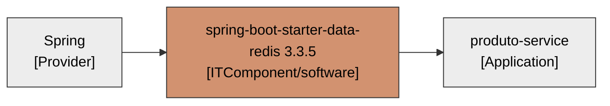

---

## Ficha — spring-boot-starter-cache 3.3.5 (ITComponent / `software`)

### 0. Descrição de negócio (quando houver — recomendada)
- Não aplicável — item técnico/infra.

### 0. Descrição técnica (OBRIGATÓRIA)
- **O que é:** abstração de cache do Spring (`@Cacheable`/`@CacheEvict`). (E11)
- **Como o sistema usa:** cache de produto por id e de endereço ViaCEP, sobre Redis. (E11)
- **Origem:** E11.

### Campos
| Campo | Valor | Origem |
|---|---|---|
| `name` | spring-boot-starter-cache | E11 |
| `category` | [x] software | E11 |
| `lifecycle` (**obrig.**) | [x] active | E25 |
| `lxTechnologyAssessmentCategory` (**obrig.**) | [x] Frameworks e Bibliotecas de Desenvolvimento | E11 |
| `lxTechnologyAssessment` (**obrig.**) | — lacuna → a definir | — |
| Versão (nome/alias) | 3.3.5 | E4 |

### Relações
| Relação | Destino | Alvo | Origem |
|---|---|---|---|
| `relITComponentToProvider` | Provider | Spring (open source) | E4 |
| `relITComponentToApplication` | Application | produto-service | E11 |

### Diagrama

---

## Ficha — spring-kafka (ITComponent / `software`)

### 0. Descrição de negócio (quando houver — recomendada)
- Não aplicável — item técnico/infra.

### 0. Descrição técnica (OBRIGATÓRIA)
- **O que é:** integração Spring com Apache Kafka (`@KafkaListener`, containers). Versão gerenciada pelo parent 3.3.5. (E14)
- **Como o sistema usa:** consome `estoque.movimentos` com ack manual e deserialização JSON tolerante a erro. (E14, E8)
- **Origem:** E14.

### Campos
| Campo | Valor | Origem |
|---|---|---|
| `name` | spring-kafka | E14 |
| `category` | [x] software | E14 |
| `lifecycle` (**obrig.**) | [x] active | E25 |
| `lxTechnologyAssessmentCategory` (**obrig.**) | [x] Integração | E14 |
| `lxTechnologyAssessment` (**obrig.**) | — lacuna → a definir | — |
| Versão (nome/alias) | gerenciada pelo parent 3.3.5 | E4 |

### Relações
| Relação | Destino | Alvo | Origem |
|---|---|---|---|
| `relITComponentToProvider` | Provider | Spring (open source) | E4 |
| `relITComponentToApplication` | Application | produto-service | E14 |

### Diagrama
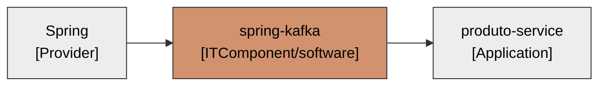

---

## Ficha — spring-boot-starter-actuator 3.3.5 (ITComponent / `software`)

### 0. Descrição de negócio (quando houver — recomendada)
- Não aplicável — item técnico/infra.

### 0. Descrição técnica (OBRIGATÓRIA)
- **O que é:** endpoints operacionais (health, info, metrics). (E18)
- **Como o sistema usa:** expõe `/actuator/health|info|metrics` e probes. (E18)
- **Origem:** E18.

### Campos
| Campo | Valor | Origem |
|---|---|---|
| `name` | spring-boot-starter-actuator | E18 |
| `category` | [x] software | E18 |
| `lifecycle` (**obrig.**) | [x] active | E25 |
| `lxTechnologyAssessmentCategory` (**obrig.**) | [x] Ferramentas | E18 |
| `lxTechnologyAssessment` (**obrig.**) | — lacuna → a definir | — |
| Versão (nome/alias) | 3.3.5 | E4 |

### Relações
| Relação | Destino | Alvo | Origem |
|---|---|---|---|
| `relITComponentToProvider` | Provider | Spring (open source) | E4 |
| `relITComponentToApplication` | Application | produto-service | E18 |

### Diagrama
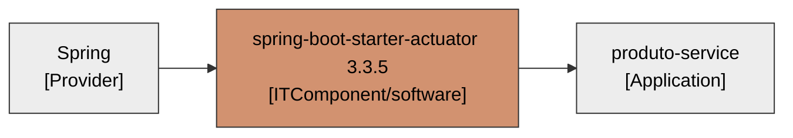

---

## Ficha — Flyway (ITComponent / `software`)

### 0. Descrição de negócio (quando houver — recomendada)
- Não aplicável — item técnico/infra.

### 0. Descrição técnica (OBRIGATÓRIA)
- **O que é:** ferramenta de migrations de banco (`flyway-core` + `flyway-database-postgresql`). (E13)
- **Como o sistema usa:** aplica `V1__cria_tabela_produto.sql` no boot; `ddl-auto=validate`. (E13)
- **Origem:** E13.

### Campos
| Campo | Valor | Origem |
|---|---|---|
| `name` | Flyway (core + database-postgresql) | E13 |
| `category` | [x] software | E13 |
| `lifecycle` (**obrig.**) | [x] active | E25 |
| `lxTechnologyAssessmentCategory` (**obrig.**) | [x] Gerenciamento e armazenamento de dados | E13 |
| `lxTechnologyAssessment` (**obrig.**) | — lacuna → a definir | — |
| Versão (nome/alias) | gerenciada pelo parent 3.3.5 | E4 |

### Relações
| Relação | Destino | Alvo | Origem |
|---|---|---|---|
| `relITComponentToProvider` | Provider | Redgate (open source) — a confirmar | E13 |
| `relITComponentToApplication` | Application | produto-service | E13 |

### Diagrama
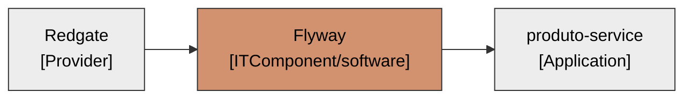

---

## Ficha — springdoc-openapi 2.6.0 (ITComponent / `software`)

### 0. Descrição de negócio (quando houver — recomendada)
- Não aplicável — item técnico/infra.

### 0. Descrição técnica (OBRIGATÓRIA)
- **O que é:** gera a documentação OpenAPI e a Swagger UI. Versão 2.6.0. (E19)
- **Como o sistema usa:** publica `/swagger-ui.html` e o contrato OpenAPI (com o securityScheme OAuth2). (E19, E30)
- **Origem:** E19.

### Campos
| Campo | Valor | Origem |
|---|---|---|
| `name` | springdoc-openapi | E19 |
| `category` | [x] software | E19 |
| `lifecycle` (**obrig.**) | [x] active | E25 |
| `lxTechnologyAssessmentCategory` (**obrig.**) | [x] Ferramentas | E19 |
| `lxTechnologyAssessment` (**obrig.**) | — lacuna → a definir | — |
| Versão (nome/alias) | 2.6.0 | E19 |

### Relações
| Relação | Destino | Alvo | Origem |
|---|---|---|---|
| `relITComponentToProvider` | Provider | springdoc (open source) | E19 |
| `relITComponentToApplication` | Application | produto-service | E19 |

### Diagrama
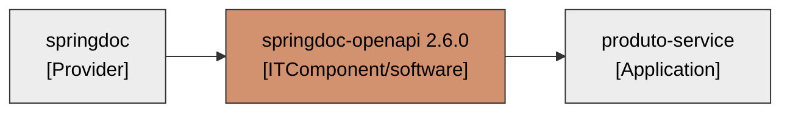

---

## Ficha — Lombok (ITComponent / `software`)

### 0. Descrição de negócio (quando houver — recomendada)
- Não aplicável — item técnico/infra.

### 0. Descrição técnica (OBRIGATÓRIA)
- **O que é:** processador de anotações que gera getters/setters/builders em tempo de compilação. (E20)
- **Como o sistema usa:** na entidade `Produto` (@Getter/@Setter/@Builder). Versão gerenciada pelo parent. (E20)
- **Origem:** E20.

### Campos
| Campo | Valor | Origem |
|---|---|---|
| `name` | Lombok | E20 |
| `category` | [x] software | E20 |
| `lifecycle` (**obrig.**) | [x] active | E25 |
| `lxTechnologyAssessmentCategory` (**obrig.**) | [x] Frameworks e Bibliotecas de Desenvolvimento | E20 |
| `lxTechnologyAssessment` (**obrig.**) | — lacuna → a definir | — |
| Versão (nome/alias) | gerenciada pelo parent 3.3.5 | E4 |

### Relações
| Relação | Destino | Alvo | Origem |
|---|---|---|---|
| `relITComponentToProvider` | Provider | Project Lombok (open source) | E20 |
| `relITComponentToApplication` | Application | produto-service | E20 |

### Diagrama
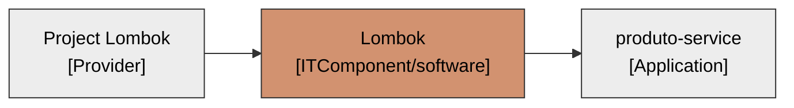

---

## Ficha — MapStruct 1.6.3 (ITComponent / `software`)

### 0. Descrição de negócio (quando houver — recomendada)
- Não aplicável — item técnico/infra.

### 0. Descrição técnica (OBRIGATÓRIA)
- **O que é:** gerador de mapeadores entre objetos (compile-time). Versão 1.6.3. (E20)
- **Como o sistema usa:** `ProdutoMapper` converte a entidade em `ProdutoResponse`. (E20)
- **Origem:** E20.

### Campos
| Campo | Valor | Origem |
|---|---|---|
| `name` | MapStruct | E20 |
| `category` | [x] software | E20 |
| `lifecycle` (**obrig.**) | [x] active | E25 |
| `lxTechnologyAssessmentCategory` (**obrig.**) | [x] Frameworks e Bibliotecas de Desenvolvimento | E20 |
| `lxTechnologyAssessment` (**obrig.**) | — lacuna → a definir | — |
| Versão (nome/alias) | 1.6.3 | E20 |

### Relações
| Relação | Destino | Alvo | Origem |
|---|---|---|---|
| `relITComponentToProvider` | Provider | MapStruct (open source) | E20 |
| `relITComponentToApplication` | Application | produto-service | E20 |

### Diagrama
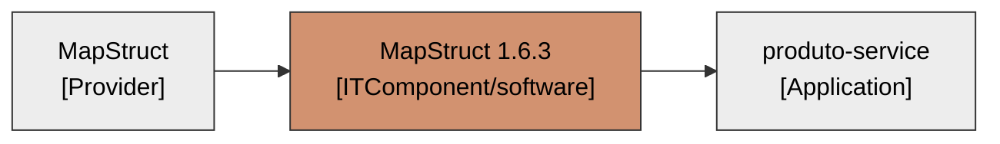

---

## Ficha — PostgreSQL JDBC Driver (ITComponent / `software`)

### 0. Descrição de negócio (quando houver — recomendada)
- Não aplicável — item técnico/infra.

### 0. Descrição técnica (OBRIGATÓRIA)
- **O que é:** driver JDBC do PostgreSQL. Versão gerenciada pelo parent. (E12)
- **Como o sistema usa:** conexão da aplicação ao banco `produtos`. (E12)
- **Origem:** E12.

### Campos
| Campo | Valor | Origem |
|---|---|---|
| `name` | PostgreSQL JDBC Driver | E12 |
| `category` | [x] software | E12 |
| `lifecycle` (**obrig.**) | [x] active | E25 |
| `lxTechnologyAssessmentCategory` (**obrig.**) | [x] Gerenciamento e armazenamento de dados | E12 |
| `lxTechnologyAssessment` (**obrig.**) | — lacuna → a definir | — |
| Versão (nome/alias) | gerenciada pelo parent 3.3.5 | E4 |

### Relações
| Relação | Destino | Alvo | Origem |
|---|---|---|---|
| `relITComponentToProvider` | Provider | PostgreSQL Global Dev Group (open source) | E12 |
| `relITComponentToApplication` | Application | produto-service | E12 |

### Diagrama
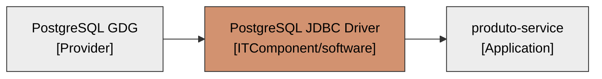

---

## Ficha — PostgreSQL 16 (ITComponent / `service`)

### 0. Descrição de negócio (quando houver — recomendada)
- **Função de negócio:** guarda o catálogo de produtos — é onde o dado de negócio persiste. (E12, E15)
- **Valor para o negócio:** fonte durável do catálogo e do estoque.
- **Origem:** E12, E15.

### 0. Descrição técnica (OBRIGATÓRIA)
- **O que é:** servidor de banco relacional PostgreSQL 16 (compose local; cloud aws a confirmar). (E12, E21)
- **Como o sistema usa:** persiste `tb_produto` via JPA/Hibernate; migrations por Flyway. (E12, E13)
- **Origem:** E12, E21.

### Campos
| Campo | Valor | Origem |
|---|---|---|
| `name` | PostgreSQL | E12 |
| `category` | [x] service | E12 |
| `lifecycle` (**obrig.**) | [x] active | E25 |
| `lxTechnologyAssessmentCategory` (**obrig.**) | [x] Gerenciamento e armazenamento de dados | E12 |
| `lxTechnologyAssessment` (**obrig.**) | — lacuna → a definir | — |
| Versão (nome/alias) | 16 | E21 |

### Relações
| Relação | Destino | Alvo | Origem |
|---|---|---|---|
| `relITComponentToProvider` | Provider | AWS (a confirmar) / PostgreSQL | E21 |
| `relITComponentToApplication` | Application | produto-service | E12 |

### Diagrama
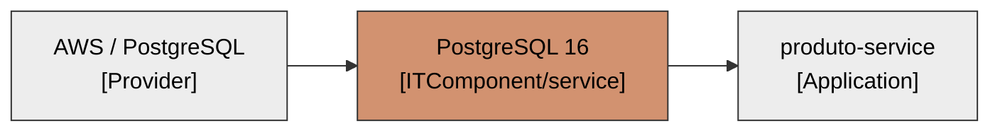

---

## Ficha — Redis 7 (ITComponent / `service`)

### 0. Descrição de negócio (quando houver — recomendada)
- **Função de negócio:** garante que o catálogo responda rápido (cache) e que movimentos/criações não se dupliquem (idempotência). (E11, E7)
- **Valor para o negócio:** desempenho e consistência operacional.
- **Origem:** E11.

### 0. Descrição técnica (OBRIGATÓRIA)
- **O que é:** servidor Redis 7 (in-memory). (E11, E21)
- **Como o sistema usa:** cache (`produtos`/`enderecos`) e chave de idempotência (SET NX + TTL). (E11, E7, E9)
- **Origem:** E11, E21.

### Campos
| Campo | Valor | Origem |
|---|---|---|
| `name` | Redis | E11 |
| `category` | [x] service | E11 |
| `lifecycle` (**obrig.**) | [x] active | E25 |
| `lxTechnologyAssessmentCategory` (**obrig.**) | [x] Gerenciamento e armazenamento de dados | E11 |
| `lxTechnologyAssessment` (**obrig.**) | — lacuna → a definir | — |
| Versão (nome/alias) | 7 | E21 |

### Relações
| Relação | Destino | Alvo | Origem |
|---|---|---|---|
| `relITComponentToProvider` | Provider | AWS (a confirmar) / Redis | E21 |
| `relITComponentToApplication` | Application | produto-service | E11 |

### Diagrama
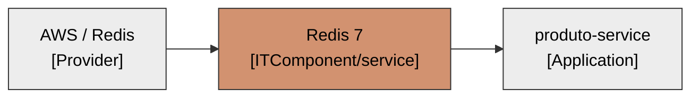

---

## Ficha — Apache Kafka 3.8 (ITComponent / `service`)

### 0. Descrição de negócio (quando houver — recomendada)
- **Função de negócio:** canal pelo qual os movimentos de estoque chegam ao catálogo de forma desacoplada. (E14, E8)
- **Valor para o negócio:** integração assíncrona confiável entre o catálogo e os sistemas que movimentam estoque.
- **Origem:** E14, E8.

### 0. Descrição técnica (OBRIGATÓRIA)
- **O que é:** broker de mensageria Apache Kafka 3.8 (KRaft no compose). (E14, E21)
- **Como o sistema usa:** o serviço consome o tópico `estoque.movimentos`. (E8, E14)
- **Origem:** E14, E21.

### Campos
| Campo | Valor | Origem |
|---|---|---|
| `name` | Apache Kafka | E14 |
| `category` | [x] service | E14 |
| `lifecycle` (**obrig.**) | [x] active | E25 |
| `lxTechnologyAssessmentCategory` (**obrig.**) | [x] Integração | E14 |
| `lxTechnologyAssessment` (**obrig.**) | — lacuna → a definir | — |
| Versão (nome/alias) | 3.8 | E21 |

### Relações
| Relação | Destino | Alvo | Origem |
|---|---|---|---|
| `relITComponentToProvider` | Provider | AWS (a confirmar) / Apache | E21 |
| `relITComponentToApplication` | Application | produto-service | E14 |
| `relRelProviderITComponentToInterface` | Interface | estoque.movimentos | E8 |

### Diagrama
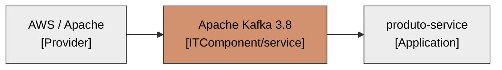
