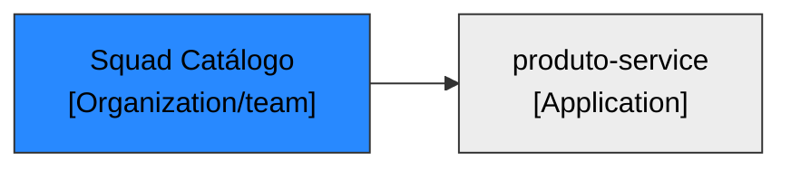

# LeanIX — Organizations · `produto-service`

> Ficha no formato `TPL-08-Organization.md`. **Status: a validar/cadastrar.** Origem referencia os `Ex` de [fichas-leanix.md](fichas-leanix.md) §0.

## Ficha — Squad Catálogo (Organization / `team`)

### 0. Responsabilidade de negócio (OBRIGATÓRIO para tipo de negócio)
- **Função de negócio:** a equipe dona do produto-service, responsável pelo sistema de catálogo (`system: catalogo-produtos`). (E22)
- **Responsabilidade no processo:** sustenta/é dona da Application; é a âncora do Responsible. (E22)
- **Valor para o negócio:** responsável pela entrega e operação do catálogo. (E22)
- **Origem:** E22.

### 0. Descrição técnica (quando houver — recomendada)
- Não aplicável — item de negócio (equipe).

### Campos
| Campo | Rotulo (PT) | Valor | Origem |
|---|---|---|---|
| `name` | Nome | Squad Catálogo | E22 |
| `category` | Subtipo | [x] team (Equipe) | E22 |
| `lifecycle` | Ciclo de vida | [x] active | E25 |

### Relações
| Relação | Destino | Alvo | Origem |
|---|---|---|---|
| `relOrganizationToApplication` | Application | produto-service (usageType: Sustenta/owner) | E22 |

### Assinaturas
| Papel | Pessoa | Obrig.? | Origem |
|---|---|---|---|
| Responsible | — lacuna (indicar pessoa do squad — catálogo só traz o grupo) | recomendado | E22,E24 |

> **Reúso:** procurar via MCP (`FactSheetTypes=["Organization"]`, subtipo `team`) o squad já cadastrado; reusar o ID se existir.

### Diagrama

