# LeanIX — Providers · `produto-service`

> Fichas no formato `TPL-09-Provider.md`. **11 Providers identificados → 11 fichas completas** (regra de completude + fechamento de relações: todo Provider citado em `relITComponentToProvider` tem ficha). Origem referencia os `Ex` de [fichas-leanix.md](fichas-leanix.md) §0.

## Inventário de abertura

| Provider | Fornece | Origem |
|---|---|---|
| ViaCEP | API pública de consulta de CEP | E10 |
| Amazon Web Services | hospedagem/cloud dos serviços gerenciados (PostgreSQL/Redis/Kafka) | E21 |
| Authorization Server (OAuth2 issuer) | emissão/validação dos tokens JWT (OAuth2) | E30 |
| Spring (VMware/Broadcom) | Spring Boot e os starters (web, security/oauth2, data-jpa, data-redis, cache, actuator, kafka) | E4 |
| Redgate (Flyway) | Flyway (core + database-postgresql) | E13 |
| springdoc | springdoc-openapi | E19 |
| Project Lombok | Lombok | E20 |
| MapStruct | MapStruct | E20 |
| PostgreSQL Global Development Group | PostgreSQL (JDBC driver + servidor) | E12 |
| Redis (projeto) | Redis server | E11 |
| Apache Software Foundation | Apache Kafka | E14 |

> **Nota de ontologia:** `relITComponentToProvider` é obrigatória (1:*). Cada Provider acima é o
> **mantenedor/fornecedor** do software; o Provider **AWS** é o fornecedor de **hospedagem** dos
> serviços gerenciados (PostgreSQL/Redis/Kafka) — complementar, não substitui o mantenedor. Todos são
> `reúso a confirmar via MCP` (provavelmente já existem no tenant).

---

## Ficha — ViaCEP (Provider)

### 0. Responsabilidade de negócio (OBRIGATÓRIO para tipo de negócio)
- **Função de negócio:** provedor externo que entrega a consulta de endereço por CEP, usada para enriquecer o endereço de origem do produto. (E10)
- **Responsabilidade no processo:** fornece o serviço público `viacep-api` consumido pelo produto-service. (E10)
- **Valor para o negócio:** padroniza o endereço sem manter base de CEP própria. (E10)
- **Origem:** E10.

### 0. Descrição técnica (quando houver — recomendada)
- **O que é / faz:** serviço HTTP público `https://viacep.com.br/ws/{cep}/json/`. Sem credencial. (E10)
- **Origem:** E10.

### Campos
| Campo | Rotulo (PT) | Valor | Origem |
|---|---|---|---|
| `name` | Nome | ViaCEP | E10 |
| `lifecycle` | Ciclo de vida | [x] active | E25 |
| `providerCriticality` | Criticidade do Provedor | [x] tactical (enriquecimento de endereço; desligável sem quebrar o CRUD) | E10 |
| `providerQuality` | Qualidade do Provedor | — lacuna (a avaliar) | — |

### Relações
| Relação | Destino | Alvo | Origem |
|---|---|---|---|
| Interface | Interface | viacep-api | E10 |

### Diagrama
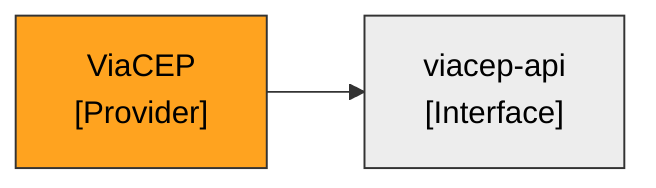

---

## Ficha — Amazon Web Services (Provider)

### 0. Responsabilidade de negócio (OBRIGATÓRIO para tipo de negócio)
- **Função de negócio:** provedor de nuvem que hospeda o serviço (conforme `cloud: aws` no catálogo). (E21)
- **Responsabilidade no processo:** sustenta a execução do container e, presumivelmente, Postgres/Redis/Kafka gerenciados. (E21)
- **Valor para o negócio:** infraestrutura do serviço. **A validar** — não há IaC no repositório confirmando os serviços AWS (E21, divergência 5).
- **Origem:** E21.

### 0. Descrição técnica (quando houver — recomendada)
- **O que é / faz:** nuvem AWS (declarada no catálogo). Sem Terraform/manifesto no fonte para detalhar os serviços. (E21)
- **Origem:** E21 (catálogo; sem IaC no fonte).

### Campos
| Campo | Rotulo (PT) | Valor | Origem |
|---|---|---|---|
| `name` | Nome | Amazon Web Services | E21 |
| `lifecycle` | Ciclo de vida | [x] active | E25 |
| `providerCriticality` | Criticidade do Provedor | [x] strategic (hospeda o serviço) — a confirmar | E21 |
| `providerQuality` | Qualidade do Provedor | — lacuna | — |

### Relações
| Relação | Destino | Alvo | Origem |
|---|---|---|---|
| `relITComponentToProvider` (inversa) | ITComponent | PostgreSQL, Redis, Apache Kafka (se gerenciados na AWS — a confirmar) | E21 |

### Diagrama
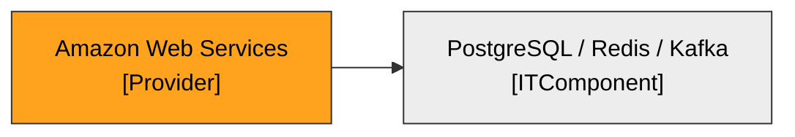

---

## Ficha — Authorization Server (OAuth2 issuer) (Provider)

### 0. Responsabilidade de negócio (OBRIGATÓRIO para tipo de negócio)
- **Função de negócio:** emite e assina os tokens OAuth2 (JWT) que autenticam o acesso ao catálogo — é a autoridade de identidade por trás da API. (E30)
- **Responsabilidade no processo:** publica o issuer/JWK Set que o produto-service usa para validar o token Bearer. (E30)
- **Valor para o negócio:** controle de acesso e conformidade; sem ele a API não autentica ninguém. (E30)
- **Origem:** E30.

### 0. Descrição técnica (quando houver — recomendada)
- **O que é / faz:** Authorization Server OAuth2/OIDC externo, referenciado por `OAUTH2_ISSUER_URI` (ex.: `https://auth.exemplo.com/realms/catalogo`). O issuer é um placeholder no fonte — **o servidor real deve ser identificado no tenant** (ex.: Keycloak, Azure AD, Cognito). (E30)
- **Origem:** E30.

### Campos
| Campo | Rotulo (PT) | Valor | Origem |
|---|---|---|---|
| `name` | Nome | Authorization Server (OAuth2 issuer) — a identificar | E30 |
| `lifecycle` | Ciclo de vida | [x] active | E25 |
| `providerCriticality` | Criticidade do Provedor | [x] strategic (sem ele a API não autentica) | E30 |
| `providerQuality` | Qualidade do Provedor | — lacuna (a avaliar) | — |

### Relações
| Relação | Destino | Alvo | Origem |
|---|---|---|---|
| Interface/Application | Application | produto-service (valida tokens emitidos por este provedor) | E30 |

> **Reúso:** o issuer no fonte é exemplo; identificar o Authorization Server real da organização e **reusar o Provider existente no tenant** via MCP, em vez de criar um novo.

### Diagrama
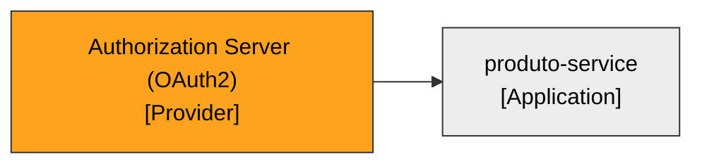

---

## Ficha — Spring (VMware/Broadcom) (Provider)

### 0. Responsabilidade de negócio (OBRIGATÓRIO para tipo de negócio)
- **Função de negócio:** mantenedor do ecossistema Spring, base técnica do serviço; fornece o framework que sustenta toda a aplicação. (E4)
- **Responsabilidade no processo:** fornece Spring Boot e os starters (web, security/oauth2-resource-server, data-jpa, data-redis, cache, actuator) + spring-kafka. (E4,E30)
- **Valor para o negócio:** base tecnológica padronizada e suportada. (E4)
- **Origem:** E4.

### 0. Descrição técnica (quando houver — recomendada)
- **O que é / faz:** projeto open source Spring (mantido por VMware/Broadcom), distribuído via Maven Central. (E4)
- **Origem:** E4.

### Campos
| Campo | Rotulo (PT) | Valor | Origem |
|---|---|---|---|
| `name` | Nome | Spring (VMware/Broadcom) | E4 |
| `lifecycle` | Ciclo de vida | [x] active | E25 |
| `providerCriticality` | Criticidade do Provedor | [x] strategic (base de todo o serviço) | E4 |
| `providerQuality` | Qualidade do Provedor | — lacuna (a avaliar) | — |

### Relações
| Relação | Destino | Alvo | Origem |
|---|---|---|---|
| `relITComponentToProvider` (inversa) | ITComponent | Spring Boot e todos os starters + spring-kafka | E4,E30 |

### Diagrama
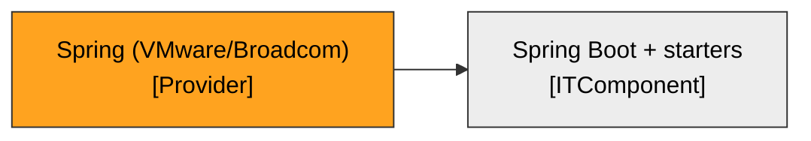

---

## Ficha — Redgate (Flyway) (Provider)

### 0. Responsabilidade de negócio (OBRIGATÓRIO para tipo de negócio)
- **Função de negócio:** mantenedor do Flyway, ferramenta de versionamento/migração de banco usada pelo serviço. (E13)
- **Responsabilidade no processo:** fornece Flyway (core + database-postgresql). (E13)
- **Valor para o negócio:** schema de banco versionado e reproduzível. (E13)
- **Origem:** E13.

### 0. Descrição técnica (quando houver — recomendada)
- **O que é / faz:** Flyway é open source, mantido pela Redgate; distribuído via Maven Central. (E13)
- **Origem:** E13.

### Campos
| Campo | Rotulo (PT) | Valor | Origem |
|---|---|---|---|
| `name` | Nome | Redgate (Flyway) | E13 |
| `lifecycle` | Ciclo de vida | [x] active | E25 |
| `providerCriticality` | Criticidade do Provedor | [x] tactical (ferramenta de migração) | E13 |
| `providerQuality` | Qualidade do Provedor | — lacuna (a avaliar) | — |

### Relações
| Relação | Destino | Alvo | Origem |
|---|---|---|---|
| `relITComponentToProvider` (inversa) | ITComponent | Flyway (core + database-postgresql) | E13 |

### Diagrama
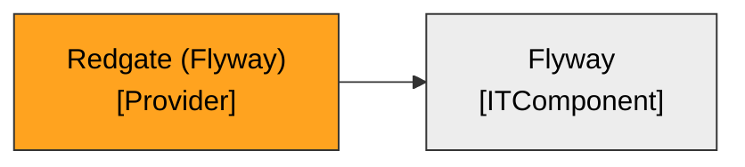

---

## Ficha — springdoc (Provider)

### 0. Responsabilidade de negócio (OBRIGATÓRIO para tipo de negócio)
- **Função de negócio:** mantenedor do springdoc-openapi, que gera a documentação da API do serviço. (E19)
- **Responsabilidade no processo:** fornece springdoc-openapi (Swagger UI + contrato OpenAPI). (E19)
- **Valor para o negócio:** documentação da API para consumidores. (E19)
- **Origem:** E19.

### 0. Descrição técnica (quando houver — recomendada)
- **O que é / faz:** projeto open source (springdoc.org), distribuído via Maven Central. (E19)
- **Origem:** E19.

### Campos
| Campo | Rotulo (PT) | Valor | Origem |
|---|---|---|---|
| `name` | Nome | springdoc | E19 |
| `lifecycle` | Ciclo de vida | [x] active | E25 |
| `providerCriticality` | Criticidade do Provedor | [x] commodity (ferramenta de documentação) | E19 |
| `providerQuality` | Qualidade do Provedor | — lacuna (a avaliar) | — |

### Relações
| Relação | Destino | Alvo | Origem |
|---|---|---|---|
| `relITComponentToProvider` (inversa) | ITComponent | springdoc-openapi | E19 |

### Diagrama
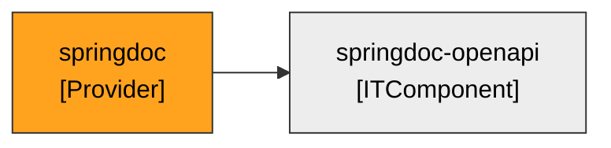

---

## Ficha — Project Lombok (Provider)

### 0. Responsabilidade de negócio (OBRIGATÓRIO para tipo de negócio)
- **Função de negócio:** mantenedor do Lombok, usado para reduzir boilerplate no código do serviço. (E20)
- **Responsabilidade no processo:** fornece a biblioteca Lombok. (E20)
- **Valor para o negócio:** produtividade de desenvolvimento. (E20)
- **Origem:** E20.

### 0. Descrição técnica (quando houver — recomendada)
- **O que é / faz:** projeto open source (projectlombok.org), distribuído via Maven Central. (E20)
- **Origem:** E20.

### Campos
| Campo | Rotulo (PT) | Valor | Origem |
|---|---|---|---|
| `name` | Nome | Project Lombok | E20 |
| `lifecycle` | Ciclo de vida | [x] active | E25 |
| `providerCriticality` | Criticidade do Provedor | [x] commodity (biblioteca de produtividade) | E20 |
| `providerQuality` | Qualidade do Provedor | — lacuna (a avaliar) | — |

### Relações
| Relação | Destino | Alvo | Origem |
|---|---|---|---|
| `relITComponentToProvider` (inversa) | ITComponent | Lombok | E20 |

### Diagrama
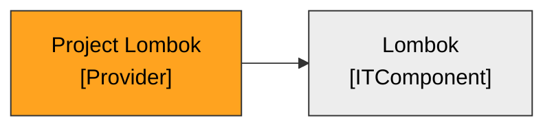

---

## Ficha — MapStruct (Provider)

### 0. Responsabilidade de negócio (OBRIGATÓRIO para tipo de negócio)
- **Função de negócio:** mantenedor do MapStruct, usado para mapear entidades em DTOs no serviço. (E20)
- **Responsabilidade no processo:** fornece a biblioteca MapStruct. (E20)
- **Valor para o negócio:** mapeamento de objetos seguro em tempo de compilação. (E20)
- **Origem:** E20.

### 0. Descrição técnica (quando houver — recomendada)
- **O que é / faz:** projeto open source (mapstruct.org), distribuído via Maven Central. (E20)
- **Origem:** E20.

### Campos
| Campo | Rotulo (PT) | Valor | Origem |
|---|---|---|---|
| `name` | Nome | MapStruct | E20 |
| `lifecycle` | Ciclo de vida | [x] active | E25 |
| `providerCriticality` | Criticidade do Provedor | [x] commodity (biblioteca de mapeamento) | E20 |
| `providerQuality` | Qualidade do Provedor | — lacuna (a avaliar) | — |

### Relações
| Relação | Destino | Alvo | Origem |
|---|---|---|---|
| `relITComponentToProvider` (inversa) | ITComponent | MapStruct | E20 |

### Diagrama
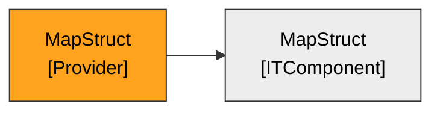

---

## Ficha — PostgreSQL Global Development Group (Provider)

### 0. Responsabilidade de negócio (OBRIGATÓRIO para tipo de negócio)
- **Função de negócio:** mantenedor do PostgreSQL — o banco de dados do serviço — e do driver JDBC. (E12)
- **Responsabilidade no processo:** fornece o servidor PostgreSQL e o JDBC driver. (E12)
- **Valor para o negócio:** persistência confiável do catálogo. (E12)
- **Origem:** E12.

### 0. Descrição técnica (quando houver — recomendada)
- **O que é / faz:** projeto open source (postgresql.org); no serviço o servidor roda em container/AWS (hospedagem AWS). (E12,E21)
- **Origem:** E12.

### Campos
| Campo | Rotulo (PT) | Valor | Origem |
|---|---|---|---|
| `name` | Nome | PostgreSQL Global Development Group | E12 |
| `lifecycle` | Ciclo de vida | [x] active | E25 |
| `providerCriticality` | Criticidade do Provedor | [x] strategic (banco do serviço) | E12 |
| `providerQuality` | Qualidade do Provedor | — lacuna (a avaliar) | — |

### Relações
| Relação | Destino | Alvo | Origem |
|---|---|---|---|
| `relITComponentToProvider` (inversa) | ITComponent | PostgreSQL JDBC Driver; PostgreSQL 16 (servidor — hospedagem AWS) | E12,E21 |

### Diagrama
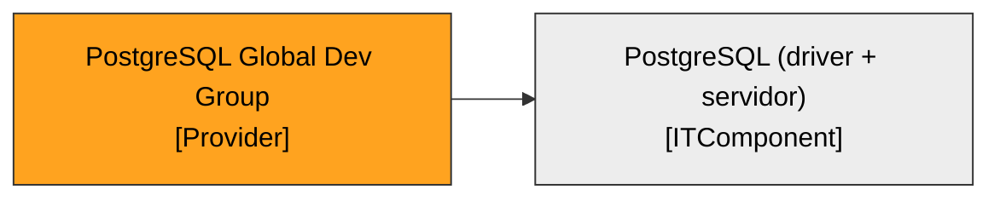

---

## Ficha — Redis (projeto) (Provider)

### 0. Responsabilidade de negócio (OBRIGATÓRIO para tipo de negócio)
- **Função de negócio:** mantenedor do Redis — o armazenamento em memória usado para cache e idempotência do serviço. (E11)
- **Responsabilidade no processo:** fornece o servidor Redis. (E11)
- **Valor para o negócio:** desempenho e consistência operacional. (E11)
- **Origem:** E11.

### 0. Descrição técnica (quando houver — recomendada)
- **O que é / faz:** projeto open source (redis.io); no serviço o servidor roda em container/AWS (hospedagem AWS). (E11,E21)
- **Origem:** E11.

### Campos
| Campo | Rotulo (PT) | Valor | Origem |
|---|---|---|---|
| `name` | Nome | Redis (projeto) | E11 |
| `lifecycle` | Ciclo de vida | [x] active | E25 |
| `providerCriticality` | Criticidade do Provedor | [x] operational (cache/idempotência) | E11 |
| `providerQuality` | Qualidade do Provedor | — lacuna (a avaliar) | — |

### Relações
| Relação | Destino | Alvo | Origem |
|---|---|---|---|
| `relITComponentToProvider` (inversa) | ITComponent | Redis 7 (servidor — hospedagem AWS) | E11,E21 |

### Diagrama
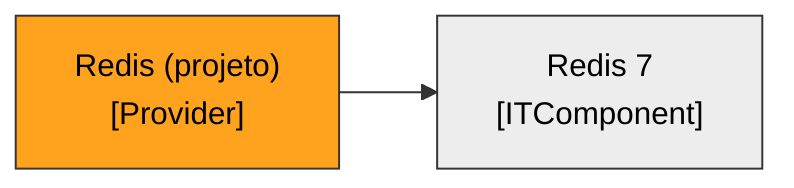

---

## Ficha — Apache Software Foundation (Provider)

### 0. Responsabilidade de negócio (OBRIGATÓRIO para tipo de negócio)
- **Função de negócio:** mantenedor do Apache Kafka — o broker de mensageria pelo qual o serviço recebe os movimentos de estoque. (E14)
- **Responsabilidade no processo:** fornece o Apache Kafka. (E14)
- **Valor para o negócio:** integração assíncrona confiável. (E14)
- **Origem:** E14.

### 0. Descrição técnica (quando houver — recomendada)
- **O que é / faz:** projeto open source da Apache Software Foundation (kafka.apache.org); no serviço roda em container/AWS (hospedagem AWS). (E14,E21)
- **Origem:** E14.

### Campos
| Campo | Rotulo (PT) | Valor | Origem |
|---|---|---|---|
| `name` | Nome | Apache Software Foundation | E14 |
| `lifecycle` | Ciclo de vida | [x] active | E25 |
| `providerCriticality` | Criticidade do Provedor | [x] strategic (mensageria do serviço) | E14 |
| `providerQuality` | Qualidade do Provedor | — lacuna (a avaliar) | — |

### Relações
| Relação | Destino | Alvo | Origem |
|---|---|---|---|
| `relITComponentToProvider` (inversa) | ITComponent | Apache Kafka 3.8 (servidor — hospedagem AWS) | E14,E21 |

### Diagrama
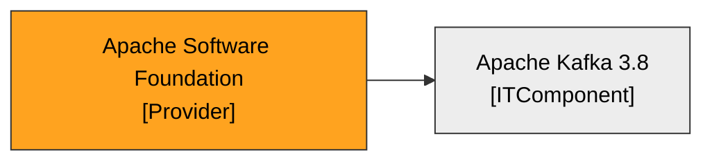
